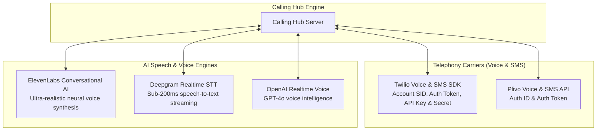
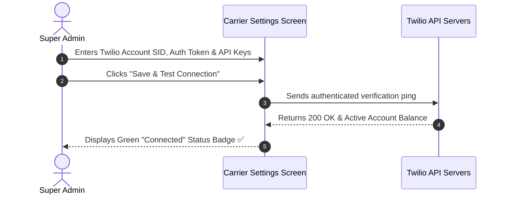

# Carrier Telephony Gateways & AI Integrations

Calling Hub is engineered as an enterprise-grade orchestrator that connects directly to global telecom carriers and cutting-edge artificial intelligence speech providers. As a Super Administrator, you configure API credentials, webhook URLs, and carrier failover rules in the **Integrations Studio**.

---

## 1. Supported Telephony & AI Providers

---

## 2. Configuring Twilio Voice & SMS Gateway

Twilio provides global PSTN voice connectivity, WebRTC softphone tokens, and SMS delivery.

### Required Twilio Credentials:
- **Account SID:** Found on your Twilio Console main dashboard (starts with `AC...`).
- **Auth Token:** Primary account authentication token.
- **API Key SID:** Standard API key for WebRTC browser softphones (starts with `SK...`).
- **API Secret:** Secret key paired with the API Key SID.

### Steps to Configure:
1. In the left navigation menu, click **Super Admin** $\rightarrow$ **Gateways & Carriers** $\rightarrow$ **Twilio**.
2. Enter your **Account SID**, **Auth Token**, **API Key**, and **API Secret**.
3. Click **Test Credentials**. The system will verify connection to Twilio's API and display your account balance.
4. Click **Save Settings**.
5. Copy the generated **Voice Webhook URL** (e.g., `https://callinghub.yourcompany.com/api/twilio/voice`) and paste it into your Twilio Console under your TwiML application settings.

---

## 3. Configuring Plivo Voice & SMS Gateway

Plivo serves as an alternative or primary carrier offering competitive international call termination rates:

### Steps to Configure:
1. Navigate to **Super Admin** $\rightarrow$ **Gateways & Carriers** $\rightarrow$ **Plivo**.
2. Enter your **Auth ID** and **Auth Token** copied from your Plivo dashboard.
3. Click **Save & Test Connection**.
4. Copy the **Inbound Voice Callback URL** to your Plivo XML application configuration.

> [!TIP]
> **Carrier Redundancy:** You can configure both Twilio and Plivo simultaneously. Calling Hub can route domestic US calls through Twilio and international routes through Plivo to optimize termination costs.

---

## 4. Configuring ElevenLabs Conversational AI

ElevenLabs powers the human-like conversational voice bots and custom voice avatars:

1. Go to **Super Admin** $\rightarrow$ **AI Integrations** $\rightarrow$ **ElevenLabs**.
2. Enter your **ElevenLabs API Key** (from `elevenlabs.io` $\rightarrow$ Profile $\rightarrow$ API Keys).
3. If using Conversational AI Webhooks, enter your **Webhook Secret** and **Webhook ID**.
4. Click **Validate API Key**.
5. Once verified, all neural voices in your ElevenLabs account (including custom cloned voices) will sync automatically to Calling Hub's voice dropdown menus.

---

## 5. Configuring Deepgram & OpenAI Realtime Keys

For real-time speech transcription and dynamic conversation logic:

### Deepgram Realtime STT:
1. Go to **Super Admin** $\rightarrow$ **AI Integrations** $\rightarrow$ **Deepgram**.
2. Enter your **Deepgram API Key**.
3. Click **Save Settings**. This powers instant speech recognition for incoming phone callers.

### OpenAI Realtime Voice:
1. Go to **Super Admin** $\rightarrow$ **AI Integrations** $\rightarrow$ **OpenAI**.
2. Enter your **OpenAI API Key** (`sk-...`).
3. Click **Save Settings**. This enables conversational reasoning and dynamic dialogue for AI voice agents.

---

## 6. Verifying Carrier Webhook Health

To ensure incoming calls and SMS delivery receipts are received without disruption:

| Carrier Service | Expected Webhook Endpoint | HTTP Method | What It Handles |
|---|---|---|---|
| **Twilio Inbound Voice** | `/api/twilio/voice` | `POST` | Generates TwiML instructions when a customer dials a number. |
| **Twilio Status Callbacks** | `/api/webhook/twilio-status` | `POST` | Records call end times, durations, and recording URLs. |
| **Plivo Inbound Voice** | `/api/plivo/voice` | `POST` | Delivers incoming call events from Plivo numbers. |
| **SMS Delivery Reports** | `/api/sms/webhook` | `POST` | Updates SMS status to `Delivered` or `Failed`. |
| **ElevenLabs Conversation** | `/api/webhook/elevenlabs` | `POST` | Stores AI conversation transcripts and task payloads. |
