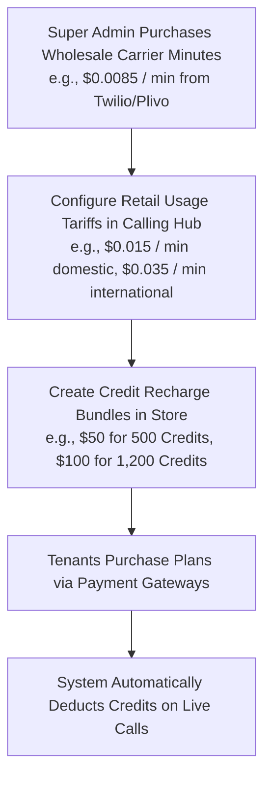
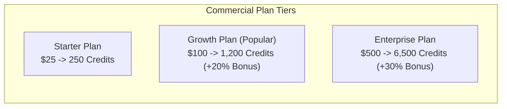

# Credit Plans & Usage Pricing Configuration

As a Super Administrator, you determine the monetization strategy and profit margins for your Calling Hub platform. You define the retail pricing for pre-packaged credit recharge plans and set granular, per-minute call termination and SMS tariffs.

---

## 1. Monetization Model Overview

Calling Hub follows a two-tiered commercial architecture:

---

## 2. Managing Credit Recharge Plans

Credit plans are the pre-packaged bundles displayed to tenant organizations when they recharge their wallets:

### Creating a New Credit Plan:
1. In the left navigation menu, click **Super Admin** $\rightarrow$ **Commercials** $\rightarrow$ **Credit Plans**.
2. Click the blue **+ Create Credit Plan** button.
3. Configure the plan parameters:

| Field | Example Value | Purpose |
|---|---|---|
| **Plan Name** | *Growth Bundle* | The commercial title displayed on the checkout card. |
| **Retail Price** | `100.00` | The monetary amount charged to the customer's credit card. |
| **Credits Awarded** | `1200` | The actual calling credits credited to the user's wallet. Adding bonus credits (e.g., 200 extra) incentivizes larger recharges. |
| **Currency** | `USD` (`$`) | Default billing currency. |
| **Description** | *Includes 200 bonus credits + 20 concurrent dialer lines* | Marketing summary highlighted in the user store. |
| **Sort Order** | `2` | Determines display order on the pricing page (1 appears first). |
| **Active Status** | `Active` (Toggle) | Toggle on to make the plan immediately purchasable. |

4. Click **Save Plan**. The card appears in the tenant billing store immediately.

---

## 3. Configuring Usage Tariffs (Rate Cards)

The **Usage Pricing Engine** dictates how many credits are deducted per minute or per event across different telephony services:

1. Navigate to **Super Admin** $\rightarrow$ **Commercials** $\rightarrow$ **Usage Pricing**.
2. Adjust the retail per-minute and per-segment rates:

| Pricing Category | Typical Wholesale Cost | Recommended Retail Tariff | Calculation Logic |
|---|---|---|---|
| **WebRTC Softphone Outbound** | $0.0085 / min | **$0.0150 / min** | Deducted in 60-second increments for completed calls. |
| **Bulk Outbound Dialer (Same Country)** | $0.0085 / min | **$0.0150 / min** | Deducted per connected call duration. |
| **Bulk Outbound Dialer (International)** | $0.0200 / min | **$0.0350 / min** | Surcharge for international PSTN destinations. |
| **Conversational AI Voice Agent** | $0.0500 / min | **$0.0850 / min** | Covers underlying telephony + ElevenLabs TTS + OpenAI brain. |
| **Two-Way Domestic SMS** | $0.0040 / segment | **$0.0075 / segment** | Deducted per 160-character GSM message. |
| **Two-Way International SMS** | $0.0150 / segment | **$0.0250 / segment** | Deducted per international SMS segment. |

3. Click **Update Rate Card**.
4. All subsequent phone calls and campaigns will immediately use the updated rate cards.

> [!NOTE]
> Rate card changes do not affect past call records. All historical call logs preserve the exact tariff that was in effect at the moment the call occurred for audit integrity.

---

## 4. Deactivating or Editing Plans

- **Editing a Plan:** To change pricing or bonus credits, click **Edit** on any plan card, update the values, and click **Save**.
- **Deactivating a Plan:** If a promotional package expires, toggle its status to `Inactive`. It disappears from the tenant store without affecting previous customer balances.
