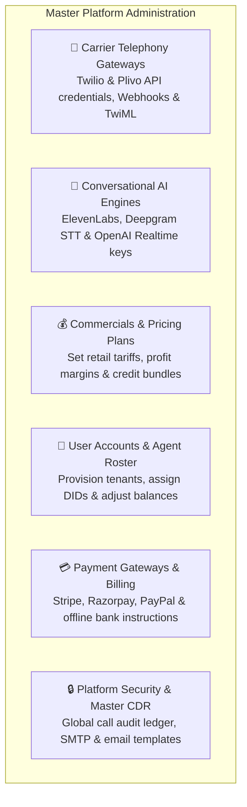
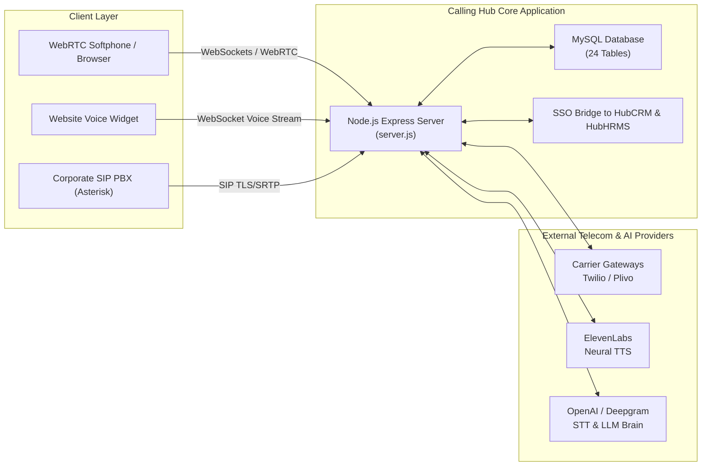
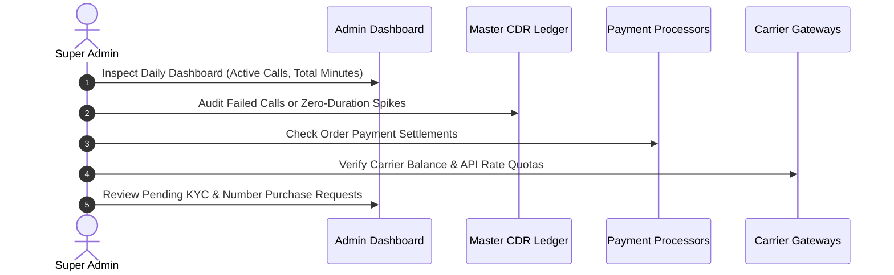

# Platform Super Administrator Overview & Architecture

Welcome to the **Platform Super Administrator Guide** for HubNest Calling Hub. As the master administrator or system owner, you hold total operational governance over the platform. You configure underlying carrier telephony backbones (Twilio, Plivo), integrate generative speech intelligence (ElevenLabs, Deepgram, OpenAI), set commercial pricing tariffs and credit recharge packages, provision agent accounts, and maintain global system security and call audit ledgers.

---

## 1. What You Control as a Super Administrator

- **Carrier Telephony Infrastructure:** Establish connections with Tier-1 VoIP carriers (Twilio and Plivo), configure webhook callbacks, and ensure redundant carrier failover.
- **Conversational Speech Intelligence:** Power AI voice bots by connecting API credentials for ElevenLabs, Deepgram, and OpenAI.
- **Commercial Tariffs & Monetization:** Set wholesale-to-retail markup pricing on per-minute calls, SMS segments, and AI voice minutes. Create branded credit recharge packages.
- **Multi-Tenant User & Agent Provisioning:** Create organization accounts, manage telecalling agents, allocate virtual phone numbers, and perform manual wallet adjustments.
- **Payment Gateway Architecture:** Accept multi-currency payments via Stripe, Razorpay, PayPal, or offline wire transfers with automated webhook verification.
- **System Governance & Master CDR:** Access the global Call Detail Record (CDR) audit ledger, customize system transactional emails, and monitor platform health.

---

## 2. Platform Architecture & Data Flow

To administer the platform effectively, it helps to understand how voice signaling and media packets flow through Calling Hub:

---

## 3. Super Administrator Daily & Weekly Checklist

Maintain platform stability and financial health by following this routine:

### Daily Tasks:
1. **Check System Health:** Review active concurrent calls and server load on the **Admin Dashboard**.
2. **Review Pending Approvals:** Inspect and approve pending KYC submissions and phone number purchase requests.
3. **Audit Master CDR:** Check for unusual traffic patterns, destination fraud attempts, or sudden spikes in failed call connection attempts.

### Weekly Tasks:
1. **Carrier Account Balance Check:** Ensure your underlying wholesale Twilio and Plivo balances are funded to avoid carrier-level call blocking.
2. **Payment Reconciliation:** Reconcile Stripe, Razorpay, and PayPal deposits against platform wallet credit additions.
3. **Backup Verification:** Ensure automated daily MySQL database snapshots are executing properly.

---

## 4. Next Steps in this Guide

Explore each administrative guide to configure and scale your Calling Hub deployment:

- 👥 **[User Accounts & Agent Roster Management](user-agent-management.md):** Provisioning users, managing roles, assigning phone numbers, and adjusting wallet credits.
- 📡 **[Carrier Gateways & AI Integrations](carrier-integrations.md):** Connecting Twilio, Plivo, ElevenLabs, Deepgram, and OpenAI credentials.
- 💰 **[Credit Plans & Usage Tariffs](credit-plans-pricing.md):** Designing credit recharge bundles and configuring per-minute retail tariffs.
- 💳 **[Payment Gateways Configuration](payment-gateways.md):** Connecting Stripe, Razorpay, PayPal, and offline wire methods.
- 🔒 **[Master CDR Logs & System Operations](system-logs-cdr.md):** Global call audit trail, SMTP setup, and transactional email template customization.
