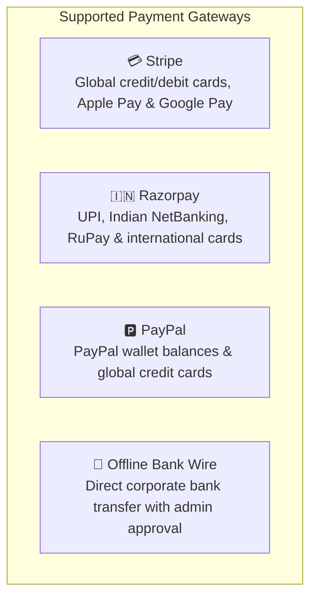
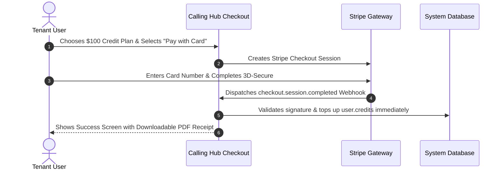

# Payment Gateways Configuration

Calling Hub includes native integration with the world's most widely trusted payment processors: **Stripe**, **Razorpay**, **PayPal**, and **Offline Bank Wire Transfers**. As a Super Administrator, you configure API credentials, enable payment methods, and setup automated fulfillment webhooks so tenant organizations can recharge their calling wallets seamlessly.

---

## 1. Supported Payment Processors



---

## 2. Configuring Stripe Payment Gateway

Stripe enables frictionless credit and debit card payments worldwide with 3D-Secure fraud protection:

### Credentials Required:
- **Publishable Key:** Starts with `pk_live_...` (or `pk_test_...` for sandbox testing).
- **Secret Key:** Starts with `sk_live_...` (or `sk_test_...`).



### Steps to Configure:
1. In the left navigation menu, click **Super Admin** $\rightarrow$ **Payment Gateways** $\rightarrow$ **Stripe**.
2. Toggle **Enable Stripe** to `Active`.
3. Paste your **Stripe Publishable Key** and **Stripe Secret Key**.
4. Click **Save Settings**.
5. Copy the **Stripe Webhook URL** displayed on the screen (e.g., `https://callinghub.yourcompany.com/api/webhook/stripe`) and register it in your Stripe Developer Dashboard listening for `checkout.session.completed`.

---

## 3. Configuring Razorpay Gateway

Razorpay is optimized for businesses operating in India and Southeast Asia, supporting UPI (Google Pay, PhonePe, Paytm), NetBanking, and credit/debit cards:

### Steps to Configure:
1. Navigate to **Super Admin** $\rightarrow$ **Payment Gateways** $\rightarrow$ **Razorpay**.
2. Toggle **Enable Razorpay** to `Active`.
3. Enter your **Key ID** (`rzp_live_...`) and **Key Secret**.
4. Click **Save & Test Connection**.
5. Add the generated **Razorpay Webhook URL** to your Razorpay dashboard listening for `payment.captured`.

---

## 4. Configuring PayPal Gateway

PayPal allows customers to pay directly from their existing PayPal wallet balance:

### Steps to Configure:
1. Navigate to **Super Admin** $\rightarrow$ **Payment Gateways** $\rightarrow$ **PayPal**.
2. Toggle **Enable PayPal** to `Active`.
3. Enter your **PayPal Client ID** and **PayPal Client Secret**.
4. Select Environment: **Live (Production)** or **Sandbox (Testing)**.
5. Click **Save Settings**.

---

## 5. Configuring Offline Bank Wire Transfers

For enterprise customers who purchase thousands of dollars in credits via corporate purchase orders (PO) or bank wire transfers:

1. Navigate to **Super Admin** $\rightarrow$ **Payment Gateways** $\rightarrow$ **Offline / Bank Wire**.
2. Toggle **Enable Offline Transfers** to `Active`.
3. In the **Bank Instructions & Wire Details** field, enter your company's banking instructions:
   ```text
   Bank Name: First National Commercial Bank
   Account Name: HubNest Telecommunications LLC
   Account Number: 9876543210
   Routing / Swift Code: FNCBUS33
   Reference Note: Please include your registered email in the wire memo.
   ```
4. Click **Save Instructions**.

### How Offline Orders are Reconciled:
- When a customer selects Offline Transfer at checkout, an order is created with a `Pending Approval` status.
- Once your finance team confirms the funds have settled in your corporate bank account:
  1. Go to **Super Admin** $\rightarrow$ **Orders**.
  2. Locate the pending order and click **Mark as Paid / Approve**.
  3. The credits are deposited into the customer's wallet instantly, and an invoice is generated.
