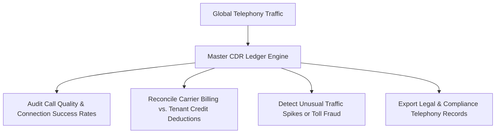
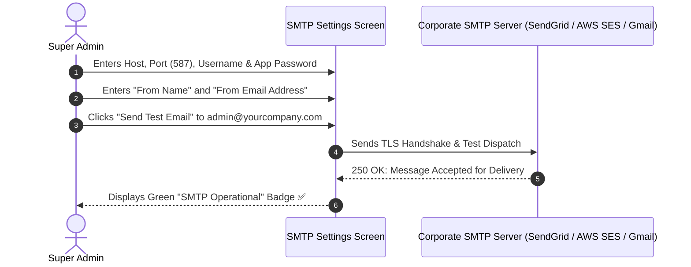
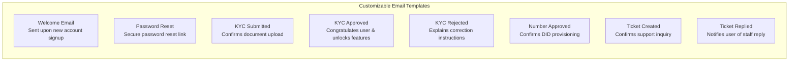

# Master CDR Audit Logs, SMTP & System Operations

As a Super Administrator, you are responsible for monitoring platform-wide call traffic, investigating connection anomalies, configuring transactional email infrastructure, and maintaining global compliance audit records.

---

## 1. Master Call Detail Record (CDR) Ledger

The **Master CDR Ledger** is the central, immutable audit trail of every voice call transmitted across the Calling Hub platform. It captures technical carrier handshakes, exact duration timestamps, and financial credit deductions across all tenant organizations and telecalling agents.

### Inspecting the Global CDR:
1. In the left navigation menu, click **Super Admin** $\rightarrow$ **Call Logs & CDR**.
2. The master ledger displays:
   - **Timestamp:** Exact start and end time (down to the second).
   - **Tenant Account:** Organization name and user UID.
   - **Direction:** `Outbound` (softphone or bulk dialer) or `Inbound`.
   - **Originating Caller ID (From):** Virtual number used.
   - **Destination (To):** Customer telephone number.
   - **Carrier Provider:** `Twilio` or `Plivo`.
   - **Call SID:** Unique carrier reference identifier for dispute reconciliation.
   - **Duration:** Raw audio talk seconds.
   - **Credits Deducted:** Wallet amount charged for the call.
   - **Recording Link:** Encrypted audio file URL (if recording was enabled).

---

## 2. Configuring SMTP Mail Server

Calling Hub relies on your corporate SMTP server to dispatch critical system notifications (password resets, KYC status updates, purchase approvals, and low-balance warnings).

### Steps to Configure SMTP:
1. Navigate to **Super Admin** $\rightarrow$ **System Settings** $\rightarrow$ **SMTP Configuration**.
2. Complete the mail server fields:
   - **SMTP Host:** Server address (e.g., `smtp.sendgrid.net`, `email-smtp.us-east-1.amazonaws.com`, or `smtp.gmail.com`).
   - **SMTP Port:** `587` (TLS) or `465` (SSL).
   - **SMTP Username:** Your authenticated account username or API key.
   - **SMTP Password:** Your strong password or SMTP app token.
   - **Sender Name (From Name):** e.g., *"HubNest Calling Hub"*.
   - **Sender Email (From Email):** e.g., `notifications@callinghub.yourcompany.com`.
   - **Secure (TLS/SSL):** Toggle to `Active` (recommended for port 587).
3. In the **Test Recipient** box, enter your email address and click **Send Test Email**.
4. Check your inbox to confirm successful delivery.
5. Click **Save Settings**.

---

## 3. Customizing System Email Templates

Calling Hub includes 10 pre-configured transactional email templates that you can customize with your company logo, brand colors, and personalized messaging:

### How to Edit an Email Template:
1. Navigate to **Super Admin** $\rightarrow$ **System Settings** $\rightarrow$ **Email Templates**.
2. Click **Edit** next to the template you wish to customize (e.g., *KYC Approved*).
3. You can edit:
   - **Subject Line:** e.g., *"Your Calling Hub KYC Verification is Approved! 🎉"*
   - **HTML / Rich Text Body:** Visual text editor supporting bold text, button links, headers, and bullet lists.
4. Use **Dynamic Variable Tags**:
   - `{{name}}`: Customer's full name.
   - `{{app_name}}`: Platform brand name.
   - `{{phone_number}}`: Associated virtual phone number.
   - `{{login_url}}`: Direct link to portal login screen.
   - `{{price}}`: Plan or number cost in credits.
5. Click **Preview Template** to see how the email looks on desktop and mobile screens.
6. Click **Save Template**.

---

## 4. Platform Health & Performance Monitoring

To ensure Calling Hub operates at peak reliability:

| Operational Metric | Healthy Benchmark | Remediation Action if Degraded |
|---|---|---|
| **Carrier API Response Latency** | Under 250 milliseconds | Check carrier status page (`status.twilio.com` or `status.plivo.com`). |
| **WebRTC Softphone Connect Rate** | Greater than 95% | Verify firewall allows UDP voice traffic on WebRTC ports (`10000–20000`). |
| **MySQL Database Query Time** | Under 50 milliseconds | Ensure database indexes on `call_logs` (`call_sid`, `user_uid`, `started_at`) are maintained. |
| **STT Voice Transcription Lag** | Under 300 milliseconds | Confirm Deepgram API key status and streaming WebSocket health. |
