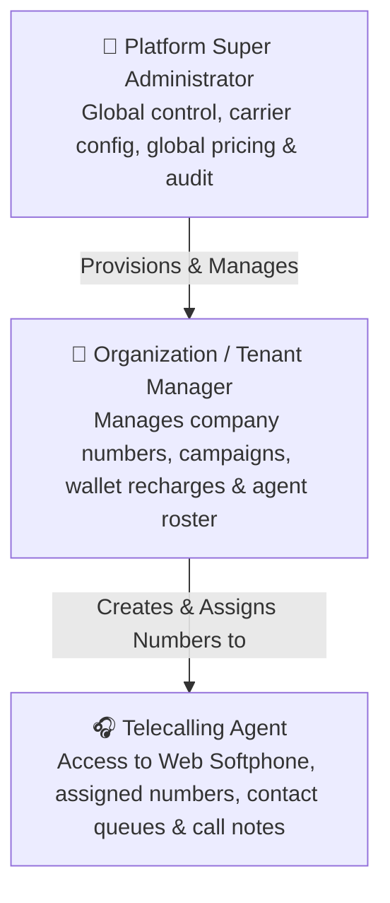
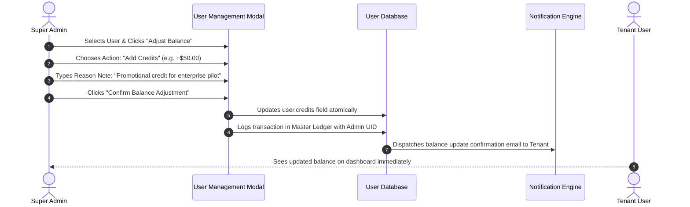

# User Accounts & Agent Roster Management

As a Platform Super Administrator, you oversee user identity, role assignments, phone number allocations, and wallet balances across all tenant organizations and telecalling agents registered in Calling Hub.

---

## 1. User & Agent Role Hierarchy

Calling Hub separates users into 3 distinct functional tiers:

| Role | Access Level | Permitted Screens & Features |
|---|---|---|
| **Super Admin** | Full Global Access | All admin portals, carrier configs, master rate cards, full CDR audit, payment gateways. |
| **Tenant User / Company Owner** | Organization Level | Buying numbers, creating IVR flows, launching bulk campaigns, purchasing credit plans, managing agents. |
| **Agent / Telecaller** | Workspace Level | Softphone dialpad, assigned contact lists, call notes, reminder tasks, personal call logs. |

---

## 2. Managing Tenant Accounts

To inspect and manage all registered organization accounts:
1. In the left navigation menu, click **Super Admin** $\rightarrow$ **Users**.
2. The user table displays:
   - Organization / Contact Name
   - Email address and mobile number
   - Current credit balance (e.g., `$124.50`)
   - KYC Verification Status (`Approved`, `Pending`, `Not Submitted`)
   - Total active phone numbers owned
   - Account Status (`Active` or `Suspended`)

### Suspending or Reactivating an Account:
- If a tenant account violates terms of service or engages in spamming:
  1. Click the three dots icon next to the user.
  2. Select **Suspend Account**.
  3. The user's active API keys and softphone sessions are revoked immediately, preventing any outbound dialing.
  4. To restore service, click **Reactivate Account**.

---

## 3. Manual Wallet Balance Adjustments

Super Administrators can manually credit or debit a user's calling balance (e.g., providing goodwill promotional credits or reconciling an offline wire transfer):

### Steps to Adjust Credits:
1. In the **Users** table, locate the target user.
2. In the Actions column, click the **Adjust Balance (Wallet icon)** button.
3. In the popup modal:
   - **Adjustment Type:** Select **Add Credits (Credit)** or **Deduct Credits (Debit)**.
   - **Amount:** Enter the numerical amount (e.g., `50.00`).
   - **Reason Note:** Enter a clear explanation for audit tracking (e.g., *"Reconciled Wire Transfer #WT-8942"*).
4. Click **Apply Adjustment**.
5. The balance updates instantly, and an audit entry is created in the financial ledger.

---

## 4. Managing the Telecalling Agent Roster

Super Administrators and Organization Owners can provision individual logins for telecallers:

1. In the left sidebar, click **Super Admin** $\rightarrow$ **Agents** (or **Team Roster**).
2. Click the blue **+ Create Agent** button.
3. Fill out the agent creation form:
   - **Full Name:** Agent's display name (e.g., *"Michael Chang"*).
   - **Email Address:** Agent's login username.
   - **Password:** Strong initial temporary password.
   - **Assigned Outbound Caller ID:** Select a verified virtual phone number from your inventory. When this agent places outbound calls from their softphone, this number will appear on the customer's phone screen.
4. Click **Create Agent**.
5. The agent can now log in immediately and start placing calls.

---

## 5. Reassigning Phone Numbers Between Agents

If an agent changes departments or leaves the organization:
1. In the **Agents** list, click **Edit** on the agent's card.
2. Click the **Assigned Number** dropdown.
3. Select a new number, or set it to `Unassigned`.
4. Click **Save Changes**. The softphone dialpad for that agent will reflect the new caller ID on their next call.
