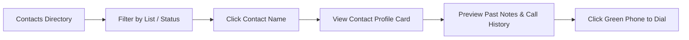
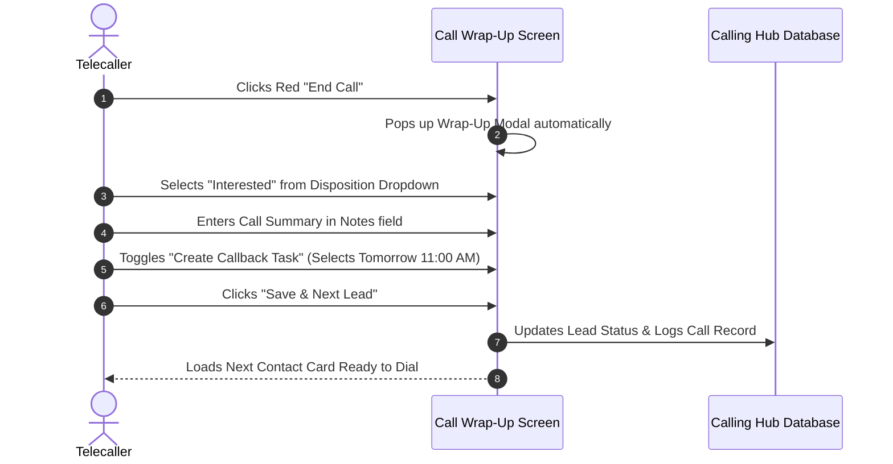

# Agent CRM & Setting Call Dispositions

The **Agent CRM** is your dedicated contact workspace inside Calling Hub. It keeps all of your prospect leads and customer accounts organized in one place, allowing you to preview customer details before dialing and categorize call outcomes with **Call Dispositions** the moment a conversation concludes.

---

## 1. What is a Call Disposition?

A **Call Disposition** is a standardized label that describes the result of a telephone call. Setting dispositions accurately ensures:
- Your sales pipeline reflects true lead stages.
- Interested prospects receive timely follow-ups.
- Unreachable numbers or wrong numbers are flagged so agents do not waste time redialing.
- Team supervisors can evaluate campaign conversion rates.

```mermaid
graph TD
    A[Call Disconnected] --> B[Call Wrap-Up Window Pops Up]
    B --> C{What was the Call Outcome?}
    C -->|Client bought product| D[Disposition: Sale Won / Closed Won]
    C -->|Client wants a quote/demo| E[Disposition: Interested]
    C -->|Client asked to call later| F[Disposition: Callback Requested]
    C -->|Phone rang with no reply| G[Disposition: No Answer]
    C -->|Line busy / voicemail| H[Disposition: Busy / Voicemail]
    C -->|Not interested in offer| I[Disposition: Not Interested]
    C -->|Asked to be removed| J[Disposition: Do Not Call (DNC)]
```

---

## 2. Navigating the Agent CRM

To access your contacts:
1. In the left navigation menu, click **Agent CRM** $\rightarrow$ **Contacts**.
2. The contact table displays:
   - **Contact Name & Company**
   - **Phone Number** (with a 1-click green Call button)
   - **Email Address**
   - **Current Lead Status** (colored badge)
   - **Last Contacted Date**
   - **Actions** (View Profile, Add Note, Edit Details)



### Searching and Filtering Contacts:
- **Search Bar:** Type any part of a customer's name, email, or telephone number to filter contacts instantly.
- **List Filter:** Click the **List Dropdown** to switch between assigned marketing lists (e.g., *"Webinar Attendees Q3"*, *"Inbound Trial Signups"*).
- **Status Filter:** Filter by lead status to quickly see only `New` leads or leads tagged as `Callback`.

---

## 3. Standard Call Dispositions Reference

Calling Hub provides pre-configured standard dispositions. Here is when to choose each:

| Disposition Name | Badge Color | Meaning & Best Use Case | Recommended Action |
|---|---|---|---|
| **Interested** | 🟢 Green | The customer wants to learn more, requested pricing, or asked for a product demonstration. | Type detailed notes and schedule a prompt follow-up task. |
| **Sale Won / Closed** | 🟣 Purple | The customer agreed to purchase or finalized the contract. | Congratulate the customer, log invoice details in notes, and notify billing. |
| **Callback Requested** | 🔵 Blue | The customer was busy (e.g., *"I'm driving right now, please call me tomorrow at 3 PM"*). | Set an exact date/time in the **Create Follow-Up Task** modal. |
| **No Answer** | 🟡 Yellow | The phone rang until it timed out without anyone answering. | The system will keep the lead in queue for a retry later. |
| **Busy / Line Busy** | 🟠 Orange | The dialed line was actively engaged on another call. | Mark as busy; retry after 30–60 minutes. |
| **Voicemail Left** | ⚪ Gray | The call reached an answering machine, and you left a voice message. | Schedule a follow-up retry in 2 days. |
| **Not Interested** | 🔴 Red | The customer politely declined the offer and does not want follow-up. | Lead is moved out of active calling campaigns. |
| **Wrong Number** | ⚫ Dark Gray | The person who answered stated this is not the contact named on file. | Mark lead as inactive and review source data. |
| **Do Not Call (DNC)** | 🚫 Red / Black | The contact explicitly demanded to be removed from all calling lists. | Immediately tags number as DNC; the system blocks future outbound dialing. |

> [!WARNING]
> **Strict Compliance:** Always select **Do Not Call (DNC)** if a recipient explicitly requests to be removed from phone communications. Continuing to call numbers tagged as DNC violates telecom regulations.

---

## 4. How to Set a Disposition After a Call

Follow these steps every time you end a telephone conversation:



1. Click the red **End Call** button to disconnect.
2. The **Call Wrap-Up Window** slides onto your screen immediately.
3. From the **Call Disposition** dropdown, select the outcome that best describes your conversation (e.g., `Interested`).
4. In the **Call Notes** box, type a clear 1-to-2 sentence summary of what was discussed.
5. If next steps are needed, check **Schedule Follow-Up** and pick the date and time.
6. Click **Save & Complete**.
7. The lead's status is updated instantly, and the system prepares the next contact card.

---

## 5. Editing or Updating a Disposition Later

If you accidentally selected the wrong disposition or if a customer calls back immediately with new information:

1. Go to **Agent CRM** $\rightarrow$ **Contacts**.
2. Click the customer's name to open their **Contact Profile Card**.
3. Under the **Lead Status** dropdown, select the updated disposition (e.g., change from `Callback` to `Sale Won`).
4. Click **Update Status**. The change is recorded in the customer's audit history.
