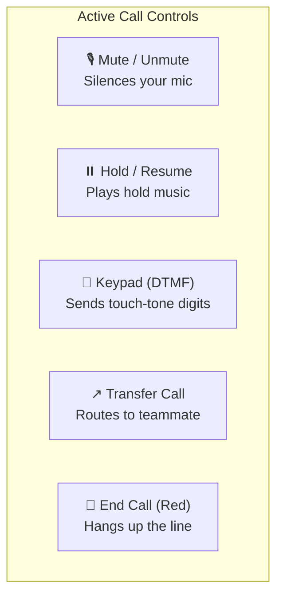
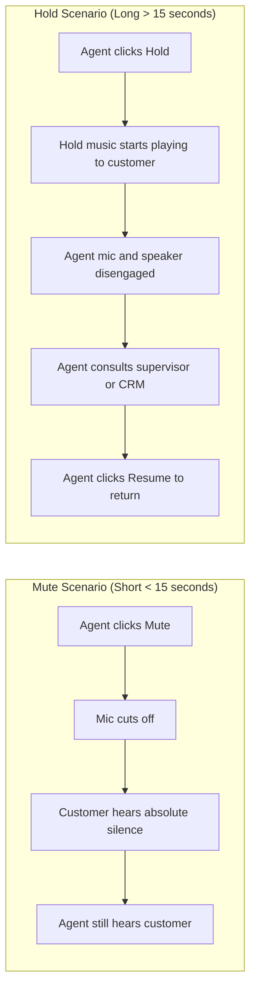
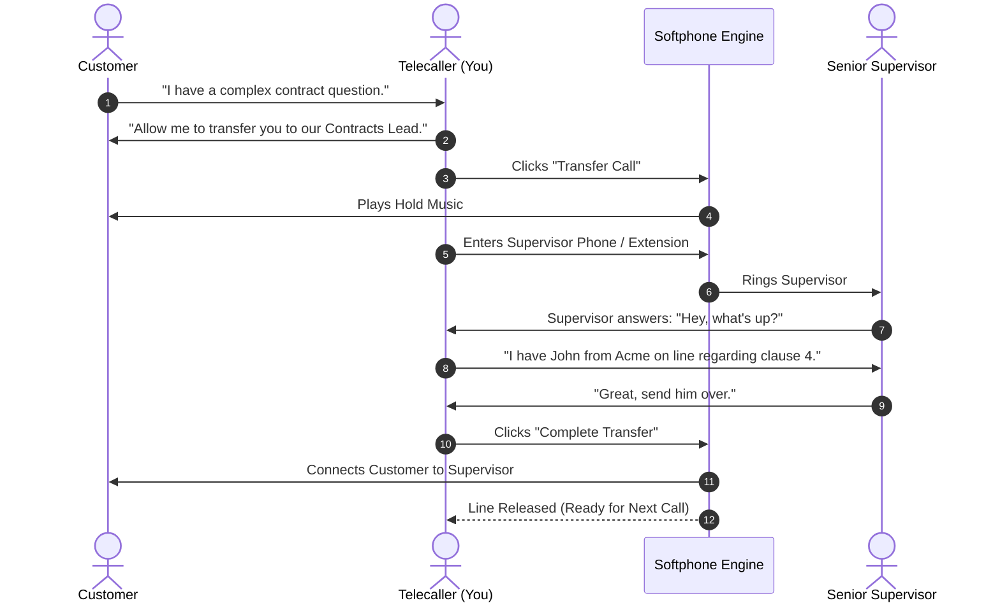

# Active Call Controls

Once a phone call connects, your softphone transforms into the **Active Call Control Center**. From this floating control bar, you can manage audio states, place callers on hold, send DTMF keypad digits to interactive voice menus, transfer calls to supervisors or teammates, and safely disconnect.

---

## 1. Overview of Active Call Controls

During an ongoing call, the softphone interface displays the live call status, the connected customer's phone number, the live duration timer, and 5 primary control buttons:

| Control Button | Visual Icon | When to Use It | Customer Experience |
|---|---|---|---|
| **Mute / Unmute** | Microphone with a slash | When you need to cough, sneeze, or confer quietly with a colleague seated next to you. | The customer hears silence, but you can still hear the customer speaking. |
| **Hold / Resume** | Pause symbol (`⏸️`) | When you need to look up customer account records or consult your supervisor for 1–2 minutes. | The customer hears pleasant on-hold music, and your microphone is muted. |
| **DTMF Keypad** | Grid of keypad dots | When calling an automated IVR system (e.g., *"Press 1 for Sales, Press 2 for Billing"*). | Sends numeric tones across the live telephone channel. |
| **Transfer Call** | Arrow pointing outward (`↗️`) | When the customer needs to speak with a different department, specialist, or manager. | Places the customer on hold while connecting to the target agent or number. |
| **End Call** | Red phone receiver down | When the conversation is completed and you have said goodbye. | Disconnects the telephone connection and triggers the call wrap-up window. |

---

## 2. Using Mute vs. Hold: Which Should You Choose?

It is important to understand the practical difference between **Mute** and **Hold**:

### When to Use MUTE:
- **Duration:** 2 to 10 seconds.
- **Example:** You need to clear your throat, sneeze, or ask your desk neighbor a quick 3-word question.
- **How to do it:** Click the **Mute** button. The icon will turn orange/red and display a slash through the microphone. Click it again to **Unmute**.

### When to Use HOLD:
- **Duration:** 15 seconds to 3 minutes.
- **Example:** You need to pull up a complex invoice in the billing system or ask your team leader for approval on a special discount.
- **How to do it:**
  1. Always ask the customer politely first: *"May I place you on a brief hold while I check those records for you?"*
  2. Wait for their consent: *"Yes, sure."*
  3. Click the **Hold** button. The button will pulse yellow, indicating hold music is playing for the caller.
  4. Perform your investigation.
  5. Click **Resume Call** to reconnect your audio.
  6. Thank the customer for waiting: *"Thank you for your patience, Mr. Davis. I have that invoice right here."*

---

## 3. Entering Keypad Digits (DTMF Touch-Tones)

Sometimes when making outbound calls to corporate clients or supplier vendors, an automated phone tree answers (e.g., *"Thank you for calling Acme Corp. Press 1 for English, press 2 for Accounts"*).

To send digits during a live call:
1. On the active call screen, click the **Keypad** button.
2. The numeric dialpad will pop up over your call controls.
3. Click the required number (e.g., `1`, `4`, `#`) or type it on your computer keyboard.
4. The softphone emits the corresponding DTMF audio frequency tone over the telephone line.
5. Click **Hide Keypad** when finished navigating the phone tree.

---

## 4. Transferring Calls

Calling Hub supports seamless call forwarding and transfers so you can route customers to the right specialist without making them hang up and dial again.

### How to Perform a Warm Transfer:
1. Explain to the customer that you are transferring them: *"I am going to connect you directly with Sarah in our Accounts department. Please hold on for just a moment."*
2. Click the **Transfer** (`↗️`) button on your active call bar.
3. A transfer dialog window will appear.
4. Enter the **Destination Phone Number** or select a teammate from the **Internal Agents Dropdown**.
5. Click **Call Transfer Target**.
6. The customer is automatically placed on hold and hears music.
7. When the target teammate answers, brief them on the customer's issue.
8. Click **Complete Transfer**. The customer is connected to your teammate, and your softphone is freed up.

> [!TIP]
> **Blind Transfer Option:** If your teammate is already expecting the call, you can click **Blind Transfer** to immediately hand off the call without waiting for them to answer.

---

## 5. Ending the Call Gracefully

When you have answered all customer questions and are ready to conclude the call:

1. Confirm satisfaction: *"Is there anything else I can assist you with today?"*
2. Say your warm sign-off: *"Thank you for calling HubNest. Have a wonderful day!"*
3. Allow the customer 1–2 seconds to say goodbye.
4. Click the red **End Call** button.
5. The call terminates immediately, the duration is recorded in seconds, and the **Call Disposition & Notes** window pops open automatically.
