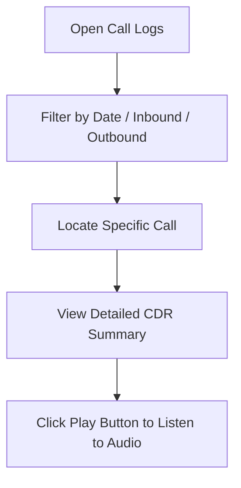
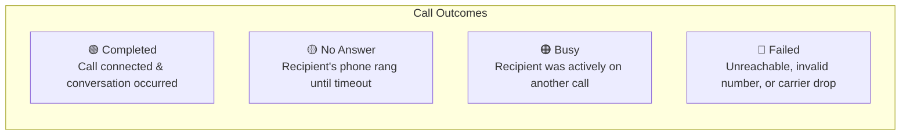
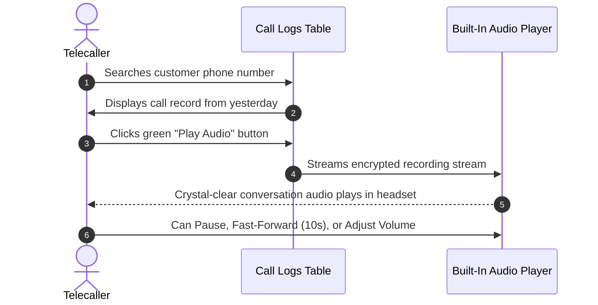

# Call Logs & Audio Playback

Calling Hub automatically maintains a complete, tamper-proof history of every call you place or receive. In the **Call Logs** section, you can review your daily talk time, verify dialed numbers, check call statuses, and listen to crystal-clear audio recordings of past conversations.

---

## 1. Accessing Your Call Logs

To open your call history:
1. In the left navigation sidebar, click **Call Logs** (or click the **Clock Icon**).
2. The **Call History Ledger** displays all calls associated with your agent account, sorted with the newest calls at the top.

---

## 2. Understanding Call Log Columns

The call history table provides rich details for every telephone interaction:

| Column Header | What It Represents | Example |
|---|---|---|
| **Date & Time** | The exact timestamp when the call was initiated. | `Oct 16, 2026 - 02:45 PM` |
| **Direction** | Whether the call was made by you or received by you. | ↗️ **Outbound** or ↙️ **Inbound** |
| **Caller (From)** | The telephone number that placed the call. | Your virtual office number (e.g., `+1 800 555 0199`) |
| **Recipient (To)** | The destination telephone number dialed. | Customer's phone (e.g., `+1 555 987 6543`) |
| **Status** | The final technical connection state. | `Completed`, `No Answer`, `Busy`, `Failed` |
| **Duration** | Total length of the connected audio conversation. | `04:18` (4 minutes, 18 seconds) |
| **Recording** | Interactive inline audio player (if call recording was active). | `▶️ Play (04:18)` |
| **Actions** | Quick action buttons. | 📞 **Redial Number**, 📋 **View Notes** |

---

## 3. Explaining Call Connection Statuses

Not every call that rings connects successfully. Here is what each status badge means:

- 🟢 **Completed:** The call was answered, and voice audio was successfully exchanged.
- 🟡 **No Answer:** The phone rang for the standard 30–45 second window, but no person or answering machine picked up.
- 🟠 **Busy:** The recipient's carrier network signaled that the dialed line was engaged.
- 🔴 **Failed:** The number is disconnected, non-existent, or blocked by the carrier network. Always double-check country codes and digit length when you see this status.

---

## 4. Listening to Call Recordings

Listening back to your conversations helps you verify complex customer orders, check addresses, and improve your own communication skills.

### How to Play a Recording:
1. Locate the call record in your **Call Logs** table.
2. In the **Recording** column, click the green **Play** (`▶️`) button.
3. The compact audio waveform player expands directly within the row.
4. You can:
   - **Play / Pause:** Click the play/pause button.
   - **Scrub / Seek:** Drag the slider across the timeline to skip to a specific moment (e.g., the 2-minute mark).
   - **Adjust Volume:** Use the mini volume slider to increase or decrease loudness.
   - **Download (if permitted):** Click the three dots icon on the right to download an MP3 copy if your administrator has enabled recording downloads for your role.

> [!NOTE]
> All call recordings are securely stored and encrypted. Depending on your organization's compliance policy, recordings are retained for 30 to 365 days.

---

## 5. Filtering and Searching Past Calls

When searching for a specific past conversation:

1. **Date Range Filter:** Click the **Date Picker** at the top of the logs table to select a preset (*Today, Yesterday, Last 7 Days, This Month*) or a custom date range.
2. **Direction Filter:** Filter by **Inbound Only** or **Outbound Only**.
3. **Status Filter:** Select **Completed** to view only connected conversations.
4. **Phone Number Search:** Type any 4 or more digits of a customer's phone number into the search box to pinpoint their call record instantly.
5. **Redial in One Click:** Need to call a customer back from your logs? Click the green **Phone Icon** in the Actions column to dial them immediately.
