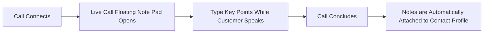
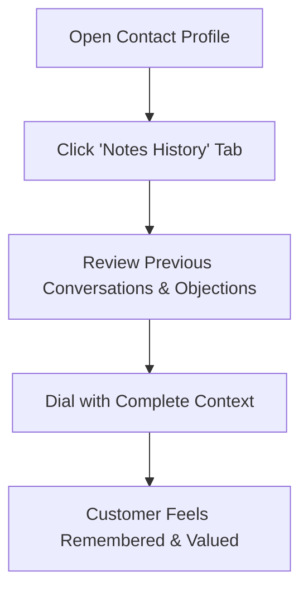
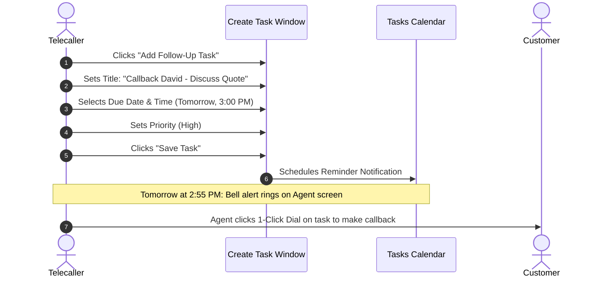
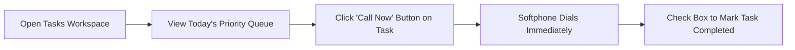

# In-Call Notes & Reminder Tasks

Taking concise, structured notes and following up on commitments are the two most critical habits of high-performing telecallers and customer agents. Calling Hub lets you type notes live during active phone conversations and automatically schedule reminder tasks so callbacks never slip through the cracks.

---

## 1. Taking Notes During an Active Call

You do not need to scramble for pen and paper or switch to another software program while speaking with a customer:

### How Live In-Call Note Taking Works:
1. When your call connects, the softphone window displays an expandable **In-Call Notes** text box on the right side of the screen.
2. Click inside the text area and type key requirements, questions, or objections as the customer speaks.
3. When you hang up, everything you typed remains saved in the call wrap-up box—you can polish it before clicking **Save**.

### What to Include in Good Call Notes:
- **Customer Need / Goal:** What problem is the client trying to solve?
- **Agreed Next Step:** What did you promise to send or do? (e.g., *"Will send product brochure for Plan B by email today"*).
- **Callback Preference:** Specific day, time window, or time zone preferred by the client.
- **Decision Maker:** Name and title of the person who holds purchasing authority.

> [!TIP]
> **Example of a Great Call Note:**
> *"Spoke with David (Procurement Head). Highly interested in 10-user plan for their marketing team. Currently using another provider whose contract expires next month. Agreed to review proposal. Callback scheduled for Thursday at 2:00 PM."*

---

## 2. Viewing Previous Call Notes Before Dialing

Before you dial an existing prospect or answer an incoming call from a known customer, you can review the complete timeline of past notes:

1. In **Agent CRM** $\rightarrow$ **Contacts**, click the customer's name.
2. Navigate to the **Call History & Notes** tab on the contact profile.
3. Every previous call is displayed chronologically with:
   - Call date and exact time
   - Agent who made the call
   - Call duration (e.g., `3 mins 42 secs`)
   - Outcome disposition badge (e.g., `Interested`)
   - Full text of the notes recorded on that call

---

## 3. Creating Follow-Up Reminder Tasks

When a customer says: *"I'm in a meeting right now, please give me a call back tomorrow afternoon at 3:00 PM,"* you can convert that commitment into a scheduled reminder task in seconds.

### Steps to Create a Task:
1. In the Call Wrap-Up window (or from the customer profile), click **Add Task**.
2. Fill out the simple task form:
   - **Task Title:** Give it an actionable name (e.g., *"Send Quote & Callback David"*).
   - **Due Date & Time:** Select the agreed calendar date and time.
   - **Priority Level:** Choose `Normal`, `High`, or `Urgent`.
   - **Description / Reminders:** Add any specific instructions or links (e.g., *"Confirm whether they need the 5-agent or 10-agent package"*).
3. Click **Create Task**.

---

## 4. Managing Your Daily Tasks & Follow-Up Reminders

Calling Hub provides a dedicated task manager to help you organize your daily work:

1. In the left navigation menu, click **Tasks** (or click the **Clipboard Icon**).
2. Your tasks are organized into 3 convenient tabs:

| Tab | What It Shows | When to Use It |
|---|---|---|
| **Today's Due Tasks** | All callbacks and reminders scheduled for today. | Your primary working list throughout your daily shift. |
| **Upcoming Tasks** | Tasks scheduled for tomorrow and later this week. | For planning your calling volume ahead of time. |
| **Overdue Tasks** | Any task whose scheduled time has passed without completion. | Check this first thing in the morning to catch up on missed callbacks. |

### Completing a Task:
- Each task card features a green **Phone Button**. Clicking it dials the associated customer immediately through your softphone.
- Once you have completed the callback, click the **Checkmark Circle** next to the task name.
- The task is marked as `Completed` and archived, keeping your daily task queue clean and up to date.
