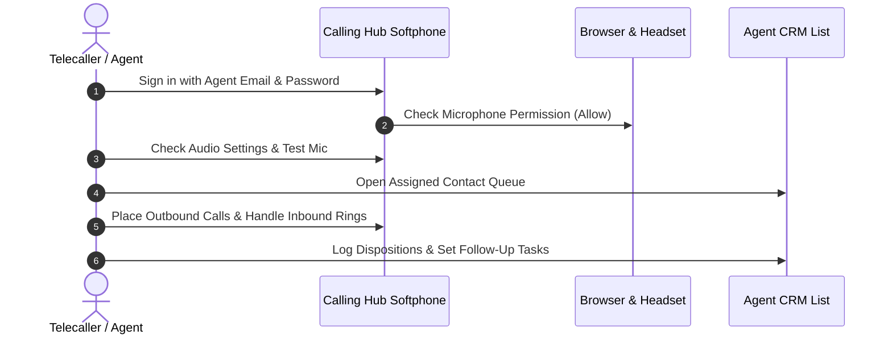

# Call Center Agent & Telecaller Overview & Daily Routine

Welcome to the **Call Center Agent & Telecaller Guide** for HubNest Calling Hub. As a telecalling agent, customer service representative, or inside sales specialist, Calling Hub provides you with a crystal-clear browser softphone, an integrated contact list, instant call disposition logging, and reminder task scheduling—all inside a single, clean workspace without requiring any external desk phones or complicated software installations.

---

## 1. What You Can Do as an Agent

- **Browser-Based Calling:** Make and receive crystal-clear voice calls directly in your Google Chrome, Microsoft Edge, or Firefox browser using your computer headset.
- **Dedicated Business Caller ID:** Your outbound calls automatically display your company's verified virtual telephone number to clients.
- **Integrated Agent CRM:** Access your assigned lead lists, search customers by phone or name, and view previous interaction history before dialing.
- **Call Dispositions in One Click:** Categorize call outcomes immediately after hanging up (`Interested`, `Callback`, `No Answer`, `Sale Won`, `Do Not Call`).
- **Call Notes & Reminders:** Record key customer requirements and schedule automatic reminder tasks so you never miss an agreed callback.
- **Personal Call Logs & Audio Playback:** Listen back to your past call recordings to review customer conversations or verify orders.

---

## 2. Your Agent Daily Routine

Follow this simple 4-step routine every working day to ensure smooth call operations:

### Step 1: Morning Login & Headset Check
1. Open your browser and navigate to the **Calling Hub** login portal.
2. Enter your assigned **Agent Email** and **Password**, then click **Sign In**.
3. Plug in your USB or 3.5mm headset with a microphone.
4. When prompted by your browser: *"callinghub.com wants to Use your microphone"*, click **Allow**.
5. Look at the top navigation bar. You should see a green badge saying **Ready / Online** next to your assigned caller ID number.

### Step 2: Open Your Assigned Contact Queue
1. In the left sidebar, click **Agent CRM** $\rightarrow$ **Contact Lists**.
2. Select your assigned lead campaign or list (e.g., *"Q4 Inbound Inquiries"* or *"Premium Warm Leads"*).
3. Review the customer names, phone numbers, and any notes left from previous calls.

### Step 3: Handle Outbound & Inbound Calls
- **For Outbound:** Click the green **Phone Icon** next to any contact name, or type the number directly into the **Softphone Dialpad**.
- **For Inbound:** When an incoming call rings, a prominent caller card will slide down displaying the caller's phone number and company name. Click the green **Accept Call** button.

### Step 4: Wrap-Up & Call Logging
1. Once the call ends, the **Call Wrap-Up Window** opens automatically.
2. Select the appropriate **Call Disposition** (`Interested`, `Follow-up Needed`, `Wrong Number`, etc.).
3. Type brief, helpful notes summarizing what the customer said.
4. If the client asked for a callback, pick a date and time to create an automatic reminder task.
5. Click **Save & Next** to load the next contact in your queue.

---

## 3. Agent Workspace Screen Tour

When you sign into Calling Hub as an Agent, your interface is organized into 4 primary functional areas:

| Interface Section | Location | What It Does |
|---|---|---|
| **Top Navigation Bar** | Screen Header | Shows your online presence status (**Online / Away**), your assigned phone number, your current wallet credit status, and your profile menu. |
| **Left Sidebar Navigation** | Left Edge | Quick links to **Softphone Dialpad**, **Agent CRM Contacts**, **Tasks & Follow-ups**, **Call Logs & History**, and **Support Desk**. |
| **Center Main Stage** | Center Area | Displays your active contact list, customer details card, or the visual dialer pad depending on which tab you have selected. |
| **In-Call Float Bar** | Bottom / Center Overlay | Appears during active calls, showing call duration timer, audio volume meter, and buttons for **Mute**, **Hold**, **Keypad**, **Transfer**, and **End Call**. |

---

## 4. Understanding Agent Statuses

In the top right corner of your screen, you can toggle your availability status:

| Status Badge | Meaning | System Behavior |
|---|---|---|
| 🟢 **Online / Ready** | You are seated at your desk and ready to take calls. | Inbound customer calls and queue distributions will ring on your softphone immediately. |
| 🟡 **In Call** | You are currently speaking with a customer. | New incoming calls will route to fallback IVR or other available agents. |
| 🟠 **Wrap-Up** | You just finished a call and are typing call notes. | Pauses incoming calls for up to 60 seconds to let you complete your CRM notes. |
| ⚪ **Away / Break** | You stepped away for lunch, tea break, or training. | Temporarily excludes you from incoming call queues. |

> [!TIP]
> **Best Practice:** Always toggle your status to **Away** before leaving your desk for a break so callers are never left waiting on hold.

---

## 5. System Requirements for Agents

To enjoy crisp, delay-free voice calls, ensure your workstation meets these basic criteria:

- **Browser:** Google Chrome (v100+), Microsoft Edge (v100+), or Mozilla Firefox (v100+). Safari is supported on macOS.
- **Headset:** A dedicated USB or 3.5mm wired headset with a noise-canceling microphone is strongly recommended over built-in laptop microphones.
- **Internet Connection:** Stable broadband with at least 5 Mbps download and 2 Mbps upload speed. Wi-Fi works well, but a wired Ethernet cable provides the best audio stability.
- **Browser Permissions:** Microphone access must be allowed in browser site settings (`chrome://settings/content/microphone`).

---

## 6. Next Steps

Explore the individual agent guides below to master each area of your workspace:

- 📞 **[Web Softphone & Dialpad](softphone-dialer.md):** Learn how to dial numbers, copy-paste contacts, and answer incoming rings.
- 🎛️ **[Active Call Controls](call-controls.md):** How to mute your mic, place callers on hold with music, use DTMF keys, and transfer calls.
- 📋 **[Agent CRM & Lead Dispositions](agent-crm-disposition.md):** Working with contact lists and logging call outcomes.
- 📝 **[Call Notes & Reminder Tasks](call-notes-tasks.md):** Taking notes during calls and setting up callback notifications.
- 🎧 **[Call Logs & Audio Playback](call-logs-recordings.md):** Searching your personal call history and reviewing audio recordings.
