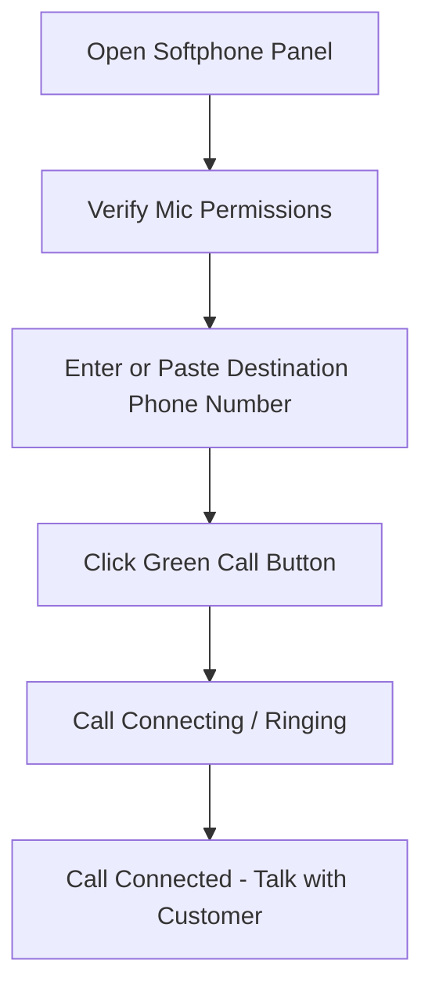
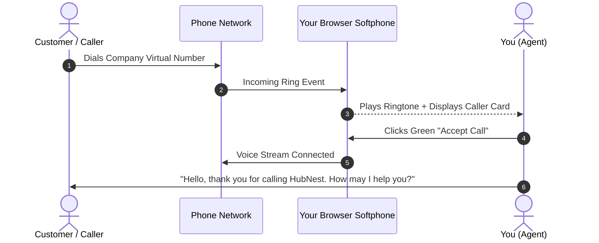

# Web Softphone & Dialpad

The **Web Softphone** is your central calling instrument inside Calling Hub. Built with modern WebRTC voice technology, it operates entirely inside your web browser. You do not need desk phones, SIP telephone handsets, or third-party dialer applications.

---

## 1. Opening the Softphone

To access your softphone dialpad:
1. In the left navigation sidebar, click **Dialler** (or press the floating phone icon on the bottom right of any screen).
2. The **Web Softphone** panel will open, displaying the numeric keypad, the phone number display screen, and your assigned caller ID number.

---

## 2. Tour of the Softphone Screen

The softphone is designed to be clean, intuitive, and accessible:

| Element | Description | How to Use |
|---|---|---|
| **Number Input Display** | Large text box at the top of the dialpad. | Type numbers using your keyboard or click the on-screen keypad numbers. You can also paste copied numbers (`Ctrl+V`). |
| **Numeric Keypad (0–9, *, #)** | Standard telephone keypad buttons. | Click buttons with your mouse to dial digits or send DTMF touch-tones during a call (e.g., pressing `1` for English). |
| **Caller ID Selector** | Dropdown menu above the dialpad. | Displays the verified business phone number that will appear on the customer's mobile screen when you call. |
| **Call Button (Green)** | Circular green button with a phone receiver icon. | Click to initiate the outbound phone call. |
| **End Call Button (Red)** | Circular red button with an inverted phone receiver. | Click to disconnect or hang up the active call. |
| **Clear / Backspace Icon** | Small arrow icon next to the number display. | Click to delete the last entered digit or backspace. |
| **Audio Device Settings Icon** | Gear icon in the dialpad header. | Click to select your preferred microphone and headphones/speakers. |

---

## 3. How to Make an Outbound Call

Making a phone call is as simple as using your mobile phone:

### Step 1: Format the Destination Number
- Always dial with the destination country code.
- **Example for United States/Canada:** `+1 555 123 4567` or `15551234567`
- **Example for India:** `+91 98765 43210` or `919876543210`
- **Example for United Kingdom:** `+44 20 7946 0958`
- If you copy a phone number containing hyphens, spaces, or parentheses (e.g., `(800) 555-0199`), the softphone automatically cleans the formatting when pasted.

### Step 2: Confirm Your Outbound Caller ID
- Look at the **From Number** dropdown at the top of the softphone.
- In most cases, your supervisor or company administrator has locked this to your dedicated office phone number. If you have multiple numbers assigned, choose the number representing the region you are calling.

### Step 3: Initiate the Call
1. Click the green **Call Button** (or press **Enter** on your keyboard).
2. The softphone display changes from the dialpad to the **Calling State**.
3. You will hear an audible ringing tone in your headset as the customer's phone rings.
4. When the customer answers, the call duration timer begins counting up (`00:01`, `00:02`...).

> [!NOTE]
> Outbound calling consumes per-minute credits from your company wallet. The system automatically tracks seconds and records the call duration in your call logs upon disconnection.

---

## 4. How to Receive an Inbound Call

When a customer or prospective lead calls your company's virtual phone number, Calling Hub routes the call directly to your softphone:

### What Happens on an Inbound Call:
1. **Audible Ringtone:** You will hear an incoming telephone chime through your headset.
2. **Visual Caller Alert:** An incoming call banner pops onto your screen showing:
   - Caller's phone number
   - Contact's name (if already saved in your Agent CRM)
   - The company number they dialed
3. **Answering the Call:** Click the prominent green **Accept** button.
4. **Declining the Call:** If you are unable to take the call or are assisting someone in person, click the red **Decline** button. The call will follow your company's fallback IVR or voicemail rules.

---

## 5. Quick Dialing from Agent CRM

You do not need to manually type phone numbers when working through your customer lists:

1. Navigate to **Agent CRM** $\rightarrow$ **Contacts**.
2. Find the customer you wish to contact.
3. Click the green **Phone Icon** in the action column next to their phone number.
4. The softphone will immediately load the number and initiate the call with a single click.

---

## 6. Audio Settings & Microphone Testing

To ensure crystal-clear audio before starting your shift:

1. Click the **Gear (Settings)** icon in the top right corner of the softphone window.
2. Under **Microphone Input**, select your USB headset microphone (e.g., *"Jabra Evolve 20 USB"* or *"Logitech H390"*).
3. Under **Audio Output**, select your headset speakers so phone audio plays directly into your ears instead of your computer's built-in speakers.
4. Speak a few words into your mic. The green **Audio Volume Meter** will bounce dynamically, confirming your voice is being detected properly.
5. Click **Done** to save your device selection.

> [!TIP]
> If the caller cannot hear you, verify that the physical mute switch on your headset cord is turned off and that browser microphone permission is set to **Allow**.

---

## 7. Troubleshooting Softphone Issues

| Symptom | Probable Cause | Quick Solution |
|---|---|---|
| **"Microphone blocked" warning** | Browser blocked access to the mic. | Click the padlock or camera icon on the left side of your browser URL bar, change microphone permission to **Allow**, and refresh the page. |
| **Call drops immediately after dialing** | Missing country code or invalid number. | Ensure the number includes the country code (e.g., `+1` or `+91`) without extra prefix digits like `011` or `00`. |
| **No audio heard during call** | Audio output routed to wrong device. | Open softphone **Settings (Gear icon)** and switch Audio Output to your connected headset. |
| **Echo or background noise** | Built-in laptop mic picking up room echo. | Use a dedicated headset with a boom microphone rather than your computer's internal mic. |
