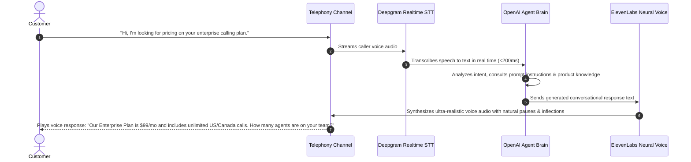
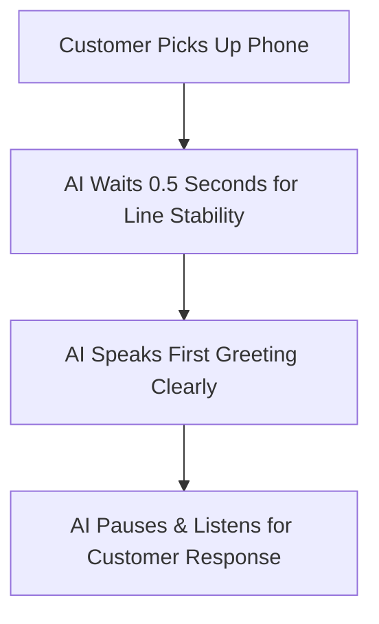

# Conversational AI Voice Agents

Calling Hub integrates state-of-the-art conversational voice technology powered by **ElevenLabs Conversational AI**, **Deepgram Speech-to-Text**, and **OpenAI Realtime Intelligence**. With Conversational AI Agents, your phone system can hold realistic, human-like voice conversations, qualify prospective leads, answer technical product inquiries, and schedule appointments around the clock without human fatigue.

---

## 1. How Conversational Voice AI Works

Unlike basic IVR menus where callers must press `1` or `2`, Conversational AI Voice Agents understand natural, unstructured human speech:



---

## 2. Tour of the AI Voice Agent Designer

To create or customize an AI voice bot:
1. In the left navigation sidebar, click **AI Voice Agents**.
2. Click the blue **+ Create AI Agent** button.
3. The configuration screen displays 5 key tabs:

| Configuration Tab | What You Configure | Key Impact on Behavior |
|---|---|---|
| **Identity & Tone** | Agent Name, Persona, Language, and Voice Avatar. | Determines the name the agent calls itself and the language it speaks. |
| **First Message** | The opening greeting spoken as soon as the phone connects. | Sets a warm, welcoming tone and prompts the caller to state their need. |
| **System Prompt & Instructions** | The core "brain" and knowledge base of your agent. | Defines how the bot answers questions, handles objections, and stays on topic. |
| **Voice Selection** | Selection from library of ElevenLabs neural voices. | Controls accent, gender, pacing, pitch, and voice warmth. |
| **Safety & Call Limits** | Maximum talk duration timer and transfer triggers. | Protects your wallet credits by capping call lengths (e.g., 5 or 10 minutes). |

---

## 3. Crafting the Perfect First Greeting

The first message sets the tone for the entire telephone interaction:



### Best Practices for First Messages:
- **Be Transparent:** Introduce the agent clearly and naturally (e.g., *"Hi there! This is Sarah from HubNest's automated concierge team. How can I assist you today?"*).
- **Keep it Concise:** Keep the greeting under 20 words so the caller has immediate opportunity to speak.
- **End with an Open Question:** Prompt the customer to speak (e.g., *"Are you calling regarding our new product release or customer support?"*).

---

## 4. Writing High-Performing System Prompts

The **System Prompt** is the written instruction manual that dictates how your AI agent thinks, responds, and represents your brand:

```markdown
You are Alex, a friendly, professional, and knowledgeable sales assistant at HubNest Calling Hub.

Your Goal:
- Welcome prospective business customers inquiring about cloud telephony.
- Ask them how many calling agents they currently employ.
- Explain that Calling Hub offers WebRTC softphones, bulk dialers, and conversational AI agents.
- If the customer expresses interest, collect their preferred email address so our team can send a demo invite.

Guidelines:
- Keep your spoken responses brief (under 2 sentences per response). People dislike listening to long paragraphs on the phone.
- Use a warm, confident, and polite tone.
- If the caller asks a question you do not know the answer to, politely say: "That is a great question. Let me have one of our senior telecom specialists follow up with you directly."
- Never invent false pricing or features.
```

> [!TIP]
> **Spoken Brevity Rule:** Always instruct your AI agent to keep responses under 2 sentences. On telephone calls, long monologues feel robotic and cause callers to lose interest.

---

## 5. Choosing the Right Voice Persona

Calling Hub includes access to ElevenLabs' premium neural voice library. Each voice carries distinct characteristics:

| Voice Name | Gender | Accent | Recommended Use Case |
|---|---|---|---|
| **Rachel** | Female | American (Calm, Warm) | General customer service, welcome concierge, healthcare. |
| **Adam** | Male | American (Deep, Authoritative) | Corporate B2B sales, financial announcements, executive updates. |
| **Bella** | Female | American (Bright, Friendly) | Retail promotions, e-commerce reminders, hospitality booking. |
| **Josh** | Male | American (Casual, Natural) | Tech startup inquiries, youth marketing, dynamic surveys. |
| **Charlotte** | Female | British (Elegant, Professional) | Luxury retail, UK customer support, formal business notices. |

You can click the **Preview Audio** button next to each voice persona to hear a live sample before assigning it to your agent.

---

## 6. Testing Your AI Voice Agent Live

Before deploying your bot to live customer phone lines:

1. Click the **Test Call** button in the top right corner of the AI Agent editor.
2. In the popup modal, enter your personal mobile phone number.
3. Click **Call My Phone**.
4. Within 5 seconds, your phone will ring from your test number.
5. Answer the call and converse naturally with your AI agent to evaluate:
   - Does the greeting sound natural?
   - Does it pause appropriately when you speak?
   - Does it answer your product questions accurately?
6. Make adjustments to your system prompt as needed and click **Save Changes**.
