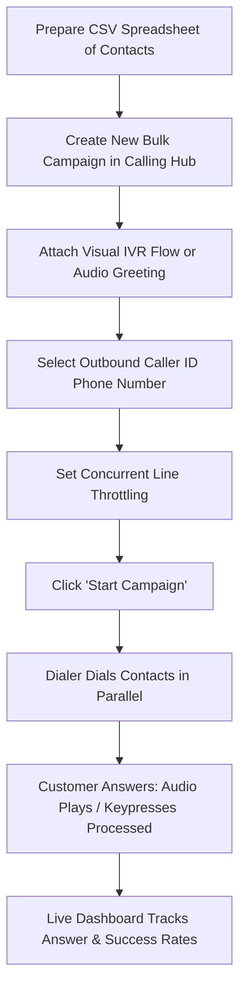
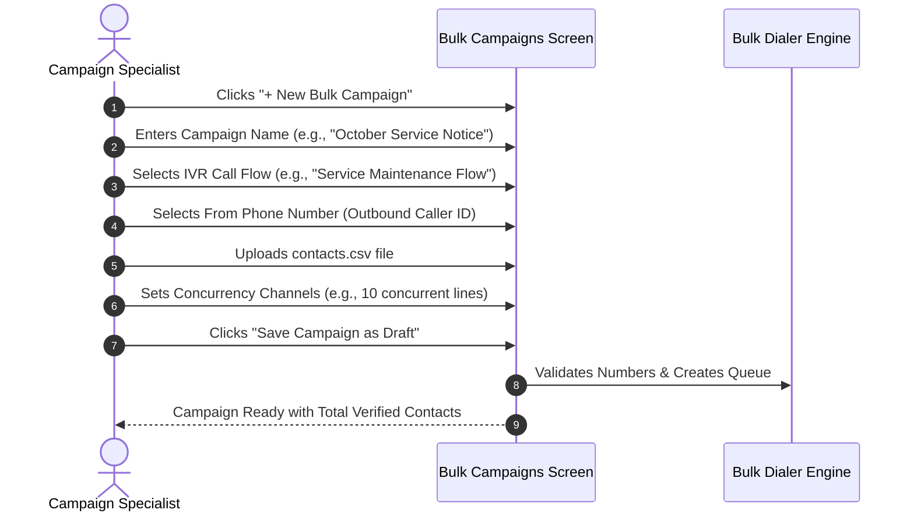
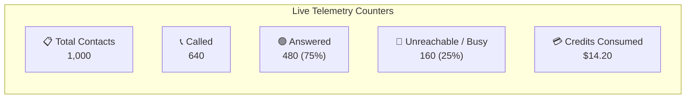

# Bulk Outbound Dialer Campaigns

The **Bulk Outbound Dialer** allows you to schedule and execute high-volume automated telephone campaigns to hundreds or thousands of contacts simultaneously. By connecting your contact list to an automated audio announcement or an interactive IVR phone tree, you can deliver timely notifications, surveys, and promotional offers with minimal human intervention.

---

## 1. How the Bulk Dialer Works



---

## 2. Preparing Your Contact CSV Spreadsheet

To ensure every number is reached without errors, format your contact file as a clean `.csv` spreadsheet:

### Required CSV Columns:
- **`phone_number` (Mandatory):** Destination mobile or landline number with country code.
- **`name` (Optional):** Contact's full name.
- **`var_one`, `var_two`, `var_three` (Optional):** Custom variables such as `AppointmentDate`, `BalanceDue`, or `AccountCode` that your IVR or AI agent can speak aloud.

### Sample CSV Structure:
```csv
phone_number,name,var_one,var_two
+15551234567,Alice Smith,Tomorrow at 10 AM,Room 304
+15552345678,Robert Johnson,Friday at 2 PM,Dr. Miller
+15553456789,Carlos Hernandez,Monday at 9 AM,Room 102
```

> [!IMPORTANT]
> **Phone Number Formatting Rule:** Always include the `+` sign and the international country code (e.g., `+1` for USA/Canada, `+44` for UK, `+91` for India). Do not include parentheses, dashes, or spaces in your CSV column.

---

## 3. Creating a New Bulk Campaign

Follow these step-by-step instructions:



### Step 1: Open the Campaign Wizard
1. In the left navigation menu, click **Campaigns** $\rightarrow$ **Bulk Calls**.
2. In the top right corner, click the blue **+ New Campaign** button.

### Step 2: Configure Basic Settings
- **Campaign Title:** Enter a clear, memorable name (e.g., *"Webinar Reminder - Oct 2026"*).
- **Caller ID (From Number):** Select the virtual phone number that should appear on recipients' caller ID.
- **Call Flow:** Select the visual IVR flow or audio greeting that will play when the call is answered.
- **Provider:** Keep as `Default Carrier` (Twilio or Plivo).

### Step 3: Upload Recipients
1. Click the **Upload CSV** box and drag-and-drop your prepared `.csv` file.
2. The system previews the first 5 rows and counts the total valid telephone numbers.
3. If any numbers are formatted incorrectly or duplicated, the system flags them for review.

### Step 4: Set Dialing Speed & Concurrency
- **Max Concurrent Channels:** Choose how many phone calls to make at the exact same second (e.g., `5`, `10`, `25`, or `50`).
  - *Recommendation:* If your call flow transfers interested callers to live telecallers, set concurrency to 1–2 lines per available human agent to avoid long caller hold times.
  - *Broadcast Only:* If callers only listen to an announcement without transferring, you can set concurrency higher (e.g., 20–50 lines).

---

## 4. Starting, Pausing, and Managing Campaigns

Once your campaign is configured, it appears in your **Bulk Campaigns Table** with a `Draft` badge.

| Button / Control | When to Click | What Happens |
|---|---|---|
| ▶️ **Start Campaign** | When you are ready to begin dialing. | The dialer immediately spins up the configured channels and begins ringing recipient numbers. The status changes to `Running`. |
| ⏸️ **Pause Campaign** | If live agents become overwhelmed or if you need to adjust campaign audio. | Immediately pauses dialing new numbers. Ongoing connected calls complete normally. Status changes to `Paused`. |
| 🔁 **Resume Campaign** | When your team is ready to continue. | Resumes dialing where the queue paused. |
| ⏹️ **Stop / Terminate** | If you wish to cancel remaining queued calls permanently. | Safely cancels all uncalled numbers and marks status as `Completed`. |
| 🗑️ **Delete** | To remove past campaign records from the view. | Removes the campaign record from the active table. |

---

## 5. Live Campaign Telemetry & Real-Time Tracking

While a campaign is in the `Running` state, Calling Hub provides real-time dials and live metric counters:



- **Live Progress Bar:** Displays percentage completion (e.g., `64% Complete`).
- **Answered Counter:** Number of recipients who picked up the phone and listened to your message.
- **Failed / Busy Counter:** Number of lines that did not connect (busy tone, out of coverage, or invalid number).
- **Wallet Credits Consumed:** Transparent, real-time calculation of calling credits deducted based on actual talk seconds.

> [!TIP]
> **Safety Pacing:** Avoid launching outbound campaigns outside normal business hours (typically 9:00 AM to 8:00 PM local time). Calling Hub automatically respects timezone scheduling if enabled in your settings.
