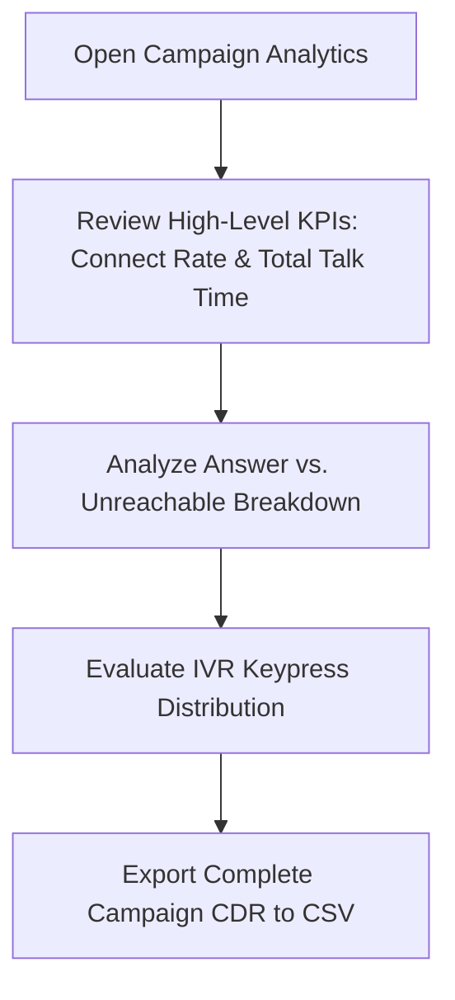
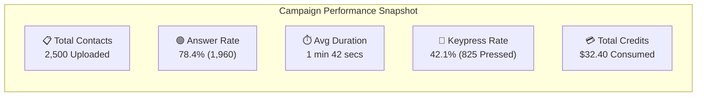
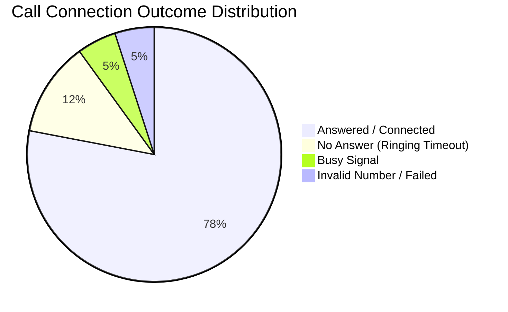

# Campaign Analytics & Performance Reports

Measuring call connect rates, menu navigation choices, and recipient engagement is essential for optimizing voice automation. Calling Hub provides a comprehensive **Campaign Analytics Dashboard** that translates raw call data into clear visual charts, completion funnels, and exportable audit reports.

---

## 1. Accessing Campaign Reports

To view campaign analytics:
1. In the left navigation menu, click **Campaigns** $\rightarrow$ **Bulk Calls** (or **SMS Campaigns**).
2. Click on the title of any completed or active campaign.
3. The **Campaign Performance Overview** opens, displaying top-level summary cards, live telemetry dials, and detailed contact logs.



---

## 2. Key Performance Indicators (KPIs) Explained

The top of the analytics dashboard features 5 primary performance cards:



| Metric Card | What It Measures | Target Benchmark | How to Improve |
|---|---|---|---|
| **Total Contacts** | Total unique telephone numbers ingested from your CSV list. | Clean list with 0 duplicates. | Scrub spreadsheets prior to upload to remove unformatted numbers. |
| **Answer Rate (Connect Rate)** | Percentage of dialed calls that connected to a person or voicemail. | **65% to 85%** | Call during local business hours (10:00 AM–4:00 PM) and use local caller ID numbers. |
| **Average Call Duration** | Mean conversation length for all answered calls. | **1 to 3 minutes** for notifications; **3 to 7 minutes** for sales. | Keep opening greetings engaging and concise. |
| **Keypress Response Rate** | Percentage of answered callers who pressed a DTMF keypad digit. | **25% to 50%** | Make menu options obvious and mention key numbers early in the audio. |
| **Credits Consumed** | Total calling wallet credits deducted for actual connected talk time. | Predictable cost per answered call. | Cap maximum duration in call flow settings to prevent long idle calls. |

---

## 3. Visual Connection Breakdown

Below the metric cards, the **Connection Breakdown Chart** categorizes every dialed contact:



- 🟢 **Answered / Completed:** The recipient picked up, and audio was exchanged.
- 🟡 **No Answer:** Phone rang for the timeout duration (30 seconds) without an answer.
- 🟠 **Busy:** Destination line was actively engaged on another phone call.
- 🔴 **Failed:** Disconnected number, international dialing restriction, or carrier network drop.

---

## 4. IVR Menu Keypress Funnel

If your campaign was linked to a **Visual Call Flow** with a **Gather Keypad Node** (e.g., *"Press 1 for Sales, Press 2 for Support, Press 9 to Opt-Out"*), the dashboard plots the exact distribution of caller choices:

```mermaid
graph TD
    Answered[1,960 Calls Answered] --> Key1[Key 1 - Transferred to Sales: 520 (26.5%)]
    Answered --> Key2[Key 2 - Connected to AI Support Bot: 305 (15.6%)]
    Answered --> Key9[Key 9 - Opt-Out / Do Not Call: 38 (1.9%)]
    Answered --> NoPress[Listened & Hung Up without Keypress: 1,097 (56.0%)]
```

### Insights You Can Act On:
- If a high percentage of callers listen and hang up without pressing a key, simplify your audio greeting or move the call to action earlier in the message.
- If callers choose **Opt-Out**, Calling Hub automatically tags their contact record as DNC to protect future campaign deliverability.

---

## 5. Exporting Campaign CDR Data to CSV

For executive reporting, client billing reconciliation, or CRM synchronization, you can download the complete raw call detail records:

1. In the upper right corner of the campaign dashboard, click **Export Report**.
2. Select **Export Full CDR (CSV)**.
3. The exported spreadsheet contains every call attempt with:
   - Recipient phone number and name
   - Exact start time and end time
   - Call duration in seconds
   - Final status (`Answered`, `Busy`, `No Answer`)
   - Captured DTMF keypress (e.g., `1`, `2`)
   - Credits deducted for that specific call
   - Link to call audio recording (if recording was enabled)
