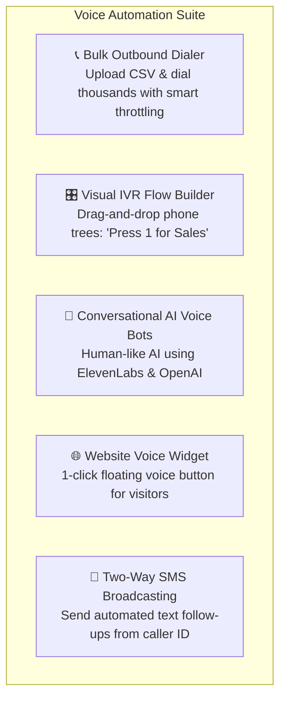
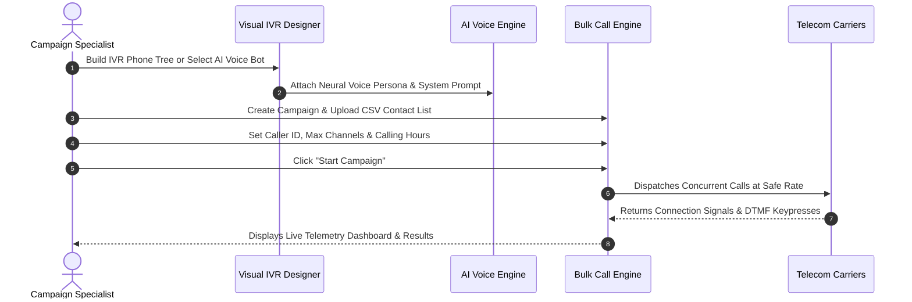

# Campaign & AI Voice Specialist Overview & Strategy

Welcome to the **Campaign & AI Voice Specialist Guide** for HubNest Calling Hub. In this role, you possess the power to scale your organization's voice communications from individual one-on-one calls to thousands of simultaneous automated phone touchpoints using intelligent IVR trees, conversational AI voice bots, bulk dialers, and embedded website voice widgets.

---

## 1. What You Can Build & Manage

- **Automated Outbound Dialing:** Upload contact spreadsheets and execute mass calling campaigns for reminders, service announcements, promotional offers, or customer surveys.
- **Visual Interactive Voice Response (IVR):** Design phone trees visually with audio prompts, keypress routing (DTMF), time-of-day office schedules, and agent forwarding without touching code.
- **Human-Quality Conversational AI Agents:** Deploy natural AI voice assistants capable of answering open-ended questions, scheduling appointments, and conversing fluently.
- **Floating Website Voice Widget:** Embed a branded voice button on your company website allowing visitors to talk directly with your AI sales representative with zero telecom charges to the visitor.
- **Mass SMS Broadcasting:** Pair your voice campaigns with automated text message reminders and two-way customer messaging.
- **Deep Performance Analytics:** Track connect rates, answer rates, drop-off points in your phone trees, and credit consumption in real time.

---

## 2. Campaign Lifecycle Workflow

Every high-performing voice automation campaign follows a 5-stage lifecycle:

### Stage 1: Strategy & Objective Definition
Determine the campaign goal: Is this an urgent product update notification, an event reminder with confirmation keypresses (*Press 1 to confirm attendance*), or an AI lead qualification interview?

### Stage 2: Content Creation & Audio Synthesis
Create the audio messaging:
- **Recorded Audio:** Upload pre-recorded MP3/WAV files voiced by your professional voiceover talent.
- **High-Definition TTS (Text-to-Speech):** Type your script and let our neural speech engine generate natural, human-sounding voice prompts in multiple languages.
- **Conversational AI:** Program your AI agent's personality, goal, knowledge base, and first greeting.

### Stage 3: Audience Segmentation & List Preparation
Export your audience from your CRM or spreadsheet:
- Ensure phone numbers include country codes (e.g., `+1 555 123 4567`).
- Include custom variables (e.g., `FirstName`, `AppointmentTime`, `InvoiceAmount`) to personalize voice prompts dynamically.

### Stage 4: Launch with Concurrency Controls
Set dialing speeds and business hours:
- Throttle dialing channels (e.g., 5 to 20 concurrent lines) to prevent overwhelming your sales team when customers press 1 for a live agent.
- Enforce strict calling windows (e.g., 9:00 AM to 7:00 PM local time) to respect customer privacy.

### Stage 5: Review Analytics & Optimize
Analyze connection rates, voicemail detection rates, keypress choices, and credit consumption to continually refine your campaigns.

---

## 3. Toolset Comparison: Choosing the Right Engine

Calling Hub provides three distinct voice execution engines. Use this decision matrix to pick the ideal tool:

| Campaign Goal | Recommended Engine | Why This is Best | Typical Cost |
|---|---|---|---|
| **Simple broadcast notice (e.g., school closing, weather alert)** | **Bulk Dialer + Audio File** | Plays a fixed audio announcement to everyone; very fast and cost-effective. | Standard per-minute call rate. |
| **Interactive phone tree (e.g., *"Press 1 for Sales, Press 2 for Support"* )** | **Visual IVR Flow Builder** | Captures DTMF keypresses and routes callers to queues or team extensions. | Standard per-minute call rate. |
| **Dynamic, two-way conversational interview or qualification** | **Conversational AI Voice Agent** | Understands free-form human speech, answers custom questions, and handles objections. | Standard call rate + AI voice minute fee. |
| **Direct website inbound conversion** | **Website Voice Widget** | Free 1-click browser call for site visitors directly to your AI sales agent. | AI voice minute fee only. |

---

## 4. Next Steps in this Guide

Explore the individual campaign guides below to build your voice automation engine:

- 📢 **[Bulk Outbound Dialer](bulk-call-dialer.md):** Uploading contact CSVs, throttling concurrency, and launching automated dialer runs.
- 🌳 **[Visual IVR Call Flow Builder](ivr-call-flow-builder.md):** Designing drag-and-drop phone trees, audio nodes, and keypad menus.
- 🤖 **[Conversational AI Voice Agents](ai-voice-agents.md):** Configuring human-like voice agents with ElevenLabs and OpenAI.
- 🌐 **[Website Voice Agent Widget](website-voice-widget.md):** Generating and styling the 1-click floating voice button for your site.
- 💬 **[SMS Broadcasting & Messaging](sms-broadcasting.md):** Sending mass text announcements and 2-way SMS follow-ups.
- 📊 **[Campaign Analytics & Reports](campaign-analytics.md):** Interpreting answer rates, drop-offs, and exportable CDR logs.
