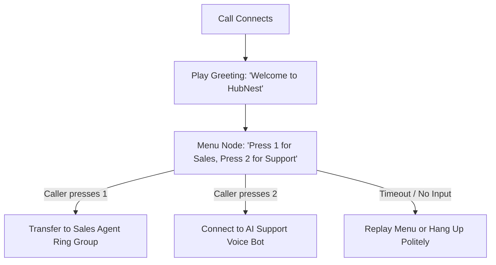
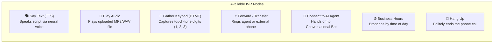
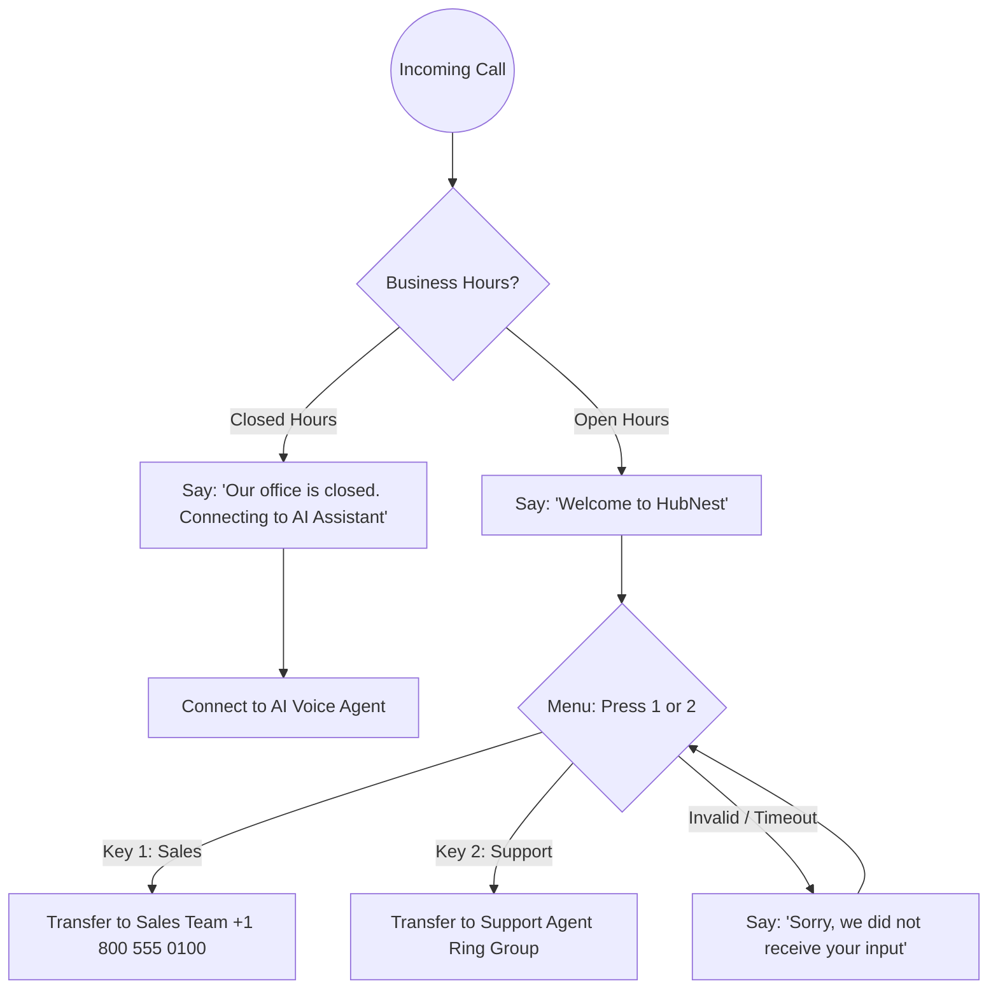

# Visual IVR Call Flow Builder

The **Visual Call Flow Builder** is Calling Hub's drag-and-drop interactive voice response (IVR) studio. It empowers non-technical managers and marketing specialists to construct sophisticated phone menus, interactive routing trees, automated greeting announcements, and live agent handoffs without writing a single line of code.

---

## 1. What is an IVR Call Flow?

An **Interactive Voice Response (IVR)** flow controls exactly what happens when a telephone call connects:

Call flows can be attached to:
- **Inbound Numbers:** Answering customer calls made to your company's virtual phone numbers 24/7.
- **Outbound Bulk Campaigns:** Serving as the interactive audio presentation when mass outbound calls connect.

---

## 2. Navigating the Visual Flow Canvas

To access the builder:
1. In the left navigation sidebar, click **Call Flows**.
2. Click the blue **+ Create Call Flow** button.
3. You will enter the visual flowchart canvas:

| Canvas Area | Description | How to Use |
|---|---|---|
| **Top Toolbar** | Flow Title, Save Flow, Test Simulation, and Publish buttons. | Name your flow (e.g., *"Main Customer Inbound Menu"*) and click **Save**. |
| **Left Node Palette** | List of all available IVR building blocks. | Click or drag any block onto the grid canvas. |
| **Central Grid Workspace** | Large dot-grid canvas where nodes are placed. | Drag nodes into position and connect output dots to input dots. |
| **Right Configuration Inspector** | Properties panel for the currently selected node. | Customize audio text, voice tone, timeout seconds, or transfer numbers. |

---

## 3. Building Blocks: Complete Node Catalog

Calling Hub provides 7 specialized node types to handle any telephony scenario:

### 1. Say Text (Neural TTS) Node
- **Purpose:** Converts written text into high-fidelity, human-quality spoken speech.
- **Settings:**
  - **Text Prompt:** Enter your message (e.g., *"Thank you for calling HubNest. Your call is very important to us."*).
  - **Voice Language:** Select English (US/UK/AU), Spanish, French, Hindi, German, etc.
  - **Voice Persona:** Choose gender and tone (e.g., *Friendly Female, Professional Male*).

### 2. Play Audio Node
- **Purpose:** Plays a studio-recorded audio file.
- **Settings:**
  - **Audio File Upload:** Drag-and-drop any `.mp3` or `.wav` file (max 10 MB).
  - Ideal for official brand music, professionally voiced radio-style promotions, or pre-recorded legal disclaimers.

### 3. Gather Keypad (DTMF Menu) Node
- **Purpose:** Presents options to the caller and waits for them to press a number on their phone keypad.
- **Settings:**
  - **Menu Prompt:** Audio or text announcing options (*"For Sales, press 1. For Support, press 2"*).
  - **Keypad Routes:** Add output branches for `1`, `2`, `3`, `0`, `*`, or `#`.
  - **Timeout:** How many seconds to wait for a keypress (default: `5 seconds`).
  - **Max Digits:** Typically `1` for simple menus, or up to `10` for account numbers or PIN codes.

### 4. Forward / Transfer Node
- **Purpose:** Hands off the caller to a human agent, ring group, or external landline/mobile number.
- **Settings:**
  - **Transfer Target:** Select an internal user agent, an agent ring group, or enter an external telephone number with country code.
  - **Hold Music:** Choose the on-hold melody played to the caller while the target phone rings.

### 5. Connect to AI Agent Node
- **Purpose:** Connects the live call directly to an ElevenLabs or OpenAI conversational voice agent.
- **Settings:**
  - **AI Voice Agent:** Select the configured conversational voice bot from your agent catalog.
  - The AI bot answers instantly, converses naturally, and can handle objections, answers FAQs, or book meetings.

### 6. Business Hours & Schedule Node
- **Purpose:** Routes callers differently depending on whether your office is open or closed.
- **Settings:**
  - **Working Hours:** Select working days (e.g., Monday–Friday) and hours (e.g., 9:00 AM to 6:00 PM).
  - **Timezone:** Select your company's operating timezone (e.g., `America/New_York`, `Asia/Kolkata`, `Europe/London`).
  - **Two Outputs:** Connect one branch for **Open Hours** (transfers to live agents) and one branch for **Closed Hours** (plays after-hours greeting or connects to AI agent).

### 7. Hang Up Node
- **Purpose:** Gracefully terminates the phone call after a closing announcement.

---

## 4. Step-by-Step: Creating a 2-Tier Phone Tree

Here is a practical walkthrough of setting up a standard company phone tree:

### Steps:
1. Drag a **Business Hours Node** onto the canvas and connect it to the starting **Call Received** point.
2. From the **Open Hours** pin, drag a connection to a new **Say Text Node** and type: *"Thank you for calling HubNest. Please listen carefully to the following options."*
3. Connect that node into a **Gather Keypad Node**. Set the prompt to: *"For Sales, press 1. For Customer Support, press 2."*
4. Click **+ Add Key** twice to create branches for `1` and `2`.
5. From Key `1`, connect a **Forward / Transfer Node** configured with your sales team's phone number.
6. From Key `2`, connect a **Forward / Transfer Node** configured with your support department.
7. From the **Closed Hours** pin of your Business Hours node, connect an **AI Voice Agent Node** so after-hours callers can speak with your 24/7 AI receptionist.
8. Click the green **Save & Publish** button in the top toolbar.

---

## 5. Attaching Your Call Flow to a Phone Number

Once published, your call flow needs to be linked to a phone number:

1. In the left sidebar, click **Telephony** $\rightarrow$ **My Phone Numbers**.
2. Locate the virtual phone number you want customers to dial.
3. In the **Routing / Use** column, select **Call Flow**.
4. Choose your newly created flow from the dropdown (e.g., *"Main Inbound Menu"*).
5. Click **Apply Changes**.
6. Make a test call from your mobile phone to your virtual number. You will hear your call flow execute immediately!
