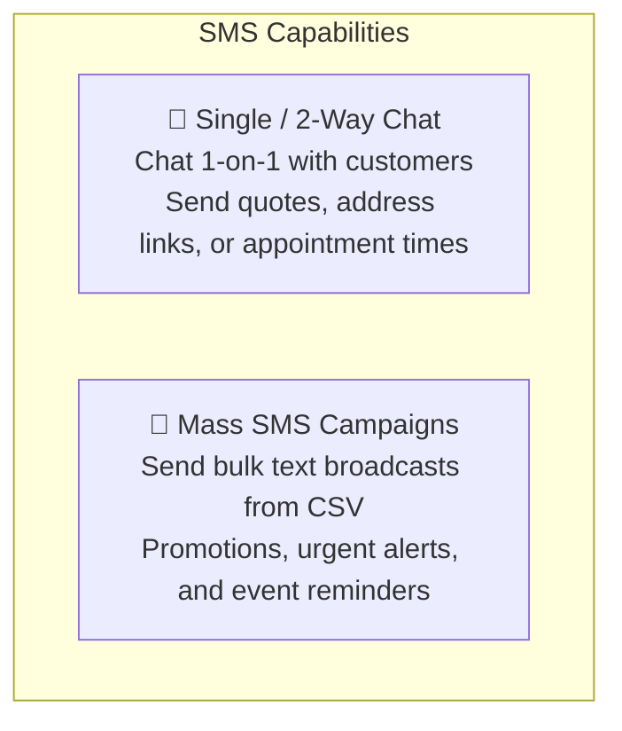
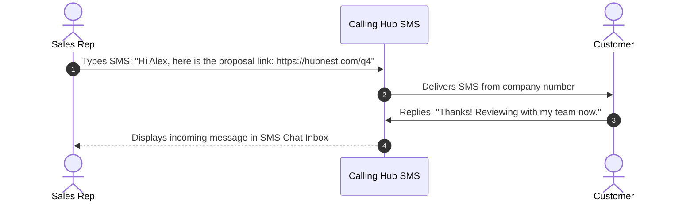
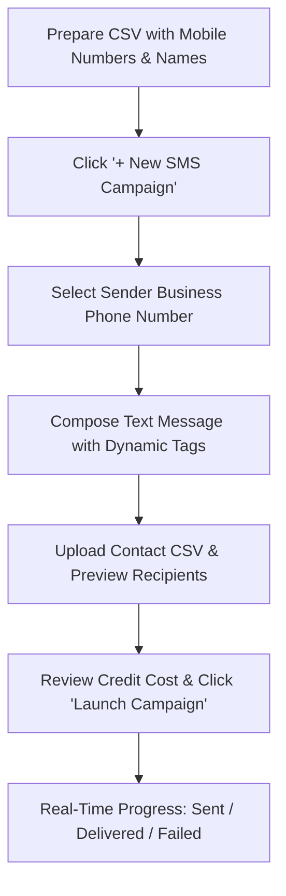

# Two-Way SMS & Mass Broadcasting

Voice calls are often most effective when paired with immediate text message follow-ups. Calling Hub provides a complete **Two-Way SMS Messaging** and **Mass SMS Broadcasting** platform. You can send individual text messages directly from your assigned business caller ID numbers, receive incoming customer replies, or broadcast thousands of personalized text announcements to your contact lists.

---

## 1. Two-Way SMS vs. Mass SMS Broadcasts

Calling Hub supports two communication models:

- **Single Two-Way SMS:** Perfect for telecalling agents and support reps following up on a phone conversation (e.g., sending a payment link while on the line).
- **Mass SMS Campaigns:** Ideal for marketing campaigns, appointment reminders, and company-wide notifications sent to hundreds or thousands of recipients.

---

## 2. Sending a Single Two-Way SMS

To send an individual text message:
1. In the left navigation menu, click **SMS** $\rightarrow$ **Send SMS** (or click the chat icon on any contact card).
2. Complete the compose form:
   - **From Number:** Choose your assigned business phone number.
   - **Recipient Mobile:** Enter the destination mobile number with country code (e.g., `+1 555 123 4567`).
   - **Message Body:** Type your text message.
3. Observe the **Segment Counter** below the text box:
   - Standard text messages allow up to **160 characters** per segment.
   - Adding emojis or special characters changes encoding to Unicode, reducing segments to **70 characters**.
4. Click **Send SMS**. The message is delivered to the customer's phone within seconds.

---

## 3. Creating a Mass SMS Broadcast Campaign

Follow these steps to schedule a bulk SMS campaign:

### Step 1: Open the Campaign Studio
1. Navigate to **SMS** $\rightarrow$ **SMS Campaigns**.
2. In the top right corner, click **+ New SMS Campaign**.

### Step 2: Configure Campaign Details
- **Campaign Name:** Enter a descriptive title (e.g., *"Flash Sale Announcement - Weekend Special"*).
- **From Number:** Select your verified SMS-capable virtual phone number.
- **Provider:** Keep as `Default Carrier`.

### Step 3: Write Your Message with Dynamic Merge Tags
Personalize each text message using dynamic tags:
- `{{name}}`: Replaced with the contact's name from your spreadsheet.
- `{{var_one}}`: Replaced with custom information (e.g., account balance, reservation time).

> [!TIP]
> **Example Message Template:**
> *"Hi {{name}}, your appointment with HubNest is confirmed for {{var_one}}. Reply YES to confirm or call us at {{from_number}} if you need to reschedule."*

### Step 4: Upload CSV & Review Recipients
1. Click **Upload Contacts** and select your `.csv` file.
2. The system checks numbers, removes invalid entries, and calculates the total message segments required.
3. Review the total estimated wallet credits required for dispatch.

### Step 5: Launch the Campaign
- Click **Launch Campaign** to dispatch immediately, or choose a scheduled future date and time.
- The status changes to `Running` as messages are handed off to telecom carriers.

---

## 4. Understanding SMS Segments & Character Limits

Telecom carriers globally bill SMS based on standardized character segments:

| Encoding Type | Included Characters | Characters per 1st Segment | Subsequent Concatenated Segments |
|---|---|---|---|
| **GSM-7 (Standard)** | English letters (`A–Z, a–z`), numbers (`0–9`), and standard punctuation. | **160 characters** | **153 characters** each |
| **Unicode (UCS-2)** | Accented letters, non-Latin scripts (Arabic, Hindi, Chinese), or **Emojis** (`😊, 🚀`). | **70 characters** | **67 characters** each |

> [!NOTE]
> Even a single emoji in your text switches the entire message to Unicode, which may double or triple the segment count and credit cost. Keep promotional texts clean and test them in the composer preview.

---

## 5. Reviewing Delivery Reports (DLR)

To inspect the status of your sent messages:
1. Go to **SMS** $\rightarrow$ **SMS Logs**.
2. The log ledger displays real-time carrier delivery receipts:
   - 🟢 **Delivered:** Successfully received on the customer's handset.
   - 🟡 **Sent / Pending:** Dispatched from our server, awaiting carrier handset handshake.
   - 🔴 **Failed / Undelivered:** Phone disconnected, roaming restriction, or carrier spam filter blockage.
