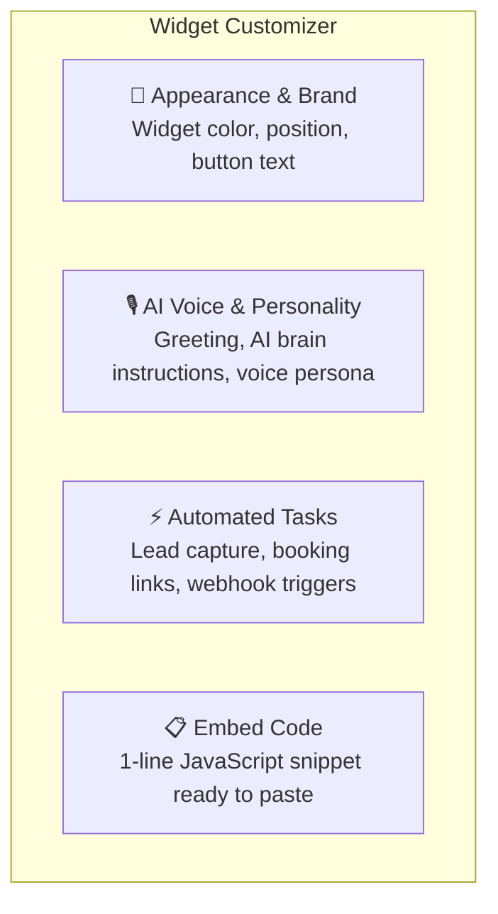
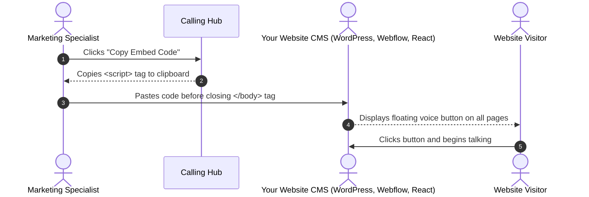
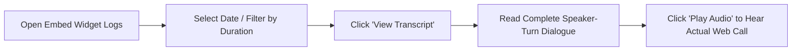

# Website Voice Agent Embed Widget

The **Website Voice Agent Widget** brings the power of conversational AI voice directly onto your public website. By adding a lightweight JavaScript snippet to your website or landing pages, visitors can click a floating microphone button and talk directly with your AI sales or support agent using their computer or smartphone browser—without dialing a phone number and completely free for the visitor.

---

## 1. What is the Website Voice Widget?

```mermaid
graph LR
    A[Visitor Browsing Website] --> B[Sees Floating Voice Widget: 'Talk with Us']
    B --> C[Clicks Widget Button]
    C --> D[Microphone Permission Prompt (1 Click)]
    D --> E[Real-Time Voice Conversation with AI Agent]
    E --> F[AI Qualifies Lead & Collects Contact Details]
    F --> G[Transcript & Audio Saved in Calling Hub Logs]
```

- **Zero Telecom Barrier:** Visitors do not need to pick up a phone or type in an international number; voice audio streams over encrypted WebSockets directly in the browser.
- **Instant Engagement:** Engages high-intent website visitors in real-time conversations while they are actively evaluating your pricing or solutions.
- **Custom Brand Matching:** Fully customizable colors, widget avatar, positioning, and greeting text to match your corporate brand identity.
- **Automated Task Triggers:** The AI agent can trigger tasks during the call (e.g., submitting visitor contact details directly to your sales pipeline).

---

## 2. Creating & Customizing Your Website Widget

To build a website voice widget:
1. In the left navigation menu, click **Embed Widgets** (or click **AI Voice Agents** $\rightarrow$ **Embed Widget**).
2. Click **+ Create Embed Widget**.
3. Customize your widget using the 4 visual design tabs:



| Setting | Options / Description | Recommended Choice |
|---|---|---|
| **Agent Title** | Name displayed in the widget bubble (e.g., *"HubNest Concierge"*). | Friendly, recognizable name. |
| **Widget Accent Color** | Hex color picker matching your brand styling. | Use your primary brand brand color (e.g., `#6366F1` or `#10B981`). |
| **Screen Position** | **Bottom-Right** or **Bottom-Left**. | Bottom-Right (standard industry location). |
| **Call Button Text** | Label on the floating pill (e.g., *"Talk with AI"* or *"Call Sales"*). | *"Talk with Sales Assistant"* |
| **Max Call Duration** | Limit conversation length (e.g., `3`, `5`, or `10` minutes). | `5 minutes` (optimal for lead qualification). |
| **First Spoken Message** | Greeting spoken as soon as visitor clicks the button. | *"Hi! Thanks for visiting HubNest. How can I help you choose the right plan today?"* |

---

## 3. Adding the Embed Code to Your Website

Once you click **Save Widget**, Calling Hub generates a single HTML snippet:



### Sample Embed Snippet:
```html
<!-- HubNest Calling Hub Voice Widget -->
<script 
  src="https://callinghub.yourcompany.com/api/embed-voice-agent/widget.js" 
  data-agent-id="ag_8f3910c842b" 
  defer>
</script>
```

### Installation by CMS Platform:
- **WordPress:** Paste into your theme's `footer.php` file, or use a header/footer injection plugin.
- **Webflow / Framer:** Paste into **Project Settings** $\rightarrow$ **Custom Code** $\rightarrow$ **Footer Code**.
- **Shopify:** Add to `theme.liquid` just before the `</body>` tag.
- **Custom HTML / React / Next.js:** Add directly into your main layout template.

---

## 4. Automatic Lead Capture & Action Tasks

Your website voice agent can capture visitor information dynamically during the voice chat:

1. In the **Automated Tasks** section of the widget editor, toggle **Lead Capture Task** to `Enabled`.
2. Instruct the AI in its prompt: *"Before ending the call, politely ask the visitor for their email address and first name so we can email them our product brochure."*
3. When the visitor speaks their email (*"My email is david@example.com"*), the speech engine captures the email and logs an entry in your **Task Logs** table.

---

## 5. Reviewing Website Conversation Transcripts & Recordings

Every web voice interaction is logged with audio and full text transcripts:



1. Go to **Embed Widgets** $\rightarrow$ **Call Logs**.
2. Each log entry displays:
   - Date and time
   - Call duration (e.g., `2 mins 48 secs`)
   - Language spoken (e.g., `en-US`)
   - Call status (`Completed`)
3. Click **View Transcript** to read the full dialogue line by line:
   - `Visitor:` *"What is the cost for the bulk dialer?"*
   - `AI Agent:` *"The bulk dialer is included in our Pro Plan at 1.5 cents per minute with up to 50 concurrent channels."*
4. Click **Play Recording** to listen to the audio stream.
