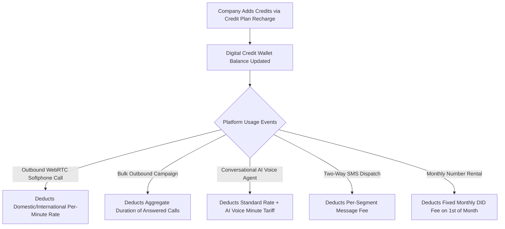
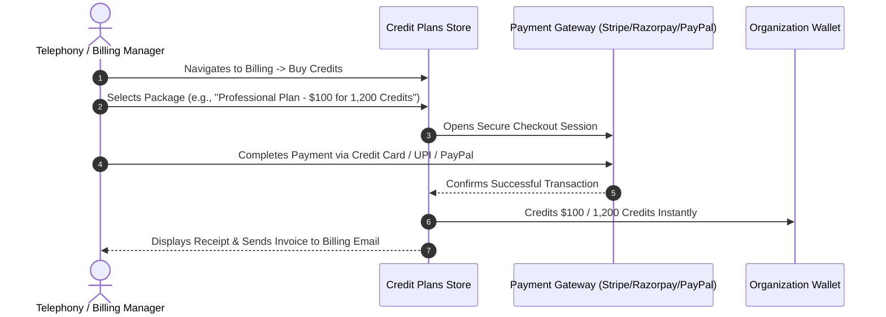

# Calling Credit Wallet & Usage Tariffs

Calling Hub operates on a prepaid, consumption-based **Calling Credit Wallet**. Instead of locking your organization into rigid, multi-year telecom contracts, you maintain a digital credit balance that is debited automatically as calls are made, minutes are consumed, and virtual numbers are rented.

---

## 1. How the Credit Wallet Works



- **Per-Second Billing:** Voice calls are billed precisely based on actual conversation seconds rather than rounding aggressively to whole minutes.
- **Unanswered Calls are Free:** You are only billed when a call connects and audio begins flowing. Ringing, unanswered calls, and busy signals do not consume talk time credits.
- **Shared Pool:** All telecallers and automated campaigns draw from your company's central credit wallet—you do not need to manage individual wallets for each agent.

---

## 2. Recharging Your Wallet with Credit Plans

To add credits to your organization's wallet:



### Steps to Purchase Credits:
1. In the left navigation sidebar, click **Billing** $\rightarrow$ **Credit Plans**.
2. Review available recharge bundles:
   - **Starter Bundle:** $25 (Great for small teams or testing).
   - **Growth Bundle:** $100 (Bonus credits included; ideal for active telecalling shifts).
   - **Enterprise Bundle:** $500 (Maximum volume discount; recommended for high-volume bulk campaigns).
3. Click **Select Plan**.
4. Choose your preferred payment method:
   - **Credit / Debit Card** (via Stripe)
   - **Razorpay** (Cards, NetBanking, UPI)
   - **PayPal**
   - **Offline Bank Wire / Invoice** (for corporate purchase orders)
5. Complete payment. Your credit balance will update immediately on your screen.

---

## 3. Understanding Usage Tariffs & Rate Cards

Calling Hub maintains transparent, upfront per-minute tariffs for every service. You can inspect your active rate card anytime under **Billing** $\rightarrow$ **Usage Pricing**:

| Telephony Service | Domestic Destination (Same Country) | International Destination | Billing Unit |
|---|---|---|---|
| **WebRTC Softphone Outbound** | $0.015 / minute | From $0.035 / minute | Per minute (60s blocks) |
| **Bulk Outbound Dialer** | $0.015 / minute | From $0.035 / minute | Per minute (60s blocks) |
| **Inbound Call Receiving** | $0.0085 / minute | $0.0085 / minute | Per minute (60s blocks) |
| **Conversational AI Voice Agent** | $0.085 / minute | $0.115 / minute | Per minute (includes ElevenLabs neural voice & OpenAI brain) |
| **Two-Way Outbound SMS** | $0.0075 / segment | From $0.025 / segment | Per standard 160-character segment |
| **Virtual DID Number Rental** | $1.50 – $3.00 / month | $4.00 – $8.00 / month | Monthly recurring |

> [!TIP]
> **Optimizing Costs:** For domestic campaigns, ensure your outbound caller ID number matches the target country. Telecom carriers apply higher international termination surcharges when calls cross international borders.

---

## 4. Setting Low-Balance Alerts

To prevent telephone calls or active bulk campaigns from pausing mid-shift due to an empty wallet:

```mermaid
graph LR
    A[Wallet Balance Monitored Continuously] --> B{Balance Drops Below Threshold? (e.g. < $25)}
    B -->|Yes| C[Trigger High-Priority Warning Toast in Agent Softphone]
    B -->|Yes| D[Dispatch Automated Warning Email to Billing Admin]
    C & D --> E[Admin Recharges Before Disruption Occurs]
```

1. Navigate to **Billing** $\rightarrow$ **Billing Settings**.
2. Locate the **Low-Balance Alert Threshold** field.
3. Enter your minimum comfortable balance (e.g., `$25.00` or `$50.00`).
4. Enter the email addresses of your finance and operations managers.
5. Click **Save Settings**.
6. When your balance drops below the threshold, the system automatically sends an alert notice giving you plenty of time to recharge.

---

## 5. Reviewing Transaction History & Downloading Invoices

For tax accounting and expense reporting:
1. In the left navigation menu, click **Billing** $\rightarrow$ **Orders & Invoices**.
2. Every purchase is listed with:
   - Order Transaction ID
   - Date and time
   - Payment method (Stripe, Razorpay, PayPal)
   - Amount paid
   - Credits added
   - Official downloadable PDF invoice
3. Click the **Download Invoice** button next to any transaction to save a compliant VAT/tax invoice for your accounting records.
