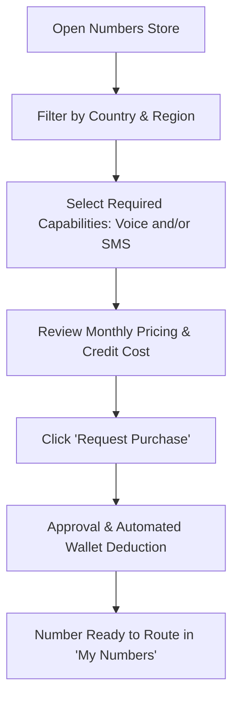
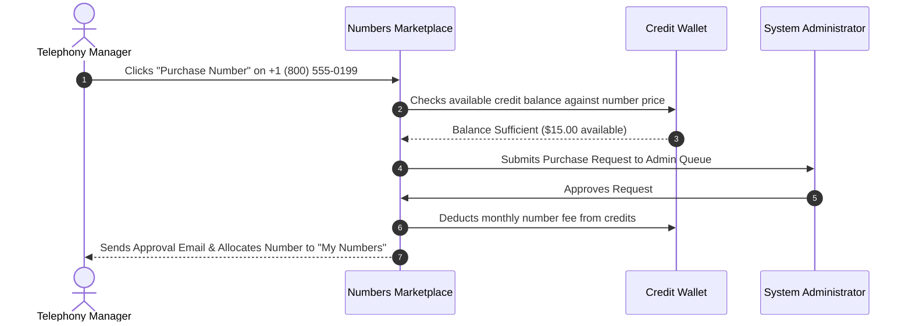
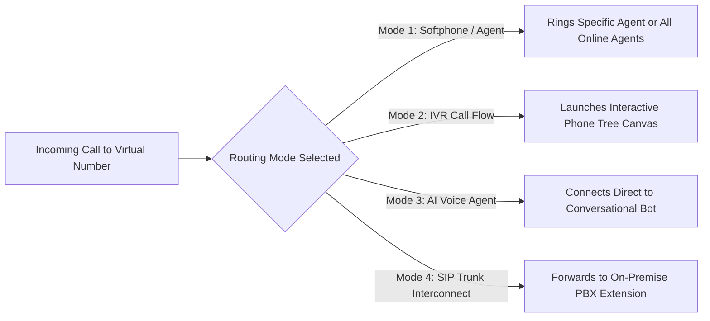

# Virtual DID Phone Numbers Marketplace

A **Virtual Phone Number** (also called a **Direct Inward Dialing / DID** number) is a real, cloud-hosted telephone number that allows your business to establish a local presence in any city, country, or region worldwide without maintaining a physical office or physical landline cables there.

In Calling Hub, you can browse available phone numbers across global carriers, submit purchase requests, and route inbound calls to softphones, IVR flows, or AI voice bots.

---

## 1. Navigating the Numbers Marketplace

To browse numbers available for purchase:
1. In the left navigation menu, click **Telephony** $\rightarrow$ **Buy Phone Numbers** (or **Numbers Store**).
2. The marketplace presents an interactive filter bar and a searchable catalog of provisioned telephone numbers.

---

## 2. Searching & Filtering Available Numbers

Use the marketplace filters to pinpoint the exact phone numbers needed for your operations:

| Filter Field | Options / Examples | Explanation |
|---|---|---|
| **Country** | United States (`+1`), United Kingdom (`+44`), Canada (`+1`), Australia (`+61`), India (`+91`), etc. | Selects the country territory where the number operates. |
| **Number Type** | **Local**, **National**, or **Toll-Free (800 / 888)**. | - **Local:** Has a city area code (e.g., 212 for New York). Best for sales. - **Toll-Free:** Free for callers to dial. Best for customer service. |
| **Capabilities** | 🎙️ **Voice Only** 💬 **SMS Only** 🎙️💬 **Voice & SMS (Dual)** | Verify that the number supports both Voice calling and two-way SMS messaging if you plan to run text campaigns. |
| **Area Code / Digits** | Type specific numbers (e.g., `415`, `800`, `206`). | Allows searching for memorable vanity digits or specific urban centers. |

---

## 3. Submitting a Number Purchase Request

Once you find a suitable number in the catalog:

### Steps to Purchase:
1. Click the blue **Buy / Request** button next to the desired number.
2. A confirmation modal will appear displaying:
   - The exact telephone number (e.g., `+1 415 555 0142`)
   - Monthly rental price in credits (e.g., `15 Credits / month`)
   - Carrier provider (Twilio or Plivo)
   - Verified KYC status of your account
3. Click **Confirm Purchase Request**.
4. If your company account has auto-approval enabled, the number is allocated to your inventory immediately. Otherwise, a request is submitted to your system administrator for rapid review.
5. You will receive an automated email notification once approved.

> [!NOTE]
> Virtual number rentals renew monthly and are automatically deducted from your calling credit wallet balance on the 1st of each billing cycle.

---

## 4. Routing Your Provisioned Numbers

Once a number is listed in your **My Numbers** table, you must tell the system how to handle incoming calls made to that number:

### How to Configure Routing:
1. Navigate to **Telephony** $\rightarrow$ **My Numbers**.
2. Locate the number and click the **Configure Routing** gear icon.
3. Select your desired **Number Use**:
   - **Softphone / Agent Direct:** Select a specific agent from your team roster. When someone calls this number, that agent's softphone will ring directly.
   - **Visual Call Flow:** Select an IVR flow created in your flow builder (e.g., *"Customer Support Tree"*). Incoming calls will hear the greeting and menu options.
   - **AI Voice Agent:** Select a configured conversational AI agent (e.g., *"Rachel - 24/7 Concierge"*). The AI bot answers and converses with the caller.
   - **External Forward:** Enter a standard landline or mobile number to unconditionally forward all incoming calls.
4. Click **Save Routing**. The configuration takes effect instantaneously without downtime.

---

## 5. Releasing or Deleting Numbers

If you no longer require a virtual phone number (e.g., a seasonal marketing promotion has concluded):
1. In **My Numbers**, click the three dots icon next to the number.
2. Click **Release Number**.
3. Confirm the warning prompt: *"Are you sure you want to release this number? Once released, this number cannot be recovered."*
4. The number is returned to the carrier pool, and monthly credit deductions for this number cease immediately.
