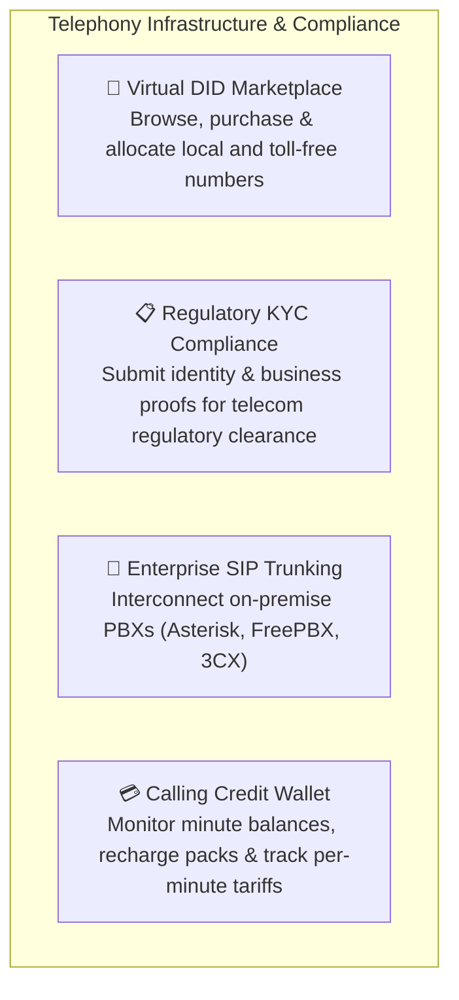
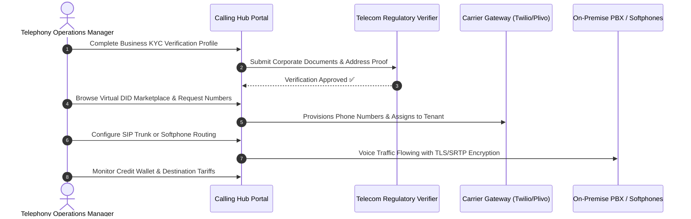

# Telephony Operations & Telecom Compliance Overview

Welcome to the **Telephony Operations & Telecom Compliance Guide** for HubNest Calling Hub. As a telephony operations manager, VoIP administrator, or telecom compliance officer, you are responsible for maintaining your company's virtual phone number inventory, ensuring adherence to global telecom KYC regulations, managing SIP PBX interconnects, and overseeing calling credit wallet balances and termination tariffs.

---

## 1. What You Manage in Calling Hub

- **Virtual DID Phone Number Provisioning:** Acquire local, national, and toll-free phone numbers across 50+ countries with instant SMS and voice capabilities.
- **Telecom Regulatory Compliance (KYC):** Manage Know Your Customer (KYC) documentation required by national telecom authorities before purchasing or transmitting traffic.
- **Enterprise SIP Trunking:** Bridge your existing on-premise PBX or call center software with cloud telephony, encrypted using TLS/SRTP with IP whitelist access controls.
- **Wallet Balances & Usage Tariffs:** Oversee real-time credit consumption, configure auto-recharge triggers, and understand domestic vs. international per-minute call termination rates.

---

## 2. Telephony Operations Workflow

A healthy telephony setup follows a structured operational cycle:

### Stage 1: Regulatory Verification (KYC)
Before phone numbers can be provisioned or bulk traffic can be transmitted, international telecom regulations require verified proof of business identity and physical address. Completing KYC early avoids provisioning delays.

### Stage 2: Number Procurement & Routing
Acquire phone numbers representing your target geographic markets (e.g., local US area codes, UK geographic numbers, or 1-800 toll-free numbers). Route each number to an agent softphone, an IVR flow, or a SIP trunk.

### Stage 3: SIP Trunking & PBX Interconnect
If your company operates an existing Asterisk, FreePBX, or 3CX PBX system, configure a SIP Trunk with IP access control lists (ACLs) to securely send and receive calls through Calling Hub's carrier infrastructure.

### Stage 4: Financial Governance & Tariffs
Keep calling credit balances topped up and monitor destination rate cards to optimize telecommunication spending across domestic and international calling routes.

---

## 3. Operational Best Practices & Guidelines

| Operational Area | Golden Rule | Common Pitfall |
|---|---|---|
| **KYC Documentation** | Upload clear, high-resolution color scans of business registration and recent utility bills matching your company name. | Uploading blurry photos or personal documents instead of official business registration certificates. |
| **Caller ID Allocation** | Always assign numbers matching the geographic region of your calling targets to maximize answer rates. | Dialing international clients from unverified or generic caller IDs, triggering carrier spam filters. |
| **SIP Security** | Enforce IP Whitelisting (ACLs) and TLS/SRTP media encryption on all SIP trunks. | Leaving SIP credentials open to `0.0.0.0/0`, creating risk of unauthorized toll fraud. |
| **Credit Monitoring** | Set a low-balance email threshold (e.g., alert when balance drops below $25) to avoid service interruption. | Allowing wallet balance to hit zero during active calling shifts, which automatically pauses ongoing campaigns. |

---

## 4. Next Steps in this Guide

Explore each technical chapter below to configure your telephony infrastructure:

- 📱 **[Virtual DID Phone Numbers Marketplace](did-phone-numbers.md):** Purchasing numbers, selecting capabilities (Voice/SMS), and assigning routing.
- 📋 **[Regulatory KYC Verification](kyc-verification.md):** Step-by-step documentation submission and compliance approval workflow.
- 🔌 **[Enterprise SIP Trunk Interconnect](sip-trunk-interconnect.md):** Connecting Asterisk/FreePBX with IP whitelists and TLS/SRTP security.
- 💳 **[Calling Credit Wallet & Tariffs](credit-wallet-tariffs.md):** Purchasing credit bundles, checking rate cards, and managing billing.
