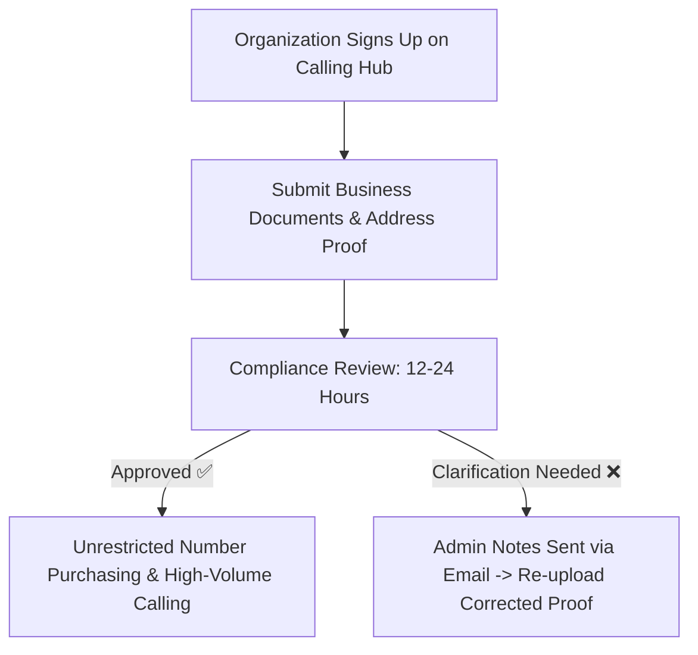
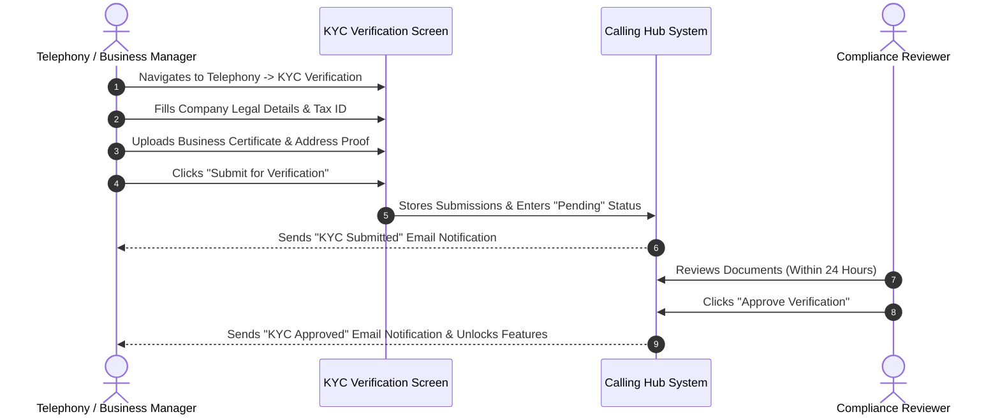

# Regulatory Telecom KYC Verification

**Know Your Customer (KYC)** verification is an international legal requirement established by telecommunications regulatory authorities worldwide (such as the FCC in the United States, Ofcom in the United Kingdom, and TRAI in India). It ensures that phone numbers and telecommunication networks are used exclusively by verified, legitimate business organizations and prevents illegal robocalling, voice phishing, and telecom fraud.

In Calling Hub, completing KYC gives your organization unrestricted access to purchase virtual phone numbers, transmit outbound calling campaigns, and connect enterprise SIP trunks.

---

## 1. Why Telecom KYC is Required

- **Regulatory Compliance:** Required by law to assign domestic and toll-free telephone numbers.
- **Enhanced Answer Rates:** Numbers backed by verified businesses receive favorable carrier trust scoring (STIR/SHAKEN A-level attestation), preventing calls from being flagged as *"Spam Likely"*.
- **Higher Concurrency Limits:** Verified business accounts can dial up to 50–100 simultaneous lines compared to restricted unverified trial accounts.

---

## 2. Required Documents Checklist

Before starting your KYC submission, have digital copies of the following documents ready (PDF, PNG, or JPG formats; maximum 10 MB per file):

| Document Type | What to Provide | Acceptance Criteria |
|---|---|---|
| **1. Business Registration Certificate** | Certificate of Incorporation, Articles of Organization, or Official Business License. | Must clearly display the legal registered company name, company registration number, and state/country of registration. |
| **2. Proof of Physical Address** | Recent utility bill (electricity, water, broadband) or bank statement dated within the last 90 days. | Address must match the company registration certificate. P.O. Box addresses are **not** accepted. |
| **3. Authorized Signatory Identity Proof** | Government-issued Passport, National ID card, or Driver's License of the business owner or director. | Must be valid, unexpired, in color, and show full legal name, date of birth, and photograph clearly. |
| **4. Tax Identification** | Official Tax Registration Document (e.g., EIN letter in the US, VAT/GST certificate). | Must match the legal business name exactly. |

---

## 3. Submitting Your KYC Verification

Follow this step-by-step guide to submit your verification profile:

### Step 1: Open the KYC Portal
1. In the left navigation sidebar, click **Telephony** $\rightarrow$ **KYC Verification**.
2. If your account is unverified, you will see a prominent yellow notice: *"KYC Verification Required"*.

### Step 2: Fill Out Business Details
- **Legal Business Name:** Enter your full registered company name (e.g., *"Acme Technologies LLC"*).
- **Business Type:** Select Corporation, LLC, Partnership, Sole Proprietorship, or Non-Profit.
- **Tax / Registration Number:** Enter your official tax ID or registration number.
- **Registered Physical Address:** Enter street address, city, state/province, postal code, and country.

### Step 3: Upload Verification Files
1. In the document upload area, drag and drop your files into the designated dropzones:
   - *Dropzone 1:* Business Registration Proof.
   - *Dropzone 2:* Utility Bill or Bank Statement (Proof of Address).
   - *Dropzone 3:* Director's Government ID.
2. Ensure files are under the maximum size limit (up to 3 files total).

### Step 4: Submit & Track Status
- Click the blue **Submit KYC Documents** button.
- Your status immediately changes to 🟡 **Pending Review**.
- You will receive an automated confirmation email confirming receipt of your submission.

---

## 4. Understanding KYC Statuses

You can track your compliance standing anytime on your KYC dashboard:

| Status Badge | Meaning | Permitted Platform Actions |
|---|---|---|
| ⚪ **Not Submitted** | No KYC documents have been submitted yet. | Can browse platform, configure softphones, but cannot purchase numbers or make external calls. |
| 🟡 **Pending Review** | Documents have been received and are undergoing review by the compliance team. | Review takes between 12 to 24 business hours. |
| 🟢 **Approved** | All documents were verified and accepted. | Full, unrestricted access to the numbers marketplace, bulk calling, and SIP interconnects. |
| 🔴 **Rejected** | One or more documents could not be validated. | Look at the **Admin Rejection Reason** note, replace the flagged document, and click **Re-Submit KYC**. |

---

## 5. What to Do If Your KYC is Rejected

Rejections typically occur due to simple formatting errors:

- **Common Reason 1: Blurry or Cropped Scans.**
  - *Fix:* Re-scan the document in high resolution, ensuring all four corners are visible.
- **Common Reason 2: Address Mismatch.**
  - *Fix:* Ensure the street address on your utility bill matches the address entered in the form.
- **Common Reason 3: Expired Document.**
  - *Fix:* Provide an active, unexpired government ID or a utility bill dated within the last 90 days.

Once corrected, click **Update Documents**, upload the fresh file, and submit for re-review.
