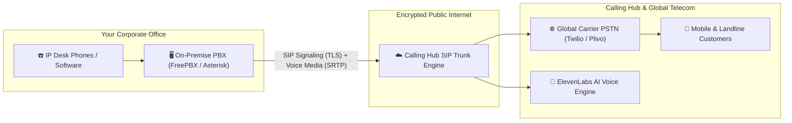

# Enterprise SIP Trunk Interconnect

An **Enterprise SIP Trunk** (Session Initiation Protocol Trunk) is a virtual digital telephone line that establishes a high-capacity, encrypted voice bridge between your company's on-premise PBX phone system (such as **Asterisk**, **FreePBX**, **3CX**, **Grandstream**, or **Cisco CallManager**) and Calling Hub's global carrier network.

With SIP Trunking, your office desk phones and legacy call center systems can leverage Calling Hub's low-cost carrier routing, international virtual numbers, and conversational AI voice agents.

---

## 1. How SIP Trunking Works



---

## 2. Navigating the SIP Trunk Studio

To manage your SIP trunks:
1. In the left navigation menu, click **Telephony** $\rightarrow$ **SIP Trunks**.
2. Click the blue **+ Create SIP Trunk** button to launch the configuration inspector.

```mermaid
graph TD
    A[Create New SIP Trunk] --> B[Assign Friendly Label & Phone Number]
    B --> C[Configure Inbound Authentication: Username/Password or IP ACL]
    C --> D[Set Outbound PBX Address & Encryption (TLS/SRTP)]
    D --> E[Optional: Attach Conversational AI Agent]
    E --> F[Test Registration & Verify Audio Loopback]
```

---

## 3. Configuring Inbound & Outbound Settings

The SIP Trunk editor organizes settings into 4 straightforward technical sections:

### Section 1: Trunk Identity
- **Trunk Label:** A descriptive name (e.g., *"HQ FreePBX Primary Trunk"* or *"London Office Asterisk"*).
- **Assigned Phone Number:** Link one of your purchased virtual numbers as the primary DID pilot number for this trunk.

### Section 2: Inbound Authentication (From PBX to Calling Hub)
How Calling Hub verifies calls originating from your on-premise PBX:
- **Authentication Method:**
  - **Option A: Digest Authentication (Username & Password):** Calling Hub generates a unique `SIP Username` and strong `SIP Password`. Enter these into your PBX trunk settings.
  - **Option B: IP Access Control List (IP Whitelist - Recommended):** Enter the static public IP address of your office PBX (e.g., `198.51.100.45`). Any call originating from this IP is trusted and authorized without password handshakes.

### Section 3: Outbound Delivery (From Calling Hub to Your PBX)
Where Calling Hub delivers incoming calls dialed to your virtual numbers:
- **Outbound PBX Address:** Enter your PBX's fully qualified domain name (FQDN) or public IP with SIP port (e.g., `pbx.yourcompany.com:5060`).
- **Transport Protocol:** Select **TLS** (Encrypted - Strongly Recommended), **UDP** (Standard), or **TCP**.
- **Media Encryption (SRTP):** Select **Required** or **Allowed** to encrypt live audio packets against eavesdropping.

### Section 4: AI Voice Interconnect (Optional)
- You can route inbound SIP calls directly to an **ElevenLabs Conversational AI Agent**.
- Callers who reach your SIP PBX extension will be answered by your AI voice assistant, capable of conversational routing or automated customer intake.

---

## 4. Connecting Popular PBX Systems (Asterisk & FreePBX)

### Sample FreePBX / Asterisk Trunk Configuration:
Add the following parameters into your FreePBX **Connectivity $\rightarrow$ Trunks $\rightarrow$ Add SIP (chan_pjsip) Trunk**:

```ini
[callinghub-trunk]
type=endpoint
transport=transport-tls
context=from-pstn
disallow=all
allow=ulaw,alaw,opus
aors=callinghub-aor
auth=callinghub-auth
outbound_auth=callinghub-auth

[callinghub-auth]
type=auth
auth_type=userpass
username=YOUR_SIP_USERNAME
password=YOUR_STRONG_PASSWORD

[callinghub-aor]
type=aor
contact=sip:sip.callinghub.yourcompany.com:5061
```

> [!TIP]
> **Audio Codecs:** Calling Hub natively supports **G.711u (u-law)**, **G.711a (a-law)**, and **Opus** for pristine, high-definition voice clarity.

---

## 5. SIP Bulk Automated Campaigns

In addition to standard PBX calling, Calling Hub allows you to launch **SIP Bulk Automated Campaigns**:
1. Go to **SIP Trunks** $\rightarrow$ **SIP Bulk Campaigns**.
2. Click **+ New SIP Campaign**.
3. Select your configured SIP Trunk and upload your contact spreadsheet.
4. The system dispatches outbound calls directly through your enterprise SIP trunk, routing answered calls to your PBX agents or attached ElevenLabs voice assistant.

---

## 6. Reviewing SIP Call Logs & Diagnostics

To troubleshoot connection errors or verify call durations:
1. Go to **SIP Trunks** $\rightarrow$ **SIP Call Logs**.
2. Every call passing through your trunk is logged with:
   - Call Direction (`Inbound` or `Outbound`)
   - Source Caller ID and Destination Number
   - SIP response code (e.g., `200 OK`, `486 Busy Here`, `404 Not Found`)
   - Audio duration in seconds
   - Consumed credits
