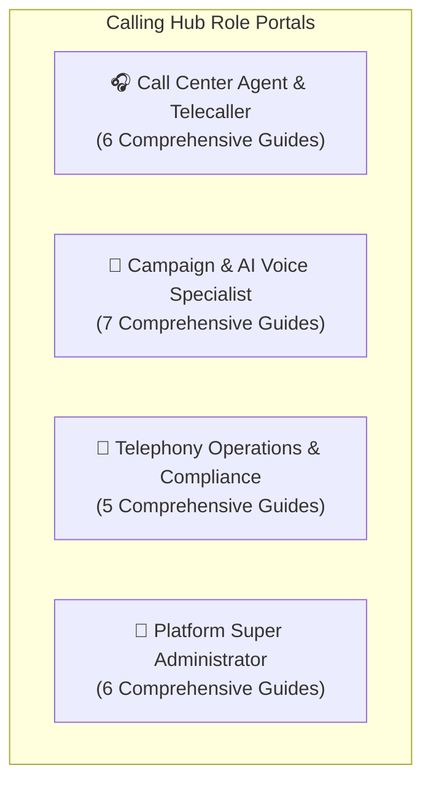

# Calling Hub — Enterprise VoIP, PBX & AI Voice Platform

Welcome to the **Calling Hub Documentation Portal**. Calling Hub is HubNest's enterprise Cloud Telephony, VoIP PBX, WebRTC Softphone, and Conversational AI Voice platform.

Whether you are a telecalling agent handling daily customer calls, a marketing specialist designing interactive IVR phone trees and bulk dialers, a telecom administrator provisioning virtual numbers and SIP trunks, or a system administrator configuring global carrier backbones, choose your dedicated user guide below:

---

## 🧭 Direct Role-Based Manuals (24 Chapters)

-   :material-phone-in-talk:{ .lg .middle style="color: #6366f1;" } **[Call Center Agent & Telecaller](../calling-agent/index.md)**

    ---

    WebRTC softphone dialpad, live in-call controls (Mute/Hold/Transfer/DTMF), Agent CRM contact queues, call dispositions (`Interested`, `Callback`, `Sale Won`), call notes, and audio playback.

    [:octicons-arrow-right-24: Open Agent Manual (6 Chapters)](../calling-agent/index.md)

-   :material-bullhorn:{ .lg .middle style="color: #3b82f6;" } **[Campaign & AI Voice Specialist](../calling-campaigns/index.md)**

    ---

    Automated outbound bulk dialer campaigns, visual IVR call flow builder (DTMF menus), conversational AI voice agents (ElevenLabs/OpenAI), floating website voice widgets, and two-way SMS broadcasting.

    [:octicons-arrow-right-24: Open Campaign Manual (7 Chapters)](../calling-campaigns/index.md)

-   :material-cellphone-cog:{ .lg .middle style="color: #10b981;" } **[Telephony Operations & Compliance](../calling-telephony/index.md)**

    ---

    Global virtual DID phone numbers marketplace, regulatory telecom KYC verification, enterprise SIP trunking interconnects (Asterisk/FreePBX), credit wallet recharges, and destination tariffs.

    [:octicons-arrow-right-24: Open Telephony Manual (5 Chapters)](../calling-telephony/index.md)

-   :material-shield-crown:{ .lg .middle style="color: #8b5cf6;" } **[Platform Super Administrator](../calling-admin/index.md)**

    ---

    Master user & agent provisioning, carrier gateway setup (Twilio, Plivo), AI speech credentials (ElevenLabs, Deepgram, OpenAI), retail pricing plans, payment gateways (Stripe, Razorpay, PayPal), and global CDR audit ledgers.

    [:octicons-arrow-right-24: Open Admin Manual (6 Chapters)](../calling-admin/index.md)

---

## 🔗 Quick Jump Links
- 📞 **[Web Softphone & Dialpad Guide](../calling-agent/softphone-dialer.md)**
- 🎛️ **[Active In-Call Controls](../calling-agent/call-controls.md)**
- 📋 **[Setting Call Dispositions in CRM](../calling-agent/agent-crm-disposition.md)**
- 📢 **[Bulk Outbound Dialer](../calling-campaigns/bulk-call-dialer.md)**
- 🌳 **[Visual IVR Flow Builder](../calling-campaigns/ivr-call-flow-builder.md)**
- 🤖 **[Conversational AI Voice Agents](../calling-campaigns/ai-voice-agents.md)**
- 📱 **[Virtual DID Phone Numbers Store](../calling-telephony/did-phone-numbers.md)**
- 📋 **[Telecom Regulatory KYC Clearance](../calling-telephony/kyc-verification.md)**
- 🔌 **[Enterprise SIP Trunk Interconnect](../calling-telephony/sip-trunk-interconnect.md)**
