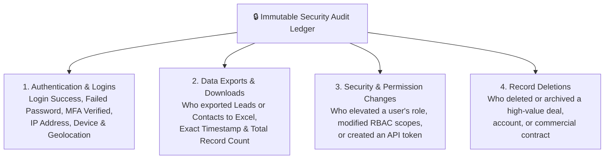

# Security Audit Logs & Login Monitoring Guide

Protecting your company's customer relationships, pricing contracts, and confidential financial records requires absolute accountability. If an employee exports 5,000 leads to Excel before resigning, or if an unauthorized login attempt occurs from an unfamiliar foreign IP address, administrators need immediate visibility.

HubCRM's **Immutable Audit Log System** (`/admin/audit-logs`) records every significant action across your workspace in a tamper-proof security ledger.

---

## 🔒 What Events Are Automatically Logged?

HubCRM captures four critical categories of user activity automatically:

---

## 🔍 How to Investigate Suspicious Activity

When you open `/admin/audit-logs`, you are greeted by an intuitive, filterable activity stream:

| Timestamp | User | Action Category | Details | IP Address & Location |
| :--- | :--- | :--- | :--- | :--- |
| **Oct 16, 11:42 AM** | Rohit Verma | `EXPORT_LEADS` | Exported 450 Leads to Excel (`leads_oct.xlsx`) | `49.36.12.82` (Mumbai, India) |
| **Oct 16, 09:15 AM** | Sneha Sen | `LOGIN_SUCCESS`| Logged in via Keycloak SSO | `103.21.54.10` (Delhi, India) |
| **Oct 15, 08:30 PM** | Unknown User | `LOGIN_FAILED` | 3 Failed Password Attempts for `admin@corp.com` | `185.220.101.4` (Tor Exit Node) ⚠️ |

### Investigation Tools:
* **Filter by User:** Type an employee's name to see every single action they performed during their shift.
* **Filter by Action Type:** Filter by **Data Exports** to ensure client lists are only being downloaded by authorized managers.
* **Filter by Failed Logins:** Spot brute-force password guessing attempts and lock affected user accounts with 1 click.

---

## 🛡️ Exporting Audit Logs for Compliance (ISO / SOC2)

When preparing for annual IT security reviews or data privacy audits:

1. Select the required reporting period (e.g., *Last 90 Days* or *Annual Year*).
2. Click **Export Audit Trail (CSV / PDF)**.
3. The exported file contains cryptographic hash stamps verifying that no logs have been edited or deleted.
