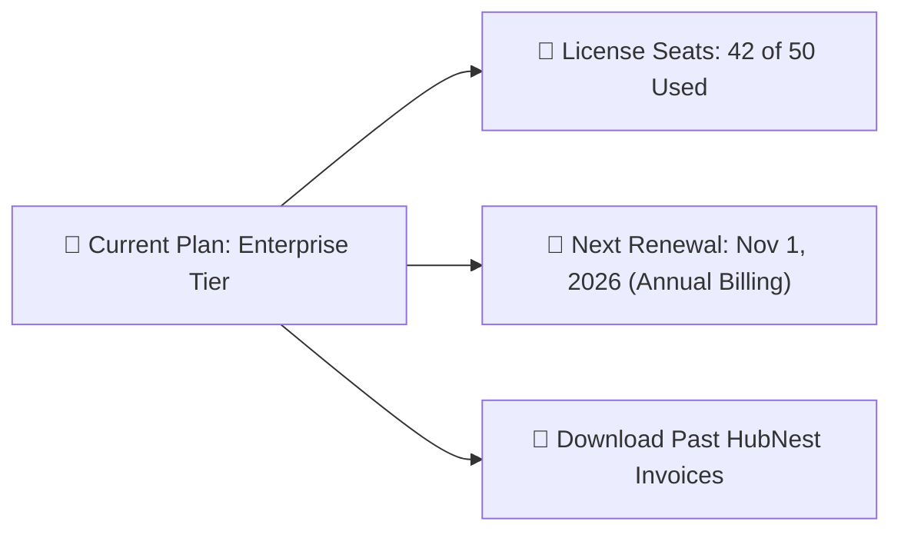

# Company Billing, Subscriptions & License Seats Guide

As your sales and support teams expand, managing your software license seats, upgrading plan tiers, and downloading tax invoices should be seamless. HubCRM's **Company Billing Center** (`/admin/billing`) lets administrators manage their organization's subscription transparently.

---

## 💳 The Subscription Overview Screen

When you open `/admin/billing`, your current plan details are displayed clearly:

| Summary Widget | What It Shows | What You Can Do |
| :--- | :--- | :--- |
| **Current Plan Tier** | Professional or Enterprise Tier. | Click **Upgrade Plan** to unlock advanced AI Studio or Salesforce migration tools. |
| **Total License Seats** | Total employee logins purchased vs. currently assigned. | Click **+ Add Seats** whenever you hire new sales reps. |
| **Billing Frequency** | Annual (with 20% savings) or Monthly billing. | Switch between annual and monthly cycles anytime. |
| **Payment Method** | Corporate Credit Card or Auto-Debit on file. | Update card details or billing contact email. |

---

## ➕ How to Add More User Seats in 30 Seconds

When hiring new sales reps or customer support agents:

1. In the Billing screen, click the blue **+ Add User Seats** button.
2. Use the slider or number box to select how many seats to add (e.g., *+5 Seats*).
3. **Instant Prorated Math:** HubCRM calculates the exact prorated charge for the remaining days of your current billing month.
4. Click **Confirm & Pay**. The new seats are unlocked immediately, allowing you to invite new hires without waiting for support assistance!

---

## 🧾 Downloading Official Tax Invoices

For your internal accounting records and tax filings:

1. Scroll down to the **Invoice History** section.
2. You will see a chronological list of all payments made to HubNest:
   * Invoice Date, Billing Period, Amount Paid, and Payment Method.
3. Click the **Download PDF (📥)** button next to any invoice.
4. The downloaded tax invoice contains HubNest's legal registered address, GST/Tax identification numbers, and your company's official corporate details.
