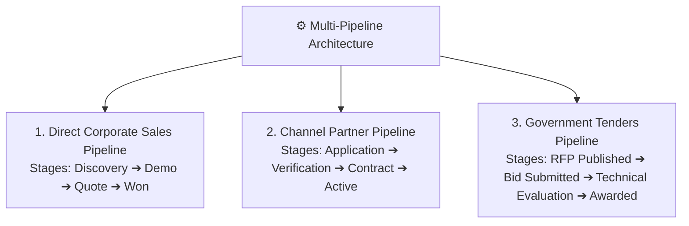

# CRM Pipeline Control, Stages & Custom Fields Guide

Every business sells differently. A manufacturing company might have an 8-month sales cycle with prototype testing stages, while a software agency might close deals in 14 days. 

HubCRM's **CRM Control Center** (`/admin/crm-control`) gives administrators complete flexibility to customize pipelines, add unique data fields, and enforce mandatory sales rules.

---

## 🔀 Multi-Pipeline Management

HubCRM allows you to run multiple independent sales pipelines side-by-side:

### How to Create or Edit a Pipeline:
1. Go to **Admin ➔ CRM Control ➔ Pipelines**.
2. Click **+ Add Pipeline** (or edit an existing one).
3. Name your pipeline (e.g., *"Enterprise Strategic Deals"*).
4. **Define Your Custom Stages:**
   * Click **+ Add Stage**.
   * Give the stage a name (e.g., *"Security Audit"* or *"Procurement Review"*).
   * Set the **Win Probability Percentage** (e.g., *75%*).
   * Reorder stages by dragging the handle up or down.
5. Click **Save Pipeline**. Reps can immediately switch between pipelines on their visual Kanban board!

---

## 📝 Custom Fields Builder

Need to capture specific information that isn't included in default templates? You can add unlimited custom fields:

1. Click on **Custom Fields** and select the record type: **Leads**, **Deals**, or **Accounts**.
2. Click **+ Add Custom Field**:
   * **Field Label:** What reps see on screen (e.g., *"Number of Warehouse Locations"* or *"Current Legacy Software"*).
   * **Field Type:** Pick from *Text, Dropdown List, Number / Currency, Date Picker,* or *Checkbox*.
   * **Placement:** Choose which section of the customer card it should appear in.
3. Click **Save Field**.

---

## 🛑 Enforcing Mandatory Fields on Stage Progression

To ensure sales reps don't skip vital steps:

* You can configure **Stage Progression Gates**:
  > *"When moving a deal to the **Proposal Sent** stage, the rep **MUST** enter the client's official Tax/GST ID and attach the proposal file before the system allows the card to advance."*
* This prevents human error and guarantees that every deal reaching the finish line has complete, verified commercial data!
