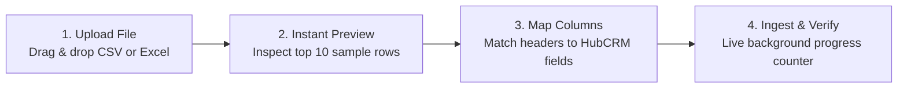

# CSV & Excel Data Migration with Atomic Rollback Guide

If your company currently tracks customer relationships in **Excel spreadsheets**, **Google Sheets**, or another CRM like **Zoho, HubSpot, or Pipedrive**, importing your historical data into HubCRM is fast, clean, and completely risk-free.

HubCRM's **Stream Ingestion Engine** (`/admin/migration`) can process spreadsheets with over 50,000 rows in minutes while featuring an **Atomic Rollback safety net** that lets you undo an entire import with a single click if you make a mistake!

---

## 📑 Preparing Your Spreadsheet for Import

Before uploading, ensure your spreadsheet follows three simple best practices:

1. **Header Row:** The first row of your file should contain clean column labels (e.g., `Full Name`, `Company`, `Phone`, `Email`, `City`, `Deal Value`).
2. **File Format:** Save your spreadsheet as a standard **.CSV (Comma Separated Values)** or **.XLSX (Excel)** file.
3. **Phone Numbers:** Ensure mobile numbers include country codes for 1-click WhatsApp and calling.

---

## 🚀 The 4-Step Import Wizard

### Step 1: Upload Your File
1. Go to **Admin ➔ Migration** and click **Import from CSV / Excel**.
2. Drag and drop your file into the upload zone.

### Step 2: Live 10-Row Preview
* HubCRM immediately renders a preview table showing the top 10 rows of your file.
* This allows you to verify that characters, accents, and column headers look completely normal before any data touches your database.

### Step 3: Visual Column Mapping
Match your spreadsheet headers to HubCRM fields:
* `Spreadsheet: Client Contact` ➔ `HubCRM: Full Name`
* `Spreadsheet: Organization` ➔ `HubCRM: Company Name`
* `Spreadsheet: Mobile` ➔ `HubCRM: Phone Number`
* `Spreadsheet: Estimated Budget` ➔ `HubCRM: Deal Value`

### Step 4: Duplicate Detection Strategy
Choose how HubCRM handles records that already exist in your system:
* **Skip Duplicates (Recommended):** If a phone number or email already exists, skip it to prevent clutter.
* **Update / Overwrite:** Update the existing customer profile with the newer details from the spreadsheet.
* **Create Anyway:** Force create duplicate records.

Click **Start Import**. The background worker processes thousands of rows smoothly while you continue working!

---

## ⏪ The Safety Net: 1-Click Atomic Rollback

Did you map the wrong column by mistake? Or realize someone gave you an outdated spreadsheet from two years ago?

**Don't panic!** HubCRM tracks every import as an isolated batch job:

1. Go to **Admin ➔ Migration ➔ Import History**.
2. Locate the batch you just performed.
3. Click the red **Rollback Batch (⏪)** button.
4. **What Happens:**
   * HubCRM atomically deletes every single contact, lead, and deal created during that specific upload batch in seconds.
   * Your existing, historical customer records remain 100% safe and untouched!
   * You can correct your spreadsheet headers and re-import with complete peace of mind.
