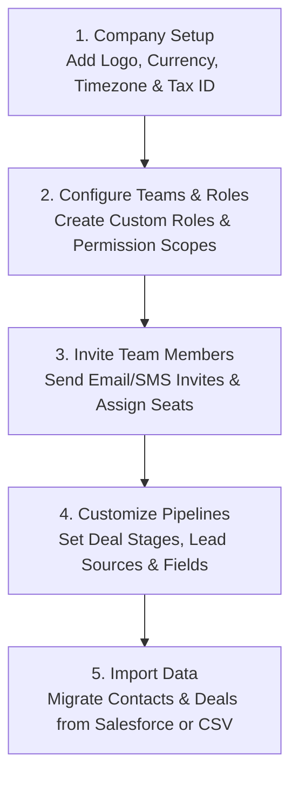

# Company Administrator Workspace Overview & Architecture

As the **Company Administrator** (Tenant Admin) of HubCRM, you hold the keys to your organization's sales, marketing, billing, and customer operations. Your role is to set up a frictionless digital environment where your teams can collaborate securely and perform at their peak.

HubCRM's **Admin Control Center** (`/admin/*`) allows you to configure organization branding, invite and manage staff members, build custom roles, customize pipeline stages, and import existing data from legacy CRMs like Salesforce.

{ width="90" }

---

## 🎯 What Does the Company Admin Do?

As the primary tenant administrator, your core responsibilities include:

* 👥 **User Management & Seat Allocation**: Onboard new employees, assign them to branches, and manage software license seats.
* 🛡️ **Role-Based Access Control (RBAC)**: Ensure employees only see the data they need (e.g., sales reps only see their own assigned leads, while managers see team totals).
* ⚙️ **CRM Customization**: Tailor deal pipeline stages, custom fields, and lead qualification rules to match your exact business model.
* 📦 **Enterprise Data Migration**: Connect to Salesforce via OAuth or import CSV spreadsheets with visual field-mapping and atomic rollback safety.
* 🔍 **Security & Audit Monitoring**: Review immutable security logs, track user login locations, and enforce Two-Factor Authentication (MFA).

---

## 🧭 The Administrator Setup Journey

Setting up HubCRM for your company follows five simple steps:

---

## 🖥️ Screen Tour: Admin Navigation

When you log in with an Administrator profile, the sidebar provides complete administrative control:

| Admin Menu Item | Icon | What You Do Here |
| :--- | :--- | :--- |
| **Admin Dashboard** | 📊 | Organization overview: active users, license utilization, system health, and storage quota. |
| **User Directory** | 👤 | Add, invite, edit, or deactivate employee accounts across all branches. |
| **Roles & Permissions** | 🛡️ | Create tailored security roles (e.g., *Junior Sales Rep, Senior Closer, Finance Admin*). |
| **Teams & Departments** | 🏢 | Group employees into regional sales teams, marketing pods, and support desks. |
| **CRM Pipeline Control** | ⚙️ | Add custom stages to your deal Kanban boards, set mandatory fields, and define lead sources. |
| **Data Migration** | 🔄 | Connect to Salesforce or upload large CSV data files with live progress tracking. |
| **Security Audit Logs** | 🔒 | Complete historical record of every login, data export, and permission modification. |
| **Integrations** | 🔌 | Connect telephony VoIP gateways, HubNotification WhatsApp keys, and Stripe/Razorpay. |
| **Company Billing** | 💳 | View your HubNest software subscription plan, download monthly invoices, and add license seats. |
| **Workspace Settings** | ⚙️ | Configure company name, primary address, corporate logo, and fiscal calendar. |

---

## 📚 What's in this Company Admin Manual?

Follow these step-by-step guides to master your administration tasks:

1. [User Onboarding & Seat Management](users-onboarding.md): How to invite staff and manage license seats.
2. [Roles & Permissions (RBAC)](roles-permissions.md): Build custom security roles with granular permissions.
3. [Teams & Department Hierarchies](teams-hierarchy.md): Organize reps and managers into functional pods.
4. [CRM Pipeline & Field Customization](crm-control.md): Customize deal stages, fields, and qualification rules.
5. [Salesforce Data Migration](salesforce-migration.md): 1-click OAuth connection and field-mapping canvas.
6. [CSV Data Stream Ingestion](csv-migration.md): Upload large spreadsheets with rollback safety.
7. [Security & Audit Trails](audit-logs.md): Monitor employee activity, exports, and login security.
8. [Ecosystem Integrations](integrations.md): Connecting Keycloak SSO, VoIP telephony, and payments.
9. [Billing & Subscriptions](billing-subscriptions.md): Manage your HubNest software plan and seat licenses.
10. [Workspace Profile & Branding](profile-settings.md): Set up company logos, tax numbers, and timezones.
