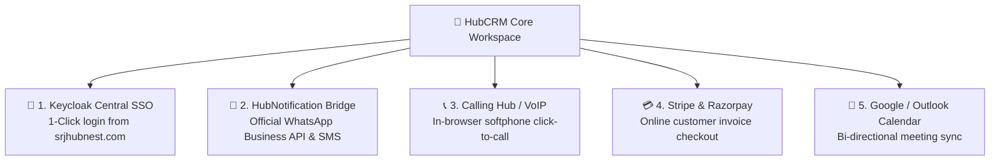

# Ecosystem Integrations Guide (SSO, VoIP, WhatsApp & Payments)

HubCRM is designed to be the central nervous system of your business. Rather than existing as an isolated silo, it connects natively with the entire **HubNest Enterprise Ecosystem** and leading global payment gateways.

The **Integrations Hub** (`/admin/integrations`) allows administrators to activate and configure these connections with straightforward setup cards.

---

## 🔌 Connected Ecosystem Overview

---

## 🛠️ Step-by-Step Integration Setup

### 1. Central Keycloak SSO (Single Sign-On)
* **What It Does:** Allows your team to log in once at `srjhubnest.com` and jump directly into HubCRM without entering passwords again.
* **How to Enable:** In the Keycloak card, toggle **Enable Central Platform SSO** to **ON**. HubCRM automatically synchronizes roles and permissions.

### 2. HubNotification (WhatsApp & SMS)
* **What It Does:** Powers 1-click WhatsApp messaging and automated delivery receipts.
* **How to Connect:** Click **Connect HubNotification**, enter your Tenant Webhook Secret, and choose your verified WhatsApp Business phone number.

### 3. VoIP Softphone & Calling Hub
* **What It Does:** Enables the green phone call button for in-browser telephony calling.
* **How to Connect:** Under **Telephony Integration**, select your company SIP provider or connect directly to **HubNest Calling Hub**. Enter your virtual number and click **Test Call**.

### 4. Payment Gateways (Stripe & Razorpay)
* **What It Does:** Powers the online customer payment portal so clients can pay invoices via credit cards and UPI.
* **How to Connect:**
  * For **Razorpay:** Enter your `Key ID` and `Key Secret`.
  * For **Stripe:** Enter your `Publishable Key` and `Restricted API Secret`.
  * Click **Save & Test Connection**. HubCRM verifies the API keys instantly.

### 5. Google Calendar & Microsoft Outlook
* **What It Does:** Synchronizes sales demos and follow-up tasks directly to your reps' personal phone calendars.
* **How to Connect:** Click **Sign in with Google** or **Sign in with Microsoft 365** and authorize calendar access.
