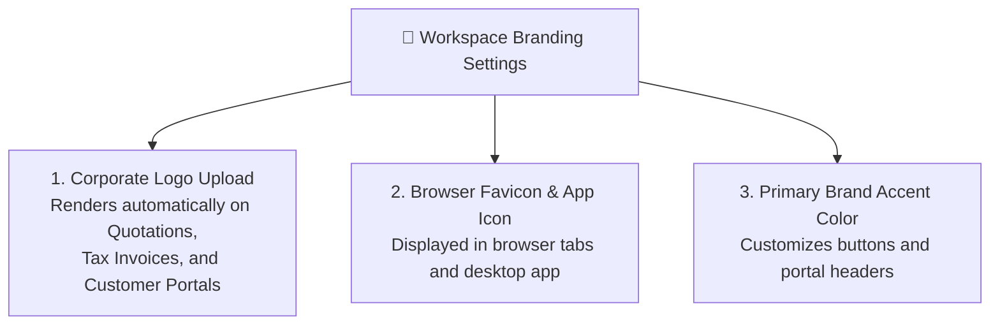

# Workspace Settings, Branding & Regional Localization Guide

Setting up your organization's corporate identity ensures that every quotation, invoice, email, and customer portal reflects your brand with high professionalism. The **Workspace Settings** screen (`/admin/settings`) is where administrators customize these essential global defaults.

---

## 🎨 Corporate Branding & Logos

Your logo and colors are used across the entire HubNest suite:

### Steps to Update Branding:
1. Navigate to **Admin ➔ Workspace Settings ➔ Branding**.
2. **Upload Primary Logo:** Upload a high-resolution PNG or SVG logo (recommended dimensions: 400x120 pixels with transparent background).
3. **Upload Square Icon / Favicon:** Upload a 64x64 pixel square icon for browser tabs.
4. **Brand Accent Color:** Choose your company's primary corporate color (e.g., `#6366F1` or `#10B981`).
5. Click **Save Changes**.

---

## 🌍 Regional Localization & Currency Settings

Ensure date formats, times, and currencies match your regional business norms:

* **Default Currency:** Select your primary transaction currency (e.g., `INR (₹)`, `USD ($)`, `EUR (€)`, `GBP (£)`, or `AED (د.إ)`). All pipeline deal values and revenue forecasts will format automatically.
* **Timezone:** Select your primary office timezone (e.g., `Asia/Kolkata (GMT+5:30)`). This ensures meeting schedules and task due dates alert employees at the correct local hour.
* **Date Display Format:** Choose your preferred format (e.g., `DD/MM/YYYY` or `MM/DD/YYYY`).
* **Fiscal Year Start:** Select your accounting year start month (e.g., `April` for India/UK businesses, or `January` for US calendar years).

---

## 🏢 Legal Company & Tax Information

This information automatically populates the header and footer of your customer tax invoices:
* **Legal Registered Name:** e.g., *"Apex Enterprise Solutions Private Limited"*.
* **Tax Identification Number (GSTIN / VAT ID):** Your official corporate tax number.
* **Registered Office Address:** Street address, city, state, postal code, and country.
* **Corporate Website & Support Hotline:** Displayed on client proposal footers.
