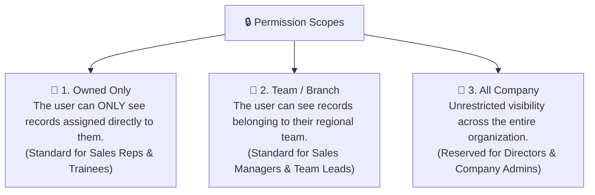

# Roles & Permissions (RBAC) & Custom Role Builder Guide

Data security and privacy are essential for every growing company. A junior sales rep shouldn't be able to export your entire customer list to Excel or view company tax invoices. Similarly, a support agent shouldn't have access to unapproved commercial contracts.

HubCRM's **Role-Based Access Control (RBAC)** (`/admin/roles`) lets administrators define exactly what each employee can **View**, **Create**, **Edit**, **Delete**, or **Export**.

---

## 🛡️ Understanding the 3 Permission Scopes

When you assign permissions to any module (like Leads or Deals), you choose from three distinct security scopes:

---

## 📋 Standard Roles Included with HubCRM

HubCRM comes pre-configured with six battle-tested roles ready to use on day one:

| Pre-Built Role | Description & Typical Scope |
| :--- | :--- |
| **Company Administrator** | Full unrestricted access to all modules, settings, billing, user management, and data migration. |
| **Sales Manager** | Full access to team pipelines, discount approvals, rep targets, activity audits, and sales reports. |
| **Sales Representative** | Access to assigned leads, deal pipeline, contacts, and tasks. Cannot export data or view invoices. |
| **Marketing Specialist** | Access to campaigns, AI Studio, landing pages, web forms, and lead generation analytics. |
| **Finance Officer** | Access to invoice creation, online payment reconciliation, expense tracking, and vendor ledgers. |
| **Support Agent** | Access to customer ticket queues, SLA resolution, and knowledge base publishing. |

---

## ➕ How to Build a Custom Role

If your organization has unique requirements (for example, you want to create a *"Senior Deal Closer"* role that can view all team deals but cannot delete customer records):

1. Go to **Admin ➔ Roles & Permissions** and click **+ Create Custom Role**.
2. Give the role a clear title (e.g., *"Junior Sales Intern"* or *"Regional Director"*).
3. **Configure the Module Permissions Matrix:**  
   For each module, check or uncheck the allowed actions:

| Module | View Scope | Can Create? | Can Edit? | Can Delete? | Can Export to Excel? |
| :--- | :--- | :--- | :--- | :--- | :--- |
| **Leads** | *Owned Only* | ✅ Yes | ✅ Yes | ❌ No | ❌ No |
| **Deals** | *Owned Only* | ✅ Yes | ✅ Yes | ❌ No | ❌ No |
| **Invoices** | *No Access* | ❌ No | ❌ No | ❌ No | ❌ No |
| **Reports** | *Owned Only* | ❌ No | ❌ No | ❌ No | ❌ No |

4. Click **Save Role**. You can now assign this custom role to any new or existing team member in the User Directory!
