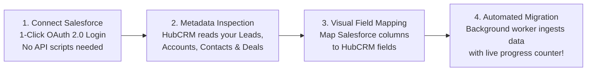

# Salesforce Enterprise Migration Guide

Migrating from a legacy CRM like **Salesforce** to HubCRM saves organizations tens of thousands of dollars in licensing fees while providing modern, integrated WhatsApp, VoIP, and HRMS tools. However, business leaders are often terrified of losing customer history or dealing with broken data.

HubCRM features a **1-Click Salesforce Migration Engine** (`/admin/migration`) that imports your entire Salesforce Org directly through secure APIs without touching messy CSV files.

---

## ⚡ The 4-Step Migration Journey

---

## 🔌 Step 1: Connecting Salesforce via OAuth 2.0

1. Go to **Admin ➔ Migration** and select **Salesforce Connector**.
2. Click the blue **Connect Salesforce Org** button.
3. You will be redirected to the official Salesforce login portal:
   * Choose **Production Environment** or **Sandbox Environment** (for testing).
   * Enter your Salesforce System Administrator credentials.
   * Click **Allow Access** to authorize the secure OAuth API bridge.
4. Upon approval, you are returned to HubCRM with a green status badge:  
   > **🟢 Connected to Salesforce Org:** *Production Instance (00D8c000008x...)*

---

## 🔍 Step 2: Object Selection & Inspection

HubCRM automatically inspects your remote Salesforce schema and presents four core standard objects:

* **Leads:** Prospective inquiries, lead sources, and ratings.
* **Accounts:** Corporate company profiles, billing addresses, and website domains.
* **Contacts:** Individual human contacts, phone numbers, and job titles.
* **Opportunities (Deals):** Active pipeline stages, deal values, and close dates.

Select the objects you wish to migrate (e.g., select all four to migrate your entire CRM history).

---

## 🗺️ Step 3: Visual Field-Mapping Canvas

HubCRM's smart mapper automatically links matching fields, but allows you to review and adjust every single column:

| Salesforce Remote Field | Mapping Action | HubCRM Target Field |
| :--- | :--- | :--- |
| `Lead.FirstName` | ➔ Maps To | `Lead ➔ First Name` |
| `Lead.LastName` | ➔ Maps To | `Lead ➔ Last Name` |
| `Lead.Company` | ➔ Maps To | `Lead ➔ Company Name` |
| `Opportunity.Amount` | ➔ Maps To | `Deal ➔ Deal Value` |
| `Opportunity.StageName` | ➔ Maps To | `Deal ➔ Pipeline Stage` |
| `Custom_ERP_Code__c` | ➔ Maps To | `Custom Field ➔ ERP ID` |

* **Preserving Ownership:** HubCRM maps your Salesforce user accounts to your new HubCRM employees so reps keep their exact deals!

---

## 🚀 Step 4: Running the Background Migration

1. Click **Start Automated Migration**.
2. The migration runs smoothly in the background:
   * **Live Percentage Counter:** Watch the progress bar (e.g., *"14,200 of 18,500 records imported"*).
   * **Safe to Close Window:** You can close your computer or work on other tasks; the server completes the import automatically.
3. Once completed, a celebration summary displays:  
   > **🎉 Migration Complete:** *4,820 Accounts, 9,140 Contacts, and 2,450 Active Deals successfully migrated with zero errors!*
