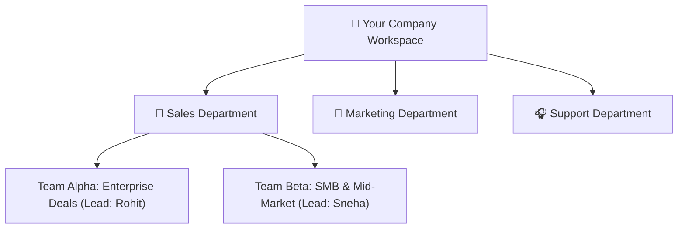

# Teams & Department Hierarchies Guide

As a company grows past 10 employees, managing everyone in a single flat list creates confusion. In HubCRM, the **Teams & Departments Hub** (`/admin/teams`) lets administrators organize staff into functional departments, regional territories, and specialized pods.

---

## 🏢 Why Structure Staff into Teams?

* **Targeted Lead Distribution:** Automatically route high-value inquiries to the *Enterprise Pod* and fast-moving inquiries to the *SMB Pod*.
* **Managerial Scopes:** Team leads only manage and review pipeline numbers for their assigned team members.
* **Aggregated Team Quotas:** Department targets (e.g., *₹50,00,000 / month*) automatically tally from the individual members of each pod.

---

## ➕ Creating a Team in 3 Simple Steps

1. Go to **Admin ➔ Teams** and click **+ Create Team**.
2. Fill in the team properties:
   * **Team Name:** e.g., *"Western India Enterprise Sales Pod"*.
   * **Department:** Select *Sales, Marketing, Finance,* or *Customer Support*.
   * **Designated Team Lead:** Select the manager or team lead who will oversee quotas, deal approvals, and activity audits for this group.
3. **Add Team Members:**
   * Select the sales executives or specialists who belong to this team.
4. Click **Save Team**.

---

## 🔄 Re-organizing or Merging Teams

When promotions occur or regional territories change:
* **Change Team Lead:** Open the team profile, select a new leader from the dropdown, and click **Save**.
* **Transfer Members:** Click **Add / Remove Members** to move reps between teams seamlessly without altering their assigned leads or historical closed revenue.
