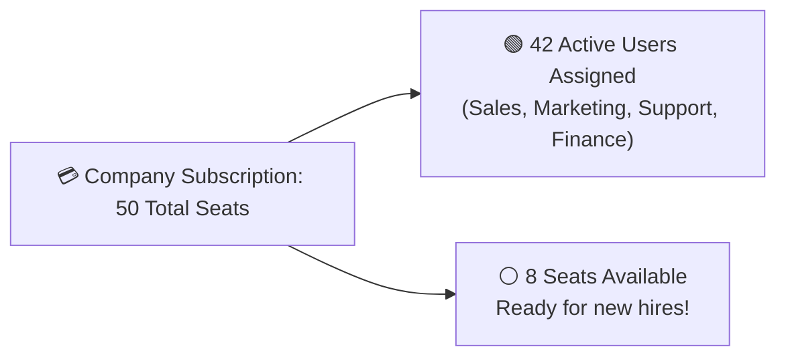

# User Onboarding, Branch Allocation & License Seats Guide

Adding new team members should be fast and simple. In HubCRM, the **User Directory** (`/admin/users`) gives administrators complete control over employee access, role assignments, branch locations, and software license seats.

---

## 👥 Understanding User Licenses & Seats

Your company subscription includes a set number of **Active User Seats** (for example, *50 User Licenses*):

* **Active User:** Consumes 1 license seat. The user can log in and manage data.
* **Deactivated User:** Consumes **0 license seats**. Their login access is permanently revoked, but **100% of their historical calls, customer notes, and closed deals remain safely preserved in your database!**

---

## ➕ How to Invite a New Employee in 4 Steps

1. Navigate to **Admin ➔ Users** and click the blue **+ Invite User** button.
2. Fill in the employee's details:
   * **Full Name:** First and last name.
   * **Corporate Email Address:** Their official work email (used for login and password creation).
   * **Mobile Phone Number:** For Two-Factor Authentication (OTP) and VoIP softphone routing.
3. **Assign Role & Branch:**
   * **Assigned Role:** Select their role (e.g., *Sales Executive, Sales Manager, Marketing Specialist, Finance Officer, Support Agent*).
   * **Office Branch:** Select their physical or virtual branch (e.g., *Mumbai Office, Bangalore Tech Center, Remote Team*).
4. Click **Send Invitation**.

### What the New Employee Experiences:
* The employee receives an invitation email and SMS containing a secure, 1-time activation link.
* They click the link, set their private password, and verify their phone OTP.
* They are instantly logged into their tailored dashboard with the exact tools needed for their specific job!

---

## 🛑 How to Deactivate a Departing Employee

When an employee resigns or transitions to another company:

1. In the **User Directory**, locate the employee's name.
2. Click the three dots (⋮) and select **Deactivate User**.
3. **Smart Reassignment Wizard:** HubCRM prompts you:  
   > *"Suresh Verma currently owns 24 active leads and 6 pipeline deals. Who should take over these records?"*
4. Select a teammate (e.g., *Priya Sharma*) to inherit the active pipeline.
5. Click **Confirm Deactivation**.
6. **Results:**
   * Suresh's login session is terminated immediately across all devices.
   * His 30 active deals and leads are transferred seamlessly to Priya with zero downtime.
   * 1 user seat is immediately freed up for your next hire!
