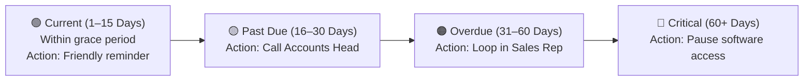

# Finance Dashboard & Receivables Aging Guide

The **Finance Dashboard** (`/finance/dashboard`) provides a clear, real-time command center for managing company cashflow. Instead of chasing sales reps for invoice statuses or reconciling bank statements manually, HubCRM organizes your revenue collections in one place.

---

## 📊 Executive Cashflow Cards

At the top of your finance dashboard, four primary financial indicators summarize your company's fiscal health:

| Financial Card | What It Shows | Finance Officer Action |
| :--- | :--- | :--- |
| **Total Collected (MTD)** | Total cleared cash received in your company bank account during the current month. | Compare against monthly operational payroll and overhead expenses. |
| **Outstanding Receivables** | Total value of invoices issued to clients that have not yet reached their payment due date. | Monitor upcoming cash inflow for the next 15–30 days. |
| **Overdue Invoices Value** | Total cash past its agreed payment due date. | **Needs immediate attention!** Prioritize client reminders and follow-ups. |
| **Expenses (MTD)** | Total logged operational costs, supplier payouts, and employee expense claims. | Track operating profit margins in real time. |

---

## ⏳ The Accounts Receivable Aging Report

HubCRM groups your unpaid client balances into clear **Aging Buckets** so you can prioritize collections strategically:

* **Current (1–15 Days):** Normal payment processing window.
* **Past Due (16–30 Days):** Send a polite automated reminder.
* **Overdue (31–60 Days):** Alert the assigned sales rep to step in and assist.
* **Critical (60+ Days):** System alerts account administrators to temporarily pause active software licenses until balance is cleared.

---

## 🔔 1-Click Payment Reminder Dispatch

Chasing payments shouldn't require writing dozens of manual emails every week:

1. In the **Overdue Invoices Table**, find the client who hasn't paid.
2. Click the **Send Reminder** button:
   * **Send via WhatsApp (💬):** Dispatches a polite, formal reminder directly to the client's Accounts department with a secure 1-click payment link.
   * **Send via Email (✉️):** Sends a professional reminder with the original invoice PDF attached.
3. HubCRM logs the reminder timestamp, so you can track how many notices have been issued before escalating.
