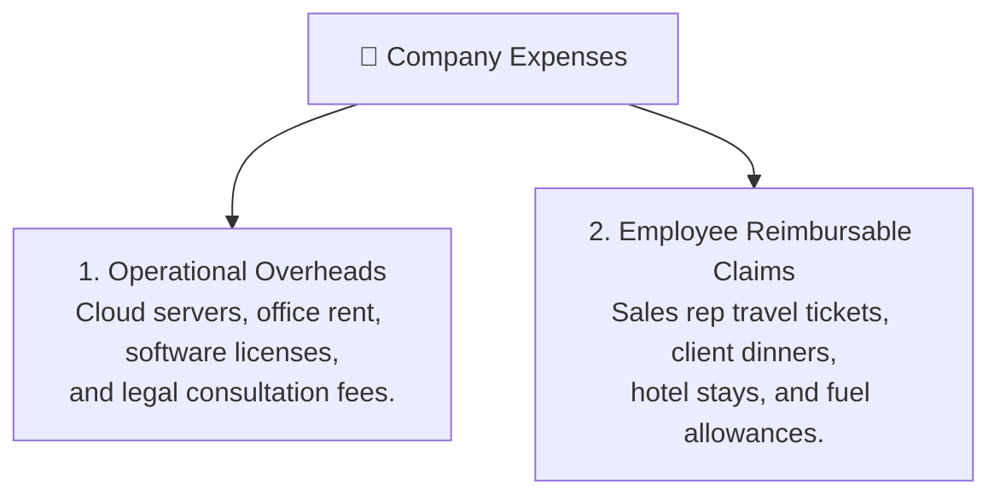

# Company Expense Tracking & Reimbursable Claims Guide

Knowing your revenue is only half the financial picture — true business health requires tracking the costs incurred to win and deliver those deals. HubCRM's **Expense Tracking Center** (`/finance/expenses`) lets finance officers record operational overheads and process employee expense claims in one organized place.

---

## 💸 The Two Main Categories of Expenses

HubCRM organizes company expenses into two clear buckets:

1. **Company Operational Expenses:** Fixed and recurring overheads paid directly by the company.
2. **Sales Reimbursable Claims:** Expenses paid out-of-pocket by sales reps during client meetings, submitted for managerial approval and payroll reimbursement.

---

## ➕ How to Log an Expense in 3 Steps

1. Navigate to **Finance ➔ Expenses** and click **+ Add Expense**.
2. Fill in the straightforward fields:
   * **Expense Category:** Pick from standard categories (*Travel & Conveyance, Meals & Client Entertainment, Software & Subscriptions, Office Supplies, Advertising*).
   * **Amount & Currency:** Enter the exact spent amount.
   * **Tax Paid (GST/VAT):** Enter any input tax credit claimed on the bill.
   * **Payment Date:** Date the transaction occurred.
   * **Payment Mode:** Select *Company Credit Card, Petty Cash, or Employee Personal Card (Reimbursable)*.
   * **Attach Receipt:** Upload a photo of the bill, fuel slip, or hotel tax invoice.
3. **Optional Deal Linking:** Link the expense to a specific customer account or active deal. This allows HubCRM to show the **true net profit margin** on that client!
4. Click **Save Expense**.

---

## 🔍 Reviewing & Approving Sales Travel Claims

When a sales executive returns from a client visit and submits a travel claim:

1. Open the **Reimbursements Pending** tab.
2. Review the claim:
   * Rep name, date, and purpose of travel (e.g., *"Client on-site software demo in Pune"*).
   * Attached boarding passes, taxi receipts, or hotel bills.
3. Click **Approve for Payment**:
   * The amount is queued for disbursement in the upcoming payroll cycle or direct bank transfer.
   * The sales rep receives an automated alert: *"Your travel claim for ₹4,200 has been approved by Accounts."*
