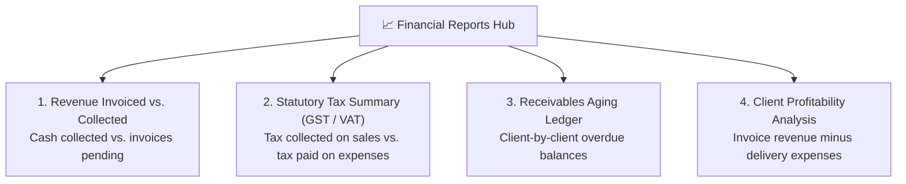

# Financial Reports, Tax Ledgers & Cashflow Export Guide

At the end of every month and financial quarter, finance teams must reconcile accounts, file statutory tax returns, and present cashflow numbers to company auditors. HubCRM's **Financial Reports Hub** (`/finance/reports`) generates audit-ready reports in one click.

---

## 📊 Core Financial Reports Available

---

## 📑 Walkthrough of Key Reports

### 1. Invoiced vs. Collected Revenue Report
* **What It Tells You:** Compares the total value of invoices you issued against the actual cleared cash collected in your bank account for any calendar month.
* **Why It Matters:** Helps leadership see whether revenue growth is translating into real liquidity or piling up in unpaid credit.

### 2. Statutory Tax Summary (GST / VAT / Sales Tax)
* **Output Tax Collected:** Total GST/VAT charged to clients across all sales invoices.
* **Input Tax Credit (ITC):** Total tax paid by your company on approved supplier bills and operational expenses.
* **Net Tax Payable:** Automatically calculates: `Output Tax - Input Tax Credit = Net Payable to Government`.

### 3. Client Outstanding Ledger
* Detailed, client-by-client breakdown of:
  * Total lifetime billed amount.
  * Total payments cleared.
  * Current outstanding balance.
  * Days overdue.

---

## 📥 Exporting to Excel, Tally & QuickBooks

HubCRM makes collaborating with external accountants and auditors painless:

1. Select the desired report from the left menu.
2. Choose your **Date Range** (e.g., *October 1 – October 31* or *Full Financial Year*).
3. Click **Export**:
   * **Export to Excel (.xlsx):** Fully formatted with summary formulas and company headers.
   * **Export to CSV:** Standard format ready for direct import into **Tally, QuickBooks, Zoho Books, or SAP**.
   * **Export to PDF:** Executive summary ready for board presentations.
