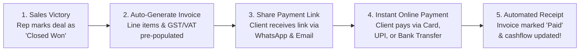

# Finance & Accounts Officer Overview & Billing Operations

Revenue closed by sales representatives only benefits the company when cash is successfully collected and accounted for. As a **Finance & Accounts Officer**, your mission is to issue accurate tax invoices, manage seamless customer payment experiences, track overdue receivables, and monitor business cashflow.

HubCRM's **Finance & Invoicing Hub** (`/finance/*`) brings invoicing, online payments, expense logging, and vendor management directly into your CRM workspace, eliminating manual handoffs between sales and accounting.

{ width="90" }

---

## 🎯 What Does HubCRM Do for Finance Teams?

HubCRM automates the repetitive friction in corporate billing:

* 🚫 **No More Re-Typing Sales Orders**: When a deal is marked "Closed Won", its line items, customer details, and agreed pricing are automatically converted into an invoice draft.
* 🚫 **No More Manual Tax Calculation**: Automatic calculation of standard GST (CGST/SGST/IGST) or VAT tax schedules based on client location.
* 🚫 **Instant Online Customer Checkout**: Every invoice has a secure, 1-click payment link where clients can pay via Credit Card, UPI, Net Banking, or Wire Transfer (via Stripe / Razorpay).
* 🚫 **Automated Payment Receipts**: When a payment succeeds, the invoice marks itself "Paid" and dispatches a stamped tax receipt to the client automatically.

---

## 🧭 The End-to-End Invoicing & Cash Collection Workflow

Here is how billing operations flow smoothly in HubCRM:

---

## 🖥️ Screen Tour: Finance Navigation

When you log into HubCRM with a Finance or Accounts profile, your sidebar reveals dedicated billing tools:

| Finance Menu Item | Icon | What You Do Here |
| :--- | :--- | :--- |
| **Finance Dashboard** | 📊 | Real-time cashflow: total revenue collected, outstanding accounts receivable, and overdue invoices. |
| **Invoices Ledger** | 🧾 | Searchable directory of all draft, issued, paid, and cancelled tax invoices. |
| **Public Payment Links** | 💳 | Manage secure online customer checkout portals and payment gateway settings. |
| **Payment Verifications**| 🛡️ | View automated transaction receipts and reconcile manual bank NEFT/RTGS transfers. |
| **Expense Tracking** | 💸 | Log operational expenses, sales team travel reimbursements, and office software costs. |
| **Vendor Directory** | 🏢 | Maintain approved supplier lists, vendor contracts, and payout schedules. |
| **Financial Reports** | 📈 | Generate tax liability reports (GST-R1), monthly cashflow summaries, and ledger exports. |

---

## 📚 What's in this Finance Manual?

Follow these step-by-step guides to master your billing workflows in HubCRM:

1. [Finance Dashboard & Receivables](dashboard.md): Monitor monthly revenue, overdue payments, and cashflow.
2. [Generating Invoices & Taxes](invoice-generation.md): How to draft GST/VAT invoices with custom line items.
3. [Public Customer Payment Portals](public-payments.md): How clients view and pay invoices online.
4. [Payment Reconciliation & Receipts](payment-verification.md): Verifying bank transfers and sending receipts.
5. [Company Expense Management](expense-management.md): Logging reimbursable and operational expenses.
6. [Vendor Management & Payouts](vendor-contracts.md): Managing supplier contracts and vendor records.
7. [Financial Reporting & Exports](financial-reports.md): Exporting tax ledgers and revenue summaries.
