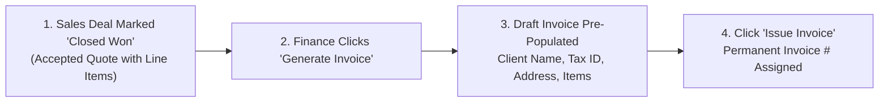

# Creating GST & VAT Invoices Guide

Creating an invoice should be fast, accurate, and fully compliant with tax laws. HubCRM's **Invoicing Engine** (`/finance/invoices`) allows you to generate compliant, beautifully branded tax invoices in under two minutes — either by auto-converting an accepted sales quote or building one from scratch.

---

## 🧾 1-Click Conversion from Sales Deals

When a sales executive marks a deal as **Closed Won**, you don't need to re-enter anything:

1. Go to **Finance ➔ Invoices**.
2. Click the **Pending from Sales** tab.
3. Locate the won deal and click **Generate Invoice**.
4. The customer's legal company name, billing address, tax identification number (GSTIN / VAT), and all quoted line items are pre-filled automatically!

---

## ➕ Creating an Invoice from Scratch

If you need to bill an existing client for ad-hoc services, renewals, or custom development:

1. Click **+ New Invoice** in the top-right corner.
2. Select the **Customer Account** from your directory (HubCRM automatically loads their verified billing address and Tax ID).
3. Set the **Invoice Dates**:
   * **Issue Date:** Today's date.
   * **Payment Terms:** Select *Due Upon Receipt*, *Net 15 Days*, or *Net 30 Days*.
4. **Add Line Items:**
   * Pick products from your catalog or enter custom descriptions.
   * Enter **Quantity** and **Unit Price**.
5. **Automated Tax Calculation (GST / VAT):**
   * If customer is in the same state: HubCRM applies **CGST (9%) + SGST (9%)**.
   * If customer is in another state: HubCRM applies **IGST (18%)**.
   * If client is international: HubCRM applies **0% Export Tax Schedule**.
6. Review the calculated **Subtotal, Taxes, and Grand Total**.

---

## 🏦 Bank Account & Payment Instructions

Every issued invoice automatically renders your company's official payment collection credentials at the bottom of the page:

* **Bank Account Details:** Bank Name, Account Holder, Account Number, and IFSC/SWIFT Code.
* **Scan-to-Pay QR Code (UPI / Mobile):** Clients can scan the QR code with their mobile banking app for instant zero-fee settlement.
* **Online Payment Link:** Direct button to pay via Credit Card or Net Banking.

---

## 🔒 Draft vs. Issued: Why It Matters

* **Draft Status (Editable):** Use Draft mode while confirming purchase order (PO) numbers or tax details with the client. You can edit line items and numbers freely.
* **Issued Status (Immutable Legal Record):** Once you click **Issue Invoice**, HubCRM locks the document and assigns a permanent, sequential invoice number (e.g., `INV-2026-0418`).
* **Correcting Mistakes:** If an issued invoice has an error, accounting compliance forbids deleting it. Simply click **Issue Credit Note** to cleanly reverse the charge.
