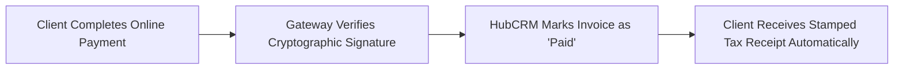

# Payment Reconciliation & Automated Receipts Guide

Accurate bookkeeping requires verifying that every single transaction matches an official invoice. HubCRM handles this in two ways: **100% automated reconciliation for online payments**, and a **simple 2-click process for manual bank wire transfers**.

---

## ⚡ Automated Online Reconciliation (Zero Manual Effort)

When a customer pays through the online payment portal (using Credit Card, UPI, or Net Banking):

* **No Manual Matching Needed:** HubCRM's automated webhook integration detects the successful transaction, records the gateway transaction ID (e.g., `pay_Op98xL2`), marks the invoice as **Paid**, and deducts the amount from your outstanding receivables ledger instantly.

---

## 🏦 Reconciling Manual Bank Wire Transfers (NEFT / RTGS)

When an enterprise client pays via offline bank transfer and emails an accounting slip or UTR number:

1. Go to **Finance ➔ Invoices** and locate the unpaid invoice.
2. Click the **Record Payment** button on the right.
3. Fill in the simple reconciliation details:
   * **Payment Date:** Date the funds cleared in your company bank account.
   * **Amount Received:** Enter the exact amount credited (e.g., *₹2,50,000*). *(Supports partial payments if the client paid an advance deposit).*
   * **Payment Method:** Select *Bank Transfer (NEFT/RTGS)*, *Cheque / Draft*, or *Direct Cash*.
   * **Transaction Reference / UTR Number:** Type the bank reference number (e.g., `HDFC26101678942`).
   * **Upload Bank Slip (Optional):** Attach a screenshot or PDF of the bank credit advice.
4. Click **Confirm Payment**.
5. The invoice status immediately updates to **Paid** (or **Partially Paid** if a balance remains).

---

## 📄 Automated Payment Receipts

As soon as a payment is recorded (online or manual):

* HubCRM generates an official, stamped **Payment Receipt PDF** containing:
  * Official Receipt Number (e.g., `REC-2026-0512`).
  * Linked Invoice Reference (`INV-2026-0418`).
  * Amount Paid, Balance Remaining, and Tax Cleared.
* The client receives an automated WhatsApp and Email alert with their receipt attached.
* The sales representative who closed the deal receives a notification celebrating that their customer has finalized payment!
