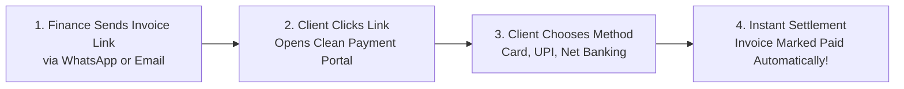

# Online Customer Payment Portals Guide (Stripe & Razorpay)

Waiting for paper cheques or manual bank wire receipts can delay cashflow by weeks. HubCRM includes a **Self-Service Customer Payment Portal** (`/finance/invoices/public/:token`) that lets your clients review their invoice online and settle their balance in under 60 seconds.

---

## 🔒 What is the Public Payment Portal?

When you dispatch an invoice from HubCRM, the system generates a secure, tokenized web link (for example: `https://crm.srjhubnest.com/pay/inv-token-98f4a12`).

* **No Login Required for Customers:** Your client does not need a HubNest account or password to pay their bill.
* **Bank-Grade Encryption:** The payment portal connects directly to PCI-DSS certified gateways (**Stripe** and **Razorpay**). Your company never touches or stores sensitive credit card numbers.

---

## 💳 Supported Payment Methods for Clients

Depending on your company's payment gateway configuration, clients can pay using:

| Payment Method | Best For | Settlement Speed |
| :--- | :--- | :--- |
| **UPI / QR Code (Google Pay, PhonePe, Paytm)** | Domestic Indian clients; zero fees. | Instant (Real-Time) |
| **Credit & Debit Cards (Visa, MasterCard, Amex)** | Domestic and international clients. | Instant (Real-Time) |
| **Corporate Net Banking (50+ Banks)** | Large institutional transactions. | Instant (Real-Time) |
| **Bank Wire Transfer (NEFT / RTGS / IMPS)** | Enterprise purchases exceeding card limits. | 1–2 Business Hours |

---

## 🖥️ What the Customer Experiences

When your client clicks their invoice payment link, they see a clean, professional screen:

1. **Official Invoice Preview:** Shows your company branding, line items, and tax breakdown.
2. **Download PDF Button:** Allows the client to save a copy for their internal finance records before paying.
3. **Pay Online Button:**
   * Clicking **Pay Now** opens the payment modal.
   * The client selects their preferred payment method (e.g., *UPI QR Code* or *Corporate Card*).
   * Upon completing the transaction with their bank OTP, the screen immediately flashes green:  
     > **🎉 Payment Successful!** *Thank you for your payment of ₹1,18,000. An official receipt has been sent to your email.*
4. The invoice status in your HubCRM dashboard changes to **Paid** instantly!
