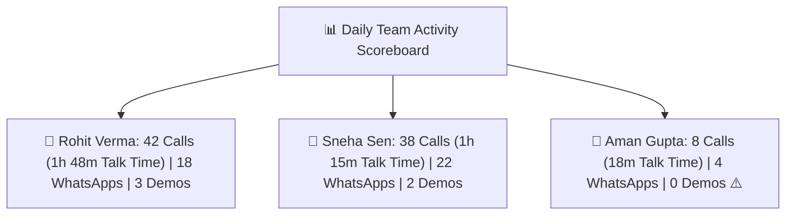

# Sales Activity Audit & Rep Coaching Guide

In sales management, **revenue is a lagging indicator** — by the time the month ends, it is too late to fix poor numbers. **Daily sales activities (calls, WhatsApp messages, and meetings) are leading indicators**. If your team makes 500 quality calls and sends 80 proposals this week, revenue will inevitably follow.

HubCRM's **Activity Audit Center** (`/sales-manager/activity-audit`) provides managers with complete, transparent operational visibility into daily rep effort without micromanagement.

---

## 📈 The Daily Activity Scoreboard

When you open the Activity Audit screen, you see a breakdown of effort across your entire sales team for any selected day or week:

| Rep Name | Outbound Calls | Talk Time | WhatsApps Sent | Demos Held | Tasks Completed |
| :--- | :--- | :--- | :--- | :--- | :--- |
| **Priya Sharma** | 45 | 2 hrs 10 mins | 24 | 4 | 28 |
| **Rohit Verma** | 42 | 1 hr 48 mins | 18 | 3 | 22 |
| **Sneha Sen** | 38 | 1 hr 15 mins | 22 | 2 | 19 |
| **Aman Gupta** | 8 ⚠️ | 18 mins ⚠️ | 4 ⚠️ | 0 | 6 ⚠️ |

* **Spotting Gaps Early:** In the example above, you immediately notice that Aman is struggling with outreach volume on Tuesday. You can coach him on Wednesday before his week is lost!

---

## 🎧 Listening to Call Recordings for Coaching

HubCRM's integrated softphone records calls so managers can provide targeted training:

1. In the **Call Logs** tab, locate any call record.
2. Click the **Play (▶️)** button to listen directly inside your browser:
   * **Adjust Speed:** Listen at 1.25x or 1.5x speed to review conversations quickly.
   * **Leave a Coaching Timestamp Note:** Add an internal comment (e.g., *"Great job handling the competitor objection at 02:15, Rohit!"*).
3. The rep receives your feedback note on their dashboard as an encouraging coaching tip.

---

## 💬 Reviewing WhatsApp & Message Transcripts

To ensure your team represents your brand with high professionalism:

1. Click on the **Messages Audit** tab.
2. Filter by rep or search for specific customer conversations.
3. Review message tone, template adherence, and response speed.
4. Verify that reps are answering customer questions promptly during business hours.

---

## 📑 Exporting Activity Reports for Appraisals

When preparing for monthly or quarterly 1-on-1 performance reviews:

1. Select the desired date range (e.g., *October 1 – October 31*).
2. Click the **Export to Excel / PDF** button in the top-right corner.
3. You will receive a clean, executive summary detailing total calls, talk time, tasks completed, and deals closed per rep to support fair, data-driven appraisals and bonus distribution.
