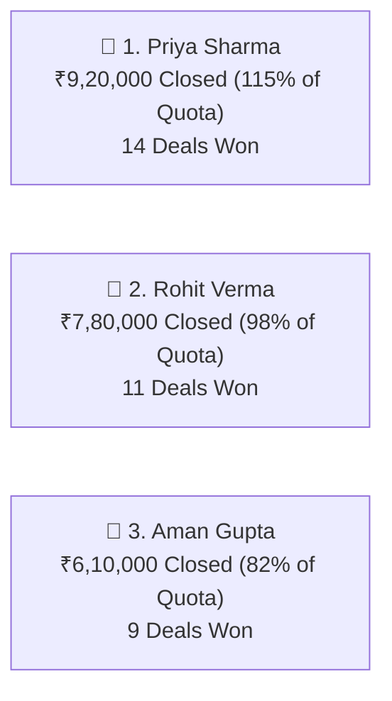

# Sales Manager Dashboard & Leaderboard Guide

The **Sales Manager Dashboard** (`/sales-manager/dashboard`) transforms complex sales data into clear, actionable visual insights. Instead of spending hours compiling spreadsheets, this screen gives you a live, accurate view of your team's collective momentum.

---

## 📊 Executive Team Summary Widgets

At the top of your manager dashboard, four core metrics give you the executive pulse of your sales department:

| Metric Card | What It Shows | Manager Takeaway |
| :--- | :--- | :--- |
| **Team Target vs. Actual** | Total revenue closed by your team against the monthly department target (e.g., *₹38,50,000 / ₹50,00,000 — 77% Achieved*). | Instantly shows whether your team is on track to hit the monthly goal. |
| **Total Open Pipeline** | Total value of all active deals currently in progress across all sales reps. | Healthy teams maintain **3x to 4x their remaining target** in open pipeline. |
| **Team Win Rate** | The percentage of qualified deals that your team successfully closes (e.g., *32%*). | Measures sales effectiveness and pitch quality. |
| **Pending Approvals** | Number of discount requests or custom quotations waiting for your review. | Needs immediate action so reps aren't delayed while closing deals! |

---

## 🏆 The Team Sales Leaderboard

Directly below the summary cards, the **Live Sales Leaderboard** ranks every sales representative on your team:

### Metrics Visible on the Leaderboard:
* **Rep Name & Photo:** The sales representative.
* **Target Quota:** Their assigned monthly target.
* **Closed Revenue:** Actual finalized revenue brought in.
* **% of Goal Achieved:** Visual progress bar (Green for >100%, Yellow for 70–99%, Red for <70%).
* **Deals Won vs. Lost:** Total deals closed this month.
* **Average Deal Size:** Helps spot reps who excel at large enterprise deals vs. those who close high-volume smaller packages.

!!! tip "Motivating Your Team"
    Displaying the leaderboard on a shared office TV screen or sharing weekly screenshots in your team chat creates healthy competition and celebrates top performers publicly!

---

## ⚠️ Manager Action Banners

HubCRM automatically highlights deals and leads requiring managerial intervention:

### 1. 🚨 Stalled Deals Alert
* **The Problem:** A deal has sat in the same stage (like *Proposal Sent*) for more than 14 days with no new call or email logged.
* **Manager Action:** Click the alert to see the list. You can schedule a 5-minute strategy huddle with the assigned rep to help them overcome client hesitation.

### 2. ✍️ Pending Quotation Approvals
* **The Problem:** A rep has drafted a quotation offering a 15% discount to a high-value customer, which exceeds their standard 10% limit.
* **Manager Action:** Click **Review**, inspect the gross margins, and click **Approve** or **Decline with Feedback**.

### 3. 📥 Unassigned Leads Pool
* **The Problem:** Fresh leads have arrived via an offline marketing campaign or partner referral and are waiting for an owner.
* **Manager Action:** Click **Assign Now** to route them evenly across your active team.

---

## 📅 Filtering and Branch Views

If you manage multiple regional offices or product teams:
* **Branch Filter:** Switch between *North Zone, West Zone, South Zone,* or view the aggregate total.
* **Date Range:** Toggle between *Current Month, Previous Month, Quarter-to-Date (QTD),* and *Year-to-Date (YTD)* for quarterly board reporting.
