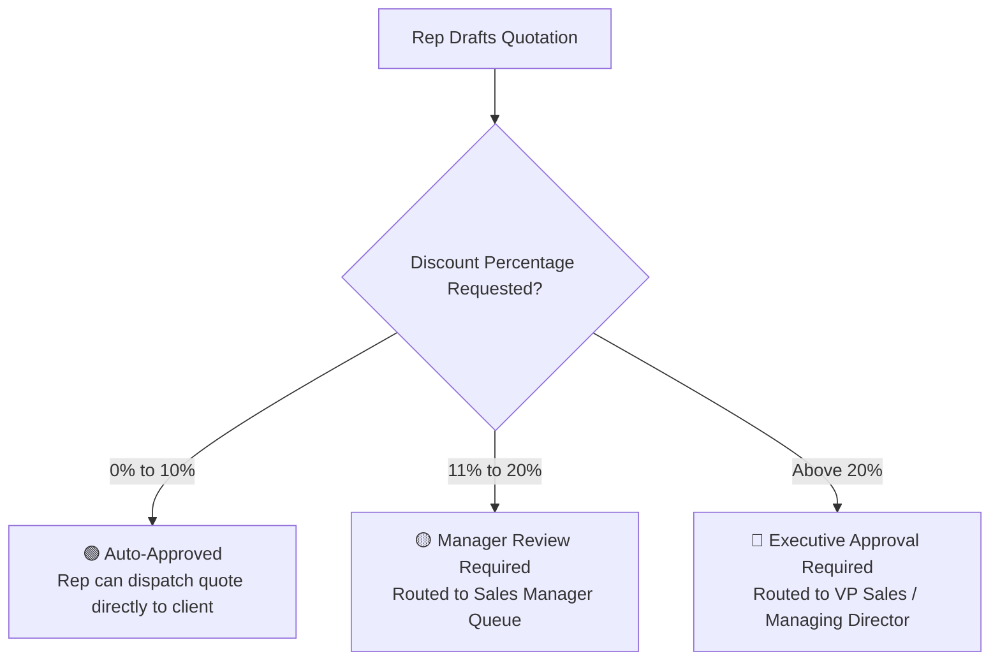

# Deal & Discount Approval Workflows Guide

To close important deals in competitive markets, sales reps often need the flexibility to offer customized pricing, bulk discounts, or tailored payment schedules. However, uncontrolled discounting damages company profitability.

HubCRM's **Deal & Discount Approval Center** (`/sales-manager/deals/approvals`) gives managers an instant, 1-click mechanism to review commercial exceptions while keeping sales cycles moving at high speed.

---

## 🛡️ The Corporate Discount Policy Matrix

HubCRM enforces your company's commercial pricing rules automatically:

* **Standard Authority (0–10%):** Reps can apply competitive discounts without waiting for permission.
* **Manager Authority (11–20%):** Automatically pauses the quote and alerts the Sales Manager.
* **Director Level (>20%):** Multi-tier escalation for exceptional strategic client acquisitions.

---

## 🔍 How to Review an Approval Request

When a sales executive submits a quote that exceeds their allowed discount threshold, you receive an instant alert on your dashboard and mobile phone:

1. Click on **Deal Approvals** (`/sales-manager/deals/approvals`).
2. Click on the pending request to open the **Commercial Review Card**:
   * **Client & Deal Name:** e.g., *"Apex Logistics — 100 HubMeet Licenses"*.
   * **Sales Executive:** Name of the rep managing the deal.
   * **Standard Contract Value:** e.g., *₹10,00,000*.
   * **Requested Discounted Value:** e.g., *₹8,50,000 (15% Discount)*.
   * **Gross Margin Impact:** Shows the calculated net margin after discount.
   * **Rep's Business Justification:** The rep's written explanation (e.g., *"Client is committing to a 24-month upfront payment instead of annual billing"*).

---

## ✍️ Taking Managerial Action: Approve, Reject, or Counter

You have three clear choices:

### Option 1: Approve (🟢)
If the justification is solid and the contract terms protect company revenue:
* Click the green **Approve Quote** button.
* An instant pop-up notification informs the rep: *"Your 15% discount for Apex Logistics has been approved by Manager."*
* The quotation unlocks immediately, allowing the rep to dispatch the PDF to the client.

### Option 2: Decline / Reject (🔴)
If the discount is too steep or the deal size doesn't warrant it:
* Click **Reject**.
* Enter a constructive feedback note (e.g., *"Discount too high for 1-year contract. Only offer up to 8% unless they sign for 2 years"*).
* The quote reverts to draft status, and the rep is prompted to revise the numbers.

### Option 3: Counter-Offer (🟡)
If you want to suggest a middle ground:
* Click **Counter-Offer**.
* Enter an approved compromised figure (e.g., *"Approved for 12% discount"*).
* The rep can accept your counter-offer with one click without creating a new quote from scratch.
