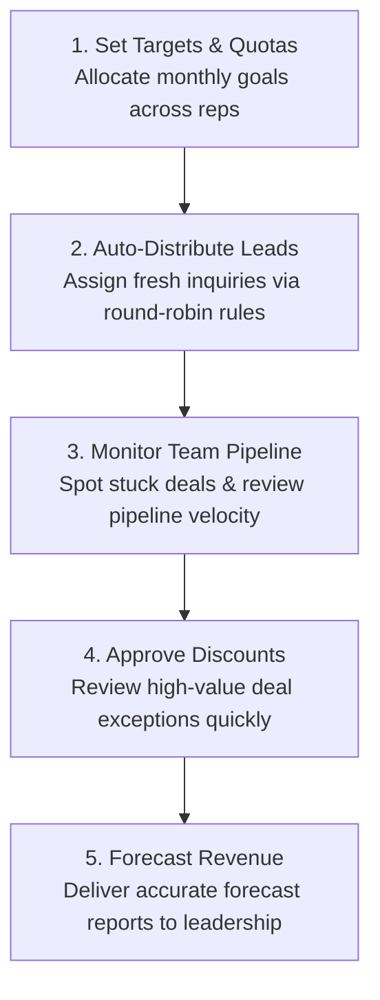

# Sales Manager Command Center & Team Oversight

As a **Sales Manager** or **Team Lead**, your success is measured not just by personal performance, but by the collective revenue, speed, and consistency of your entire sales team. HubCRM provides you with the executive oversight, automated lead routing, deal approvals, and forecasting tools needed to build a championship sales organization.

{ width="90" }

---

## 🎯 What Does HubCRM Do for Sales Managers?

HubCRM eliminates the guesswork and stressful end-of-month surprises that plague sales leaders:

* 🚫 **No More Unfair Lead Distribution**: Automated round-robin routing ensures leads are distributed fairly based on rep capacity and availability.
* 🚫 **No More Discount Chaos**: Enforce strict company discount thresholds with instant 1-click mobile and desktop approval requests.
* 🚫 **No More Stalled Deals**: Visual bottleneck indicators highlight deals that haven't moved in over 14 days so you can coach reps before opportunities go cold.
* 🚫 **No More Manual Excel Reports**: Real-time sales leaderboards, win/loss analytics, and revenue forecasts are generated automatically.

---

## 🧭 The Sales Leadership Workflow

Here is how modern sales managers use HubCRM to drive high-performance teams:

---

## 🖥️ Screen Tour: Manager Navigation

When you log into HubCRM with a Manager or Team Lead profile, your sidebar provides specialized team tools:

| Manager Menu Item | Icon | What You Do Here |
| :--- | :--- | :--- |
| **Manager Dashboard** | 📊 | High-level executive view: team revenue target vs. actuals, team win rate, and top performers. |
| **Team Roster & Quotas** | 👥 | Manage your sales reps, check individual capacity, set monthly revenue targets, and review attendance. |
| **Lead Distribution** | 🎯 | Configure automated round-robin lead allocation, assign unassigned leads, and set territory rules. |
| **Deal Approvals** | ✍️ | Review and approve/reject custom quotes, extended payment terms, or discount requests submitted by reps. |
| **Pipeline Velocity** | ⚡ | Measure how fast deals move through stages and identify which reps have deals stuck in negotiation. |
| **Activity Audits** | 📞 | Audit daily calls, WhatsApp messages, and meetings logged by each representative. |
| **Sales Forecasting** | 📈 | Weighted revenue projections for the current month and quarter based on pipeline probability. |

---

## 📚 What's in this Sales Manager Manual?

Follow these step-by-step guides to master your managerial workflows:

1. [Manager Executive Dashboard](dashboard.md): Tracking team numbers, leaderboard rankings, and alerts.
2. [Managing Reps & Quotas](team-roster.md): Adding sales reps, adjusting quotas, and capacity balancing.
3. [Lead Routing & Round-Robin](lead-distribution.md): Setting up fair, automated lead distribution rules.
4. [Deal & Discount Approvals](deal-approvals.md): How to review discount requests and enforce pricing policies.
5. [Pipeline Health & Velocity](pipeline-velocity.md): Spotting stalled deals, bottleneck stages, and coaching reps.
6. [Auditing Team Activities](activity-audit.md): Monitoring call volumes, WhatsApp engagement, and meeting logs.
7. [Revenue Forecasting & Reports](reports-forecasting.md): Delivering predictable revenue numbers to company directors.
