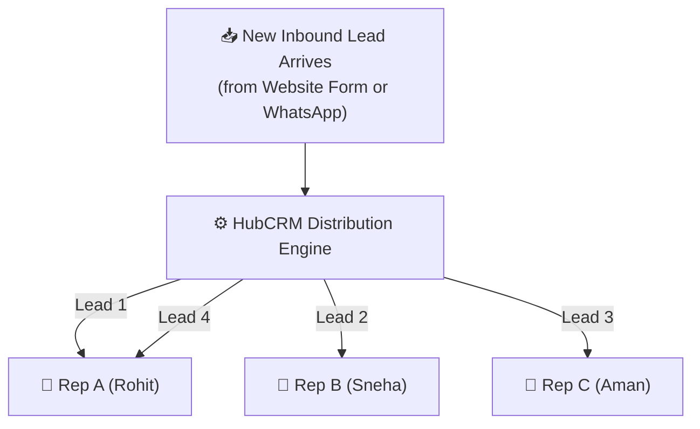

# Lead Routing, Round-Robin & Distribution Rules Guide

The faster a new lead is contacted, the higher the chance of closing the deal. Industry data shows that leads contacted within **15 minutes** are **7 times more likely** to convert than leads contacted after an hour.

HubCRM's **Automated Lead Distribution Engine** (`/sales-manager/leads`) ensures that every new inquiry arriving from your website, ads, or WhatsApp campaigns is instantly assigned to the right sales executive with zero manual delay.

---

## 🔄 What is Round-Robin Lead Routing?

Round-Robin is a fair, automated distribution method that assigns incoming leads sequentially in a continuous circle across your active sales team:

* **No Cherry-Picking:** Reps cannot pick only high-value leads and ignore smaller ones.
* **Instant Notification:** As soon as a lead is assigned, the rep receives a pop-up and mobile alert to call immediately.
* **Fair Opportunity:** Every rep gets equal opportunities to hit their monthly quota.

---

## ⚖️ Weighted Distribution (Experience-Based Routing)

Not all reps have the same closing bandwidth. For instance, a Senior Closer can handle twice the workload of a freshly hired trainee. HubCRM allows you to set **Weighted Round-Robin**:

1. Navigate to **Lead Distribution ➔ Routing Rules**.
2. Select your sales representatives and assign their relative weights:
   * **Senior Rep (Rohit):** Weight = **2** *(Receives 2 leads for every 1 lead sent to junior reps)*.
   * **Account Executive (Sneha):** Weight = **2**.
   * **Trainee / Associate (Aman):** Weight = **1**.
3. Click **Save Rules**. HubCRM will automatically balance the intake ratio.

---

## 🚀 Priority Fast-Track Routing (High-Value Leads)

When a large enterprise prospect fills out a form requesting a 100+ user deployment, you may want that lead to bypass the general queue and go straight to your senior enterprise specialist:

1. Click **+ Add Priority Rule**.
2. Define the condition:
   * *If Estimated Users > 50* **OR** *Company Size > 200 Employees*
3. Action:
   * **Route Directly to:** Select Senior Enterprise Closer (or Enterprise Sales Pod).
4. Save Rule. All high-value opportunities are immediately fast-tracked to your experienced closers.

---

## 📦 Managing the Unassigned Leads Pool

If your company runs an offline trade show, acquires a marketing database, or receives referrals that aren't auto-routed:

1. Go to **Lead Distribution ➔ Unassigned Pool**.
2. You will see a list of all leads currently awaiting an owner.
3. Select the checkboxes beside the leads you wish to distribute (or click **Select All 50 Leads**).
4. Click **Bulk Assign**:
   * **Option 1: Split Evenly:** Select your active reps (e.g., Rohit, Sneha, Aman). HubCRM divides the 50 leads evenly into groups of 16–17.
   * **Option 2: Assign to Specific Rep:** Send all selected records to a specific specialist.
5. Click **Confirm Assignment**. Every assigned rep receives their fresh batch instantly!
