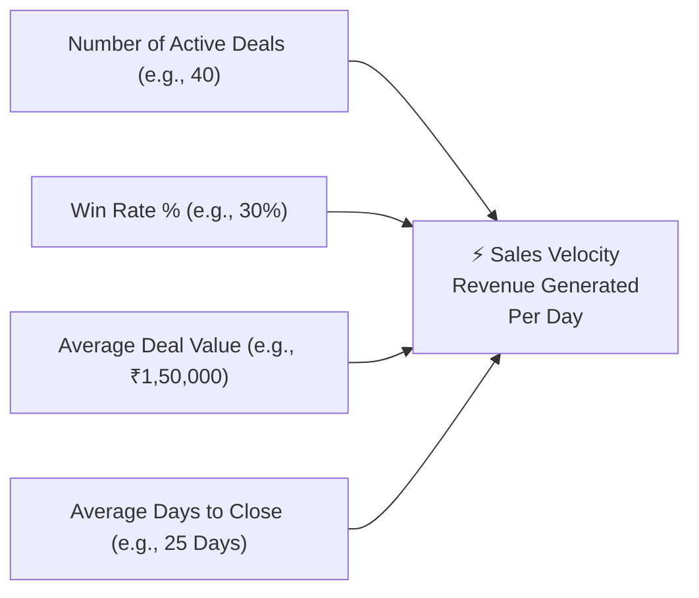

# Sales Pipeline Velocity & Bottleneck Detection Guide

In sales management, **deal momentum is everything**. The longer a deal lingers in your pipeline without advancing, the less likely it is to close. In fact, opportunities that stay open twice as long as your average sales cycle have an 80% higher chance of being lost.

HubCRM's **Pipeline Velocity & Health Center** (`/sales-manager/reports/velocity`) gives managers the diagnostic tools needed to identify stage bottlenecks and coach representatives to close faster.

---

## ⚡ What is Sales Velocity?

Sales velocity measures **how much revenue your team generates each day** based on four straightforward factors:

* **How to Increase Velocity:** You can double your team's revenue by closing deals faster, improving your win rate slightly, or focusing on higher-value opportunities.

---

## 🔍 Identifying Stage Bottlenecks

The **Stage Duration Analysis** report shows how many average days deals spend in each stage of your sales funnel:

| Pipeline Stage | Healthy Target Duration | Danger Sign (Bottleneck) | Manager Action |
| :--- | :--- | :--- | :--- |
| **1. Discovery & Needs** | 2 to 4 Days | Deals sitting for > 10 days | Reps are not scheduling product demos quickly enough. Enforce demo booking on the first call. |
| **2. Demo / Presentation**| 3 to 7 Days | Deals sitting for > 14 days | Rep is failing to secure follow-up commercial meetings with the actual financial decision-maker. |
| **3. Proposal / Quotation**| 5 to 10 Days | Deals sitting for > 21 days | **Major Bottleneck!** The client has the quote but is ghosting or comparing competitors. Prompt rep to send a revised quote or arrange an executive check-in. |
| **4. Negotiation & Review** | 4 to 8 Days | Deals sitting for > 14 days | Contract or legal roadblock. Manager should step in to assist with contract terms. |

---

## 🧹 Cleaning "Zombie Deals" (Stalled Opportunities)

A bloated pipeline full of old, unresponsive opportunities creates false optimism and distorts revenue forecasts. HubCRM provides a **1-Click Stalled Deals Cleaner**:

1. Click on the **Stalled Deals** tab.
2. Filter for deals with **No activity logged in 14+ days**.
3. Review the list with your sales rep:
   * **Re-Engage:** Send a high-impact *"Breakup or Check-in"* WhatsApp message.
   * **Reassign:** Transfer the deal to another rep for a fresh perspective.
   * **Close Lost:** If the client has completely ghosted, mark as *Closed Lost (Unresponsive)* to keep the pipeline clean and realistic.

!!! tip "Weekly Pipeline Hygiene Rule"
    Top sales teams hold a 20-minute **Pipeline Scrub** meeting every Monday morning. Ensuring every deal on the board has an active follow-up task scheduled for the current week guarantees steady closing momentum.
