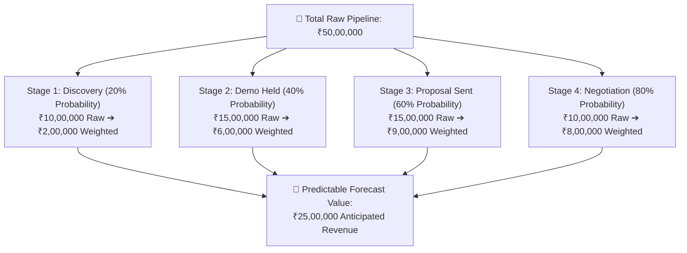

# Sales Revenue Forecasting & Executive Reporting Guide

Company directors and finance executives constantly ask sales managers one critical question: *"How much revenue are we going to close this month?"* If you only report raw deal numbers, you risk over-promising and under-delivering.

HubCRM's **Sales Forecasting & Reports Engine** (`/sales-manager/reports`) applies proven mathematical weighting to your team's pipeline, giving you predictable, credible revenue forecasts you can stand behind with confidence.

---

## 📈 Understanding Weighted Pipeline Value

Not every deal in your pipeline closes. A deal created yesterday has a lower chance of closing than a deal currently undergoing final contract review. HubCRM calculates **Weighted Revenue** based on stage probabilities:

* **Raw Pipeline Value:** The total face value of all active deals (e.g., *₹50,00,000*).
* **Weighted Forecast Value:** The statistically probable revenue you can realistically bank on (e.g., *₹25,00,000*).

---

## 🎯 The Three Forecast Buckets (Commit vs. Best Case)

When presenting to company leadership, HubCRM categorizes your deals into three standard confidence buckets:

| Forecast Bucket | Confidence Level | Criteria for Inclusion |
| :--- | :--- | :--- |
| **1. Closed Won** | 100% (Guaranteed) | Money is in the bank or the contract is signed by the client. |
| **2. Commit** | 80%–90% (High Confidence) | Decision-maker has verbally agreed, commercial quote is approved, and contracts are in final legal review. **This is your baseline promised number.** |
| **3. Best Case** | 50%–70% (Upside) | Active deals where the customer loves your product, but procurement timelines or board approvals might slide into next month. |

---

## 📊 Generating Executive Reports in 1 Click

When your Managing Director or CEO asks for a quarterly sales update:

1. Go to **Reports ➔ Sales Forecasting**.
2. Select the reporting period (e.g., *This Month*, *Q4 2026*, or *Annual Summary*).
3. Select your desired view:
   * **Revenue by Rep:** Visual bar chart comparing individual quota achievements.
   * **Revenue by Product/Service:** See which software tier or add-on is driving the most revenue.
   * **Win/Loss Analysis:** Pie chart showing why deals were won or lost over the last 90 days.
4. Click **Export Executive Summary (PDF / Excel)**.
5. HubCRM generates a beautifully formatted report complete with your company logo, summary charts, and rep breakdowns ready to share in leadership meetings.
